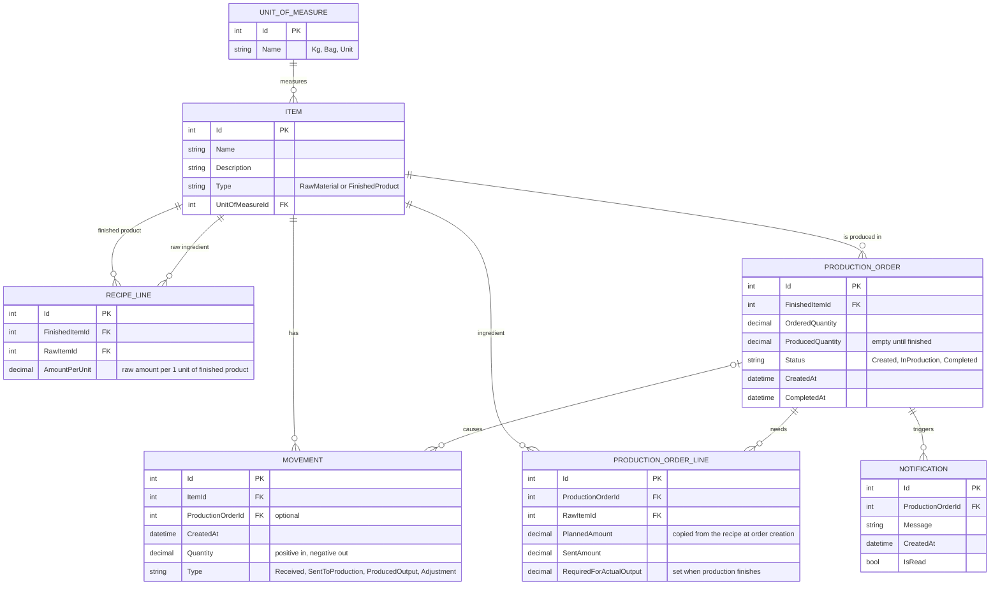

# Production & Inventory Tracker API

A backend API that tracks raw materials and finished products through
production and flags discrepancies, to reduce waste.

## Problem
Inventory and production managers need to know what raw materials a
production order should use, what was actually used, and where the numbers
don't match. When this is tracked by hand or in spreadsheets, discrepancies
are found late and waste goes unnoticed.

## How it works
1. A production order is received (e.g. 1,000 bags of 1 kg shredded cheese).
2. The app calculates the raw materials needed, using the product's recipe.
3. The raw materials are sent to production and deducted from inventory.
4. When production finishes, the finished products are registered.
5. The app compares the actual output with the order and recalculates the
   raw materials that output really required.
6. If the numbers differ, the app records the difference and notifies
   the manager.

## User stories

- As a warehouse user, I want to send raw materials to production against
  an order, so that inventory is deducted at the right time.
- As a production user, I want to register finished products, so that the
  app compares actual output with the order.
- As a manager, I want to be notified when usage or output differs from the
  order, so that I can investigate waste or errors.
- As a manager, I want a history of every stock change, so that I can
  audit what happened.

## Design decisions
- **Stock is a history of movements, not a number I edit.** Every change is
  saved as a movement (+50 kg received, -5 kg used), and current stock is the
  sum of an item's movements. This gives a full audit trail and avoids two
  users overwriting each other's updates.
- **Warehouse stock cannot go negative.** The app rejects a movement that
  would take an item below zero, because negative stock hides mistakes.
- **Production differences are recorded as variances, not silently fixed.**
  Example: an order for 1,000 bags needs 1,000 kg of cheese. If the machine
  produces 1,001 bags, the recipe says 1,001 kg were needed. The 1 kg
  difference is saved on that production order, and the manager is notified
  if it is above a tolerance of [X]%. A person decides whether stock needs
  an adjustment.
- **Quantities use `decimal`**, not `float` or `double`, because rounding
  errors in inventory are not acceptable.
- **Each item has one unit of measure** (Kg, Bag, Unit...), stored in its own
  table. Recipe amounts are expressed in the raw item's unit, e.g. 1 Bag of
  shredded cheese needs 1 Kg of cheese.
- **One warehouse for now.** Multiple locations are a later feature.
- **Notifications are saved records** that the manager can fetch from an
  endpoint. Email or chat alerts come later.

## Data model

## Tech stack
ASP.NET Core Web API, Entity Framework Core, SQLite (PostgreSQL later)
