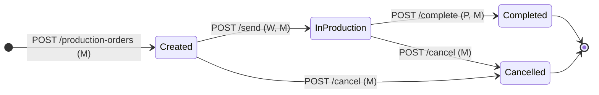
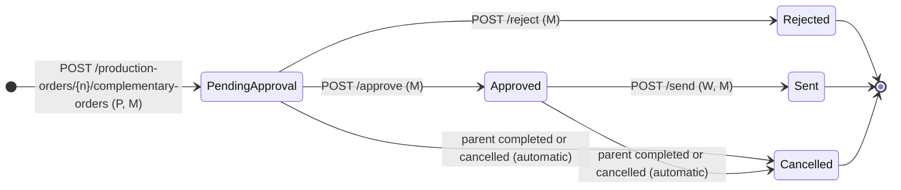
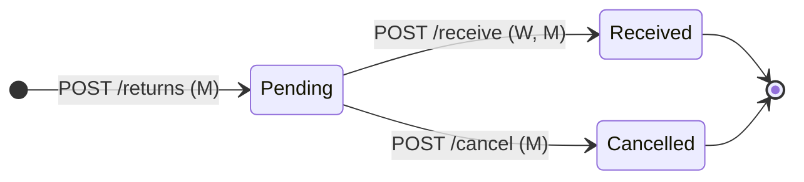
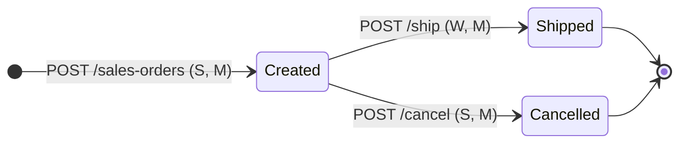
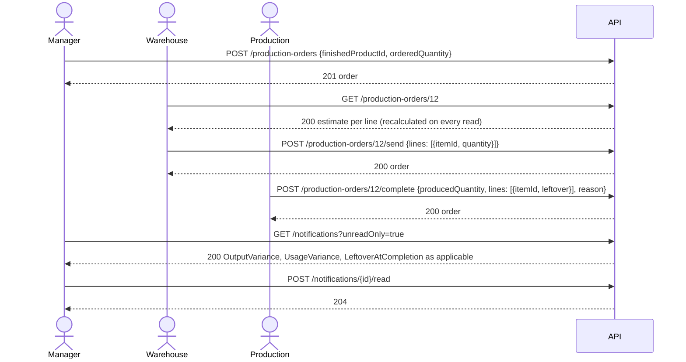
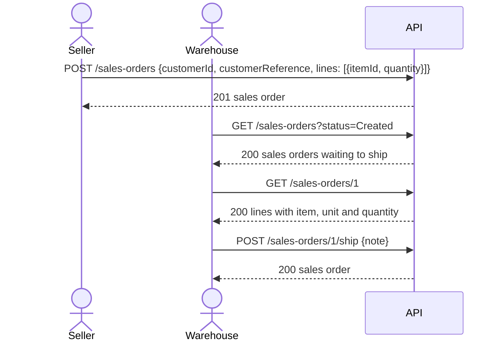

# Design specification: Production & Inventory Tracker API

Based on `docs/01-prd.md` (version 1 approved 2026-11-11; (v1.1) version 1.1, sales orders, sections 7 to 13, approved 2026-11-23). Version 1 has no user interface (decision #15), so this document designs the interface the product does have: the HTTP API. Template sections about screens, visual design, accessibility and responsive layout are replaced by API equivalents or marked not applicable. There are no mockups.

(v1.1) Version 1.1 adds customers, sales orders, shipments, the Seller role, role-based reads and two shipped-totals reports. Every addition and every change to a version 1 part is marked "(v1.1)" in place; section 10 lists every change to a version 1 part. Everything not marked is unchanged and applies to the new endpoints too.

(v1.2) Version 1.2 adds a web front end (PRD sections 14 to 20, approved 2026-11-27). Its screens, flows, design system and mockups are in sections 11 to 22 at the end of this document; the mockups are in `design/mockups/` (start with `index.html`). Sections 1 to 10 are unchanged: the screens call these endpoints and show these messages word for word.

## 1. Design direction

The API is used by client programs on behalf of three kinds of people ((v1.1) four): warehouse staff, production line staff, the production and inventory manager, and (v1.1) sales staff. It should be predictable. Every resource follows the same URL, JSON, paging and error rules, so a client written for one endpoint works for the next. The API returns every computed figure (send ranges, leftover estimates, variances, the "above tolerance" flag) ready to show, so no client has to repeat the calculations in PRD section 4.3. Conventions are the ones ASP.NET Core gives with the least custom code: JSON with camelCase, string enums, ProblemDetails errors.

## 2. Conventions

These rules apply to every endpoint. Section 5 lists each endpoint against them.

### 2.1 URLs

- Base path: `/api/v1`. All paths in this document are relative to it. The version prefix costs nothing now and lets a later web front end or breaking change live beside v1.
- Resources are plural nouns in kebab-case: `/production-orders`, `/complementary-orders`, `/returns`.
- The resource is called `production-orders`, not `orders`, because sales orders are on the PRD's "Later" list. (v1.1) Sales orders are now in scope and live at `/sales-orders`; the two names keep "order #12" and "sales order #12" apart (PRD D-10).
- Production orders, complementary orders and returns are identified in URLs by their **number**, the same number people say aloud ("order #12"). Each has its own sequence starting at 1. Units, items, movements and notifications use integer ids. Users use the string id ASP.NET Core Identity generates. (v1.1) Sales orders are identified by their number too, with a sequence of their own starting at 1 (D-10). Customers use integer ids.
- (v1.1) The two shipped-totals reports are read-only computed lists under `/reports`: `/reports/shipped-by-item` and `/reports/shipped-by-customer`. They are not records, so they have no id and no detail URL.
- Nesting is used only to create a child that cannot exist without its parent: `POST /production-orders/12/complementary-orders`. Once created, a child is read and acted on at its own top-level URL (`/complementary-orders/3`), because it has its own number. The recipe is a single sub-resource of its finished product: `/items/7/recipe`.
- State changes are `POST` to an action path named with a verb: `/send`, `/complete`, `/cancel`, `/approve`, `/reject`, `/receive`, `/deactivate`, `/reactivate`, `/read`, (v1.1) `/ship`. The response is `200` with the updated resource, so a client never needs a second request to show the result. The one exception is marking notifications read (`/read`, `/read-all`): it answers `204` with no body, because the read mark belongs to the calling Manager and there is nothing new to show.
- Query parameters are camelCase: `?status=Created&orderNumber=12`.

### 2.2 Status codes

| Code | Used for |
|------|----------|
| `200` | Successful read, update or action. Body: the resource. |
| `201` | Created. Body: the new resource. `Location` header: its URL, for example `/api/v1/production-orders/12`. |
| `204` | Success with nothing to return (delete, password change, mark read). |
| `400` | Invalid input, including business rules the PRD marks as `400` (send outside range, receipt for a finished product). |
| `401` | Missing, invalid or expired token; failed sign-in; token of a deactivated user. |
| `403` | Signed in, but none of the user's roles allows the action. (v1.1) Reads too: some read endpoints are now limited by role (decision #147, section 4). |
| `404` | The record named in the URL does not exist. |
| `408` | The request body arrived too slowly and the web server stopped waiting for it (decision #124). |
| `409` | The request conflicts with current state: status, stock, another order in production, a pending return, a duplicate name. |
| `413` | The request body is over 1 MB (decisions #122, #124). |

Every operation that takes a request body, sign-in included, can answer `408` or `413`. Section 4 and section 5 do not repeat this per endpoint.

`422` is not used. The PRD assigns every rejection to `400` or `409`, and ASP.NET Core uses `400` for validation by default.

**Order of checks.** When a request breaks several rules, the first failing check decides the response: (1) `401` token, (2) `403` role, (3) `404` record in the URL, (4) `400` input shape and format (missing fields, decimal places, negative numbers, unknown ids in the body), (5) `409` state (status, another order in production, pending return, item in use), (6) `400` range rules (send ranges, leftover larger than stock), (7) `409` stock. Checking roles before existence means a user without the role cannot learn which numbers exist. QA can rely on this order, with two consequences of how the framework works (decision #23, built): a body that is not valid JSON, or has a value of the wrong JSON type, is `400` before the `404` check, because the body is read before the action runs; and without a token every path, including one that does not exist, answers `401`, because the token check comes first.

A body the web server will not deliver sits in the same place, after `401` and `403` and before the `404` check (decision #124): over 1 MB is `413` `request-too-large`, too slow is `408` `request-timeout`, and any other broken body (for example a malformed chunked body, or a connection that ends early) is `400` `validation` with no `errors` field (decision #41).

Two caps are checked first in the action, before the write transaction, so they also come before the `404` for the record in the URL, where there is one (security review SEC-01):

- More than 500 lines on a recipe (`PUT /items/{id}/recipe`), a send, a completion, a complementary request, a complementary send or (v1.1) a new sales order (`POST /sales-orders`, AC-24.5) is `400` `too-many-lines` (decision #123). A new sales order has no record in its URL, so there the cap simply comes before every other body check, the customer check included.
- More than 10 roles on `POST /users` or `PUT /users/{id}/roles` is `400` `validation` (decision #125). On the role change it comes before the `404` for the user in the URL.

Each cap is answered on its own: the response holds only that one message, even when other fields are also wrong. The other body checks keep the order above.

**(v1.1) Check order on the new actions.** The general order above applies; this is what it means for each new action, so QA can test every pairing. "Body" checks are the framework's unreadable-body answers (`413`, `408`, `400` invalid JSON or wrong type), which always sit after `403` and before `404`.

| Action | Order of checks |
|--------|-----------------|
| `POST /sales-orders` | `401` → `403` (Manager, Seller) → body → `400` `too-many-lines` on its own, before the write transaction → `400` field checks, all in one response (customer missing or unknown, customer reference, lines, items, quantities, duplicates) → `409` `customer-inactive`. No stock check (AC-24.2). |
| `POST /sales-orders/{number}/ship` | `401` → `403` (Warehouse, Manager) → body → `404` sales order → `400` note over 500 → `409` status (`already-shipped`, `sales-order-cancelled`) → `409` `insufficient-stock` naming every short line. |
| `POST /sales-orders/{number}/cancel` | `401` → `403` (Manager, Seller) → body → `404` sales order → `400` reason missing, blank or over 500 → `409` status (`already-shipped`, `sales-order-cancelled`). The reason comes before the status, as for production orders (decision #104): a blank reason on a Shipped sales order is `400`. |
| `POST /customers`, `PUT /customers/{id}` | `401` → `403` (Manager, Seller) → body → `404` customer (PUT only) → `400` name and notes → `409` `customer-name-taken`. |
| `POST /customers/{id}/deactivate`, `/reactivate` | `401` → `403` (Manager, Seller) → `404` customer. Nothing else can fail. |
| `DELETE /customers/{id}` | `401` → `403` (Manager, Seller) → `404` customer → `409` `customer-has-sales-orders`. |
| `GET` reports and lists | `401` → `403` → `400` query values (paging, dates, enums, numbers). An unknown id in a filter is `200` with an empty list. |
| `GET /sales-orders/{number}`, `GET /customers/{id}` | `401` → `403` (Warehouse, Manager, Seller) → `404`. |

Two consequences worth stating. A Production-only user asking for a sales order that does not exist gets `403`, not `404` (roles before existence). On ship, a short stock line is reported only when the sales order is Created and the note is valid: a Cancelled sales order is always `sales-order-cancelled`, whatever the stock.

### 2.3 JSON fields and values

- Field names are camelCase. Unknown fields in a request body are ignored.
- Every field defined for a response is always present. A value that is not known yet is `null`, never omitted (AC-14.2: "values not yet known are empty").
- **Enums are strings**, exactly as named in the PRD. Requests accept any letter case; responses use the forms below. An unknown value is `400`.
  - `ItemType`: `RawMaterial`, `FinishedProduct`
  - `Role`: `Warehouse`, `Production`, `Manager`, (v1.1) `Seller` (AC-30.1)
  - `Location`: `Warehouse`, `ProductionStorage`
  - `MovementType`: `Received`, `SentToProduction`, `ConsumedInProduction`, `ProducedOutput`, `ReturnedToWarehouse`, `Adjustment`, (v1.1) `ShippedToCustomer` (D-2, AC-28.1)
  - `OrderStatus`: `Created`, `InProduction`, `Completed`, `Cancelled`
  - `ComplementaryOrderStatus`: `PendingApproval`, `Approved`, `Rejected`, `Sent`, `Cancelled`
  - `ReturnStatus`: `Pending`, `Received`, `Cancelled`
  - `NotificationType`: `UsageVariance`, `OutputVariance`, `LeftoverAtCompletion`, `ComplementaryAwaitingApproval`, `OrderCancelledWithMaterial` ((v1.1) unchanged: still exactly five, decision #143)
  - (v1.1) `SalesOrderStatus`: `Created`, `Shipped`, `Cancelled` (D-10)

  The order listed is the order used wherever values are named in a message ("status must be Created, Shipped or Cancelled."). (v1.1) Role names in `403` messages follow the `Role` order too (7.1).
- **Times** are UTC in ISO 8601 with a `Z` suffix: `"2026-11-11T14:05:00Z"`. Whole-second precision is enough. The one date-only input, `receiptDate`, is `"2026-11-11"`.
- **People** are shown as `{ "id": "8b1c…", "email": "ana.ruiz@example.com" }`. The PRD gives users an email and no display name.
- (v1.1) **Customers inside other records** (a sales order, a report row) are shown as `{ "id": 1, "name": "Deli Norte", "isActive": true }`: the customer's current name and active status, read at the time of the request (AC-25.2, AC-29.3, AC-33.4). No old name is kept anywhere.
- (v1.1) **Movement links.** A movement now carries `salesOrderNumber` beside `orderNumber`, `complementaryOrderNumber` and `returnNumber` (5.6). It is set on `ShippedToCustomer` movements, and only there.

### 2.4 Quantities

- **Quantities are JSON numbers, not strings.** System.Text.Json reads a JSON number straight into a C# `decimal` without going through floating point, so input is exact. Numbers are the ASP.NET Core and OpenAPI default, so no custom converters are needed. The usual reason for sending decimals as strings is client-side arithmetic in JavaScript. Here clients do no arithmetic, because every computed value comes back already rounded.
- **Decimal places on input** (PRD 4.1): at most 3 for quantities and 6 for recipe amounts per unit. Trailing zeros do not count: `12.5000` is accepted as 12.5. A quantity sent as a string (`"12.5"`) is `400`.
- **Maximums on input** (decision #80, owner): every entered quantity (receipts, ordered and produced quantities, sends, complementary requested amounts and sends, leftover entered, adjustments, returns, (v1.1) sales order line quantities, AC-24.3) is at most 999,999,999.999; a recipe amount per unit is at most 999,999.999999. For an adjustment the limit applies to the size, so -999,999,999.999 is the lowest. Above the limit is `400` `validation` (7.2). These limits keep every computed amount for an order (planned and required amounts, ranges, variances) inside the stored range. The one accepted exception (architecture risk 12) is stock, which is a sum and is not capped: only about a million maximum-size movements of one item could push a stock total, or a value stored from it, past that range.
- **Computed values** (planned amount, estimates, send ranges, usage, variances) are rounded by the server to 3 decimal places, half away from zero, before they are returned. Every displayed percentage, in API responses and in notification messages and data, is round(round(unrounded, 6), 2), both steps half away from zero, so a notification and the order response always show the same value (decision #58). Clients must not rely on trailing zeros being present: `1000` and `1000.000` mean the same thing.
- **Percentages are percent values**, not fractions: `1.5` means 1.50%. Field names end in `Percent`.
- **Sign:** a variance or difference is signed. Positive means more than planned or required.
- **The unit travels with the quantity.** Every object that carries quantities of one item includes `"unit"`: the unit's name, for example `"kg"` or `"Bag"`. Quantities are never sent without a unit nearby.
- **Threshold flags are computed by the server.** A usage variance of 2.0001% is returned as `2.0` but is above a 2% tolerance (AC-20.4). A client cannot get this right from the rounded value, so each completed line carries `usageVarianceAboveTolerance` (true or false).

### 2.5 Lists

- Every list endpoint is paged. Query: `page` (1-based, default 1) and `pageSize` (default 50, from 1 to 100). Values outside those limits are `400`. A page past the end returns `200` with an empty `items` array.
- Response envelope:

  ```json
  { "items": [ ], "page": 1, "pageSize": 50, "totalCount": 132 }
  ```

- **Order:** newest first (PRD 4.1), meaning by creation time descending, then by id or number descending. There is no `sort` parameter in v1. Stock has no creation time of its own, so stock rows follow the item's creation time. Units have no creation time either, so they are newest first by id (decision #68). (v1.1) Customers and sales orders follow this rule: newest first by `createdAt`, then by id or number.
- (v1.1) **The one exception: the two shipped-totals reports are ordered by name, not newest first** (AC-32.1, AC-33.1, PRD row 51), because a total has no creation time. `/reports/shipped-by-item` is ordered by item name, A to Z. `/reports/shipped-by-customer` is ordered by customer name, then item name, A to Z. "A to Z" compares the names in upper case (the stored normalized name, trimmed and upper-cased with invariant rules), character by character (ordinal), so letter case never changes the order. SQLite compares text this way by default; a later PostgreSQL port must keep it ordinal (the "C" collation on that sort), or the order would change. Ties cannot happen, because item names and customer names are each unique ignoring case; the id is still the last sort key, so paging is stable even if that ever changes. A consequence of the ordinal rule: a name starting with an accented letter ("Émile") sorts after Z. The reports have no `sort` parameter either.
- **Filters** are optional query parameters. They combine with AND. A filter that matches nothing, including an id that does not exist, returns `200` with an empty list (AC-11.2). A filter value in the wrong format (`status=Done`, `from=yesterday`) is `400`.
- **Date ranges** (`from`, `to`) are dates (`2026-11-01`). Both are whole UTC days and both are included (AC-11.2). `from` later than `to` is `400`. (v1.1) Either end may be left out; with neither, the range is all time. The reports use these rules on the sales order's shipment time (D-13).

### 2.6 Text inputs

- Names and reasons have leading and trailing spaces removed before they are checked. A value that is empty after trimming counts as missing.
- Uniqueness checks on names and emails ignore letter case. Emails are stored as entered.
- (BUG-002, decisions #170, #171, #173, #174) Customer, unit and item names are first converted to one standard Unicode form (NFC), so a letter such as "é" typed as one character or as "e" plus an accent mark is the same name; a look-alike of an existing name is a duplicate. The name is stored in that form, trimmed, and its length is counted after conversion. A name with no visible characters (only white space, control or invisible format characters such as a zero-width space) counts as missing ("Name is required."); invisible characters among visible ones are kept. A name that cannot be converted (in practice only U+FFFE) is refused with "Name contains a character that is not allowed.", checked before the other name rules. Names stored before v1.1 are not rewritten (#172).
- (T-034, decisions #176, #181, #182) Also refused with "Name contains a character that is not allowed.": a control character (NUL, tab, line break) or a Unicode noncharacter anywhere in the name; an invisible (default-ignorable) character, a Hangul filler or U+2800 at the start or end; a combining mark as the first character. Hangul fillers and U+2800 count as invisible, so a name made only of them is "Name is required.". Invisible characters in the middle (for example ZWJ and ZWNJ between letters) stay allowed. A consequence: a name ending in an emoji with a variation selector (such as a red heart) is refused. A PUT that sends a record's stored name back unchanged skips these T-034 rules, so records saved before them can still be edited; any change to the name, even of letter case only, follows every rule.
- Limits: unit name 1–50 (PRD); reasons and notes up to 500 (PRD); item name 1–100 and item description up to 500 (not in the PRD; default chosen here, see section 9); email up to 256 (the Identity default, decision #66). Length limits apply after trimming. Passwords are never trimmed.
- (v1.1) Limits (PRD row 34): customer name 1–100; customer notes up to 500; customer reference on a sales order up to 100; shipment note up to 500; sales order cancellation reason 1–500. Optional texts (customer notes, customer reference, shipment note) that are empty after trimming are stored as `null` (AC-26.8).

## 3. User flows

Each flow is a sequence of calls. "W", "P" and "M" are the Warehouse, Production and Manager roles; (v1.1) "S" is the Seller role. Every call after sign-in carries `Authorization: Bearer <token>`.

### 3.1 Lifecycles



Production order. Only one order can be InProduction at a time (AC-15.10).



Complementary order. There is no manual cancel endpoint; the PRD only cancels them automatically (AC-19.6, AC-21.4).



Leftover return.



(v1.1) Sales order (D-10). Shipped and Cancelled are final: a shipped sales order cannot be cancelled (AC-27.2) and a cancelled one can never be shipped (AC-27.3). Any number of sales orders can be Created at once, and they can be shipped in any order (AC-24.6, AC-26.5).

### 3.2 First sign-in with the seeded admin (US-02, US-01, US-04)

1. The owner sets `ADMIN_EMAIL` and `ADMIN_PASSWORD` (and the token signing key) as environment variables and starts the application with an empty database. One active Manager is created.
2. `POST /auth/sign-in` with those values → `200` with a token, expiry and `"roles": ["Manager"]`.
3. Optional: `POST /auth/change-password` → `204`. The admin's password now differs from the environment value; restarting changes nothing (AC-02.2).
4. Continue with 3.3 (create staff and a second Manager).

If something fails:
- A variable is missing, or the password breaks the policy: the application does not start. The console shows one of the start-up messages in section 7.4 and no user is created.
- Wrong credentials: `401` "Invalid email or password." After 5 failures in a row: `401` "Account temporarily locked. Try again later." for 15 minutes.

### 3.3 User management (US-03, US-04, US-05)

1. M: `POST /users` with email, initial password and roles → `201`. The person signs in with that password (3.2 step 2) and changes it (`POST /auth/change-password`).
2. M: `GET /users` to see everyone with roles and active status.
3. M: `PUT /users/{id}/roles` → `200`. The new roles apply from that user's next sign-in.
4. M: `POST /users/{id}/deactivate` → `200`. The user's existing tokens stop working at once. `POST /users/{id}/reactivate` reverses it.
5. M: `PUT /users/{id}/password` → `204`, to reset a forgotten password.

(v1.1) To set up sales staff, M creates the user with `"roles": ["Seller"]`, or adds `Seller` to an existing user's roles. Only a Manager can give it; existing users do not have it after the upgrade (AC-30.1, AC-30.3). Seller does not count as a Manager for the "at least one active Manager" rule (AC-30.5).

If something fails: duplicate email `409`; bad email, empty or unknown role, weak password `400`; removing the Manager role from, or deactivating, the last active Manager `409` "At least one active Manager is required." Nothing changes in any of these cases.

### 3.4 Master data (US-06, US-07, US-08)

1. M: `POST /units` `{ "name": "kg" }`, then `{ "name": "Bag" }` → `201` each.
2. M: `POST /items` for the raw material "Cheese" (kg) and the finished product "Shredded cheese 1 kg bag" (Bag) → `201` each.
3. M: `PUT /items/7/recipe` with one line: Cheese, 1 per bag → `200`.
4. Anyone ((v1.1) W, P or M; a Seller gets `403`): `GET /items/7/recipe` to check it.

If something fails: duplicates `409`; invalid recipe lines `400` naming the line; changing type or unit of an item in use `409`. The Manager corrects the request and sends it again.

### 3.5 Receiving stock (US-09, US-10, US-11)

1. W: `POST /receipts` `{ itemId: 3, quantity: 1000, receiptDate: "2026-11-11", note: "Delivery note 4471" }` → `201` with the Received movement.
2. Anyone: `GET /stock/3` → Warehouse stock has gone up by 1,000 kg.
3. Anyone ((v1.1) W, P or M; a Seller gets `403`): `GET /movements?itemId=3&type=Received` to see the receipt in the history.

If something fails: a finished product `400` "Receipts are for raw materials only."; a date after today, a bad quantity or a long note `400`. No stock changes.

### 3.6 Main production order flow (US-13, US-14, US-15, US-19, US-20, US-23)



1. M creates the order. Response `201`: status Created, one line per recipe line with `plannedAmount` and an `estimate` block (leftover applied, nominal send, send range, tolerance).
2. W reads the order and weighs out the nominal send, staying inside the range.
3. W sends, with one quantity per line (zero is allowed where the range starts at zero). Response `200`: InProduction; `leftoverApplied`, `warehouseSend` and `carriedLeftover` are now fixed on each line; `estimate` becomes `null`.
4. P completes, giving produced quantity, the physical total leftover per line, and a reason if any leftover is above zero. Response `200`: Completed with every variance figure.
5. M reads unread notifications and marks them read, one at a time or all at once (`POST /notifications/read-all`).

If something fails, the order stays as it was:
- Send outside range: `400` naming each failing line with its range. W adjusts the quantities and sends again.
- Not enough Warehouse stock: `409` naming item and available stock. W records the missing receipt (3.5) or M reduces the order by cancelling and recreating it.
- Another order in production: `409` "Order #N is in production. Only one order can be in production at a time." Wait for that order to be completed or cancelled.
- A pending return of one of the order's materials: `409` "Return #R of Cheese is waiting to be received by the warehouse. Record it first." W records it (3.9 step 2), then sends.
- Order already sent: `409` "Materials have already been sent for this order. Raise a complementary order for more material." Go to 3.7.
- Completion with leftover but no reason, or leftover above stock: `400`. P corrects and sends again.

### 3.7 Complementary order flow (US-16, US-17, US-18)

```mermaid
sequenceDiagram
    actor P as Production
    actor M as Manager
    actor W as Warehouse
    participant API
    P->>API: POST /production-orders/12/complementary-orders {reason, lines}
    API-->>P: 201 complementary order #3, PendingApproval
    Note over API: ComplementaryAwaitingApproval notification created
    M->>API: GET /notifications?unreadOnly=true
    API-->>M: 200 includes complementary order #3
    alt approve
        M->>API: POST /complementary-orders/3/approve
        API-->>M: 200 Approved
        W->>API: POST /complementary-orders/3/send {lines: [{itemId, quantity}]}
        API-->>W: 200 Sent; parent line complementarySends increased
    else reject
        M->>API: POST /complementary-orders/3/reject {note}
        API-->>M: 200 Rejected (can never be sent)
    end
```

1. P raises the request while the parent is InProduction → `201`, PendingApproval, with each line's `sendRange` already shown.
2. M reads it (from the notification or `GET /complementary-orders?status=PendingApproval`) and approves or rejects it.
3. W sends an approved one, within requested amount ± t. No leftover is netted.
4. W or anyone ((v1.1) W, P or M; a Seller gets `403`) can watch for work with `GET /complementary-orders?status=Approved`.

If something fails: parent not InProduction `409`; item not on the parent `400`; approving a non-pending one `409`; sending one that is not Approved `409` stating its status; outside range `400`; not enough stock `409`. When the parent is completed or cancelled, unsent requests become Cancelled automatically with the note "Parent order completed" or "Parent order cancelled".

### 3.8 Cancellation (US-21)

- **Created order:** M `POST /production-orders/9/cancel { reason }` → `200` Cancelled. No stock moves. Its leftover allocation goes to the next oldest Created order; that order's next `GET` shows the larger estimate (AC-15.5).
- **InProduction order:** same call. No stock moves; everything sent stays in production storage as free leftover; unsent complementary orders become Cancelled; if any of the order's materials has stock above zero in production storage, an OrderCancelledWithMaterial notification is created. M then decides: leave it for the next order, return it (3.9), or write it off (3.10).

If something fails: Completed or already Cancelled `409`; blank reason `400`.

### 3.9 Return flow (US-22)

```mermaid
sequenceDiagram
    actor M as Manager
    actor W as Warehouse
    participant API
    M->>API: GET /stock/3
    API-->>M: 200 freeLeftover 20 kg
    M->>API: POST /returns {itemId: 3, quantity: 20, reason, orderNumber: 9}
    API-->>M: 201 return #5, Pending (20 kg no longer free leftover)
    W->>API: GET /returns?status=Pending
    API-->>W: 200 includes return #5
    W->>API: POST /returns/5/receive
    API-->>W: 200 Received; ReturnedToWarehouse movement created
```

1. M checks free leftover on `GET /stock/{itemId}`.
2. M instructs the return → `201` Pending.
3. W physically moves the material and records it → `200` Received. Production storage goes down and Warehouse goes up by the quantity.
4. If the return was a mistake, M `POST /returns/5/cancel` → `200` Cancelled, and the quantity is free leftover again.

If something fails: more than the free leftover `409` stating the free leftover; material on the order in production `409`; receiving or cancelling a return that is not Pending `409`.

### 3.10 Adjustment and write-off (US-12)

1. M: `GET /stock/3` to see the current figures.
2. M: `POST /adjustments { itemId: 3, location: "ProductionStorage", quantity: -20, reason: "Spoiled" }` → `201` with the Adjustment movement.
3. Anyone ((v1.1) W, P or M; a Seller gets `403`): the next `GET` of a Created order shows a leftover estimate 20 kg lower.

If something fails: zero quantity or blank reason `400`; a negative quantity larger than the stock `409` "Not enough stock: Cheese in Production storage has 12 kg."; material of the InProduction order in production storage `409`; a finished product in production storage `400`.

### 3.11 Reading notifications (US-23)

1. M: `GET /notifications?unreadOnly=true` → newest first, each with its message and structured `data`. The count of unread notifications is `totalCount`.
2. M: `POST /notifications/{id}/read` → `204` for that Manager only. Other Managers still see it as unread.
3. M: `POST /notifications/read-all` → `204`.

### 3.12 Customers (v1.1) (US-29)

1. S or M: `POST /customers { "name": "Deli Norte", "notes": "Deliveries before 10:00, ask for the kitchen." }` → `201`, active.
2. W, M or S: `GET /customers?isActive=true` to pick a customer for a sales order.
3. S or M: `PUT /customers/1 { "name": "Deli Norte SA", "notes": "…" }` → `200`. Every sales order and report shows the new name from now on, older ones included (AC-29.3).
4. S or M: `POST /customers/1/deactivate` → `200`, `isActive: false`. New sales orders for it are refused; its Created sales orders can still be shipped or cancelled (AC-29.4). `POST /customers/1/reactivate` reverses it. Repeating either succeeds and changes nothing.
5. S or M: `DELETE /customers/3` → `204`, only for a customer that never had a sales order in any status. Its name is free for a new customer (AC-29.5).

If something fails, nothing changes:
- A name another customer already has, ignoring case: `409` "A customer named 'Deli Norte' already exists." Pick another name, or use the existing customer.
- A blank name, a name over 100 or notes over 500: `400`. Correct and send again.
- Deleting a customer that has, or ever had, a sales order: `409` "Deli Norte has sales orders and cannot be deleted. Deactivate it instead." (Step 4.)
- An unknown or already deleted customer id: `404` "Customer 3 not found."

### 3.13 Sales order: create and ship (v1.1) (US-24, US-25, US-26, US-28, US-31)



1. S (or M) creates the sales order for an active customer, with one or more lines of any item, raw material or finished product (AC-24.1, AC-24.8). Response `201`, Created. Stock is not checked and does not change (AC-24.2); the item's `openDemand` on `GET /stock` goes up by the line quantity (AC-31.1).
2. W lists Created sales orders and opens one to pick the goods.
3. W ships it, optionally with a note such as a delivery note number. No quantities are sent: every line ships in full (AC-26.1). Response `200`, Shipped. Each line becomes a `ShippedToCustomer` movement that lowers Warehouse stock, linked to the sales order (AC-28.1); open demand goes down by the same amounts (AC-31.2).
4. Anyone who can list movements (W, P, M): `GET /movements?salesOrderNumber=1` shows the shipment movements (AC-28.2, AC-28.7).

Worked example (AC-26.2): Warehouse holds 1,001 Bag of "Shredded cheese 1 kg bag". Sales order #1 for Deli Norte has 600 Bag. Before shipping, `GET /stock/7` shows `warehouse` 1,001 and `openDemand` 600. After shipping, it shows 401 and 0, and one movement of −600 Bag with `salesOrderNumber` 1.

If something fails when creating, nothing is saved:
- Deactivated customer: `409` "Customer Deli Norte is deactivated. Reactivate the customer or choose another one." (Reactivate: 3.12 step 4.)
- Unknown customer, no lines, a bad quantity, an unknown item, the same item twice, a reference over 100: `400` naming each problem.
- More than 500 lines: `400` "At most 500 lines are allowed." Split the sales order.

### 3.14 Refused shipment (v1.1) (US-26)

A shipment is all or nothing (decision #141). When the Warehouse stock of any line's item is less than the line's quantity, the whole shipment is refused with `409`, the message names every short line, no movement is created and the sales order stays Created (AC-26.3).

1. W: `POST /sales-orders/2/ship` → `409` `insufficient-stock` "Not enough stock: Shredded cheese 1 kg bag in Warehouse has 401 Bag; sales order #2 needs 500 Bag." A line that is covered (here 50 Bag of Grated cheese with 80 in stock) is not named.
2. The shortfall is resolved outside the sales order, by one of:
   - P completes a production order for the product, which adds its output to the Warehouse (3.6); or W records a receipt of a raw material (3.5);
   - for a raw material that sits in production storage: M instructs a return and W records receiving it (3.9). Production storage stock is never shipped, and a Pending return does not count until it is received (AC-26.11);
   - if the customer accepts less: S cancels the sales order (3.15) and creates a new one for the smaller quantity. There are no partial shipments (decision #141).
3. W ships again → `200` Shipped (AC-26.4).

Other refusals on ship, all leaving the sales order as it was:
- Already shipped, including the loser of two shipments at the same moment: `409` "This sales order has already been shipped."
- Cancelled: `409` "This sales order is cancelled."
- A note over 500: `400`.

Shipping never waits for or protects production. It is allowed while a production order is InProduction, and it may take raw material that a Created production order will need; that order's send is then refused for lack of stock (AC-26.6, AC-26.12, decision #149). Shipping is not blocked by a Pending return either (unlike a production send, AC-15.11): the return only matters when it is received.

### 3.15 Cancel a sales order (v1.1) (US-27)

1. S or M: `POST /sales-orders/4/cancel { "reason": "Customer changed the order to 400 bags" }` → `200` Cancelled, whoever created it (AC-27.1). No stock moves. Its lines leave open demand at once (AC-31.2).
2. If the customer still wants a smaller quantity, S creates a new sales order (3.13 step 1).

If something fails: missing or blank reason, or over 500: `400` "Reason is required." / "Reason must be 500 characters or fewer."; already shipped: `409` "This sales order has been shipped and cannot be cancelled."; already cancelled: `409` "This sales order is already cancelled." If a shipment and a cancellation of the same sales order arrive at once, exactly one succeeds (AC-26.10): a cancel that loses gets "This sales order has been shipped and cannot be cancelled.", a shipment that loses gets "This sales order is cancelled." and creates no movement.

### 3.16 Shipped totals and open demand (v1.1) (US-31, US-32, US-33)

1. Anyone: `GET /stock` or `GET /stock/{itemId}` shows `openDemand` beside the Warehouse stock, for every item (AC-31.1, AC-31.4). It is a figure to read; nothing is reserved (AC-31.3).
2. W, M or S: `GET /reports/shipped-by-item?from=2026-12-01&to=2026-12-31` → one row per item shipped in December, A to Z by item name (AC-32.1, AC-32.3). Add `customerId` for one customer, `itemType` for finished products or raw materials only.
3. W, M or S: `GET /reports/shipped-by-customer?from=2026-12-01&to=2026-12-31` → one row per customer and item, A to Z by customer name, then item name (AC-33.1, AC-33.3). Add `customerId` or `itemId` to narrow it.

If something fails: `from` after `to`, a date or item type in the wrong format: `400`. No shipments in the period, or a customer or item id that does not exist: `200` with an empty list.

### 3.17 Correct a mistaken shipment or record a customer return (v1.1) (AC-28.6, decision #142)

Movements and shipped sales orders are never edited, and a shipped sales order cannot be cancelled. To put goods back:

1. M: `POST /adjustments { itemId: 7, location: "Warehouse", quantity: 600, reason: "Sales order #1 shipped by mistake" }` → `201` (3.10). The reason names the sales order; the adjustment is not linked to it otherwise.
2. The sales order stays Shipped and the shipped-totals reports still count it (D-13, PRD row 50).

## 4. Resource and endpoint map

Roles: W = Warehouse, P = Production, M = Manager, (v1.1) S = Seller, All = any signed-in user, whatever their roles. A user with several roles may call anything any of their roles allows (AC-05.2, AC-30.8). Every endpoint except sign-in needs a valid token.

(v1.1) **The Roles column is exact, for reads as well as actions** (decision #147). A signed-in user who holds none of the listed roles gets `403` `forbidden` with the message for that roles set in 7.1. In version 1 every read was "All"; in version 1.1 the reads of recipes, movements, production orders, complementary orders and returns are W, P, M (a Seller-only user gets `403`, AC-30.6), and the new reads of customers, sales orders and the reports are W, M, S (a Production-only user gets `403`, AC-25.4, AC-29.7, AC-32.6, AC-33.2). Units, items and stock stay All (AC-30.7, AC-31.4, decision #151). Rows marked (v1.1) are new or have a changed Roles cell; the Roles value inside every unmarked row is the same as in version 1.

| Method | Path | Roles | Success | Stories |
|--------|------|-------|---------|---------|
| POST | `/auth/sign-in` | no token | 200 | US-01 |
| POST | `/auth/change-password` | All | 204 | US-04, (v1.1) US-30 |
| GET | `/users` | M | 200 | US-03 |
| POST | `/users` | M | 201 | US-03 |
| GET | `/users/{id}` | M | 200 | US-03 |
| PUT | `/users/{id}/roles` | M | 200 | US-03 |
| POST | `/users/{id}/deactivate` | M | 200 | US-03 |
| POST | `/users/{id}/reactivate` | M | 200 | US-03 |
| PUT | `/users/{id}/password` | M | 204 | US-03 |
| GET | `/units` | All | 200 | US-06 |
| GET | `/units/{id}` | All | 200 | US-06 |
| POST | `/units` | M | 201 | US-06 |
| PUT | `/units/{id}` | M | 200 | US-06 |
| DELETE | `/units/{id}` | M | 204 | US-06 |
| GET | `/items` | All | 200 | US-07 |
| GET | `/items/{id}` | All | 200 | US-07 |
| POST | `/items` | M | 201 | US-07 |
| PUT | `/items/{id}` | M | 200 | US-07 |
| DELETE | `/items/{id}` | M | 204 | US-07 |
| GET | `/items/{id}/recipe` | (v1.1) W, P, M | 200 | US-08, (v1.1) US-30 |
| PUT | `/items/{id}/recipe` | M | 200 | US-08 |
| GET | `/stock` | All | 200 | US-10, (v1.1) US-31 |
| GET | `/stock/{itemId}` | All | 200 | US-10, (v1.1) US-31 |
| GET | `/movements` | (v1.1) W, P, M | 200 | US-11, (v1.1) US-28, US-30 |
| GET | `/movements/{id}` | (v1.1) W, P, M | 200 | US-11, (v1.1) US-28, US-30 |
| POST | `/receipts` | W, M | 201 | US-09 |
| POST | `/adjustments` | M | 201 | US-12 |
| GET | `/production-orders` | (v1.1) W, P, M | 200 | US-14, (v1.1) US-30 |
| GET | `/production-orders/{number}` | (v1.1) W, P, M | 200 | US-13, US-14, (v1.1) US-30 |
| POST | `/production-orders` | M | 201 | US-13 |
| POST | `/production-orders/{number}/send` | W, M | 200 | US-15 |
| POST | `/production-orders/{number}/complete` | P, M | 200 | US-19, US-20 |
| POST | `/production-orders/{number}/cancel` | M | 200 | US-21 |
| POST | `/production-orders/{number}/complementary-orders` | P, M | 201 | US-16 |
| GET | `/complementary-orders` | (v1.1) W, P, M | 200 | US-16, (v1.1) US-30 |
| GET | `/complementary-orders/{number}` | (v1.1) W, P, M | 200 | US-16, (v1.1) US-30 |
| POST | `/complementary-orders/{number}/approve` | M | 200 | US-17 |
| POST | `/complementary-orders/{number}/reject` | M | 200 | US-17 |
| POST | `/complementary-orders/{number}/send` | W, M | 200 | US-18 |
| GET | `/returns` | (v1.1) W, P, M | 200 | US-22, (v1.1) US-30 |
| GET | `/returns/{number}` | (v1.1) W, P, M | 200 | US-22, (v1.1) US-30 |
| POST | `/returns` | M | 201 | US-22 |
| POST | `/returns/{number}/receive` | W, M | 200 | US-22 |
| POST | `/returns/{number}/cancel` | M | 200 | US-22 |
| GET | `/notifications` | M | 200 | US-23 |
| GET | `/notifications/{id}` | M | 200 | US-23 |
| POST | `/notifications/{id}/read` | M | 204 | US-23 |
| POST | `/notifications/read-all` | M | 204 | US-23 |
| GET | (v1.1) `/customers` | W, M, S | 200 | US-29 |
| GET | (v1.1) `/customers/{id}` | W, M, S | 200 | US-29 |
| POST | (v1.1) `/customers` | M, S | 201 | US-29 |
| PUT | (v1.1) `/customers/{id}` | M, S | 200 | US-29 |
| POST | (v1.1) `/customers/{id}/deactivate` | M, S | 200 | US-29 |
| POST | (v1.1) `/customers/{id}/reactivate` | M, S | 200 | US-29 |
| DELETE | (v1.1) `/customers/{id}` | M, S | 204 | US-29 |
| GET | (v1.1) `/sales-orders` | W, M, S | 200 | US-25 |
| GET | (v1.1) `/sales-orders/{number}` | W, M, S | 200 | US-24, US-25 |
| POST | (v1.1) `/sales-orders` | M, S | 201 | US-24 |
| POST | (v1.1) `/sales-orders/{number}/ship` | W, M | 200 | US-26, US-28 |
| POST | (v1.1) `/sales-orders/{number}/cancel` | M, S | 200 | US-27 |
| GET | (v1.1) `/reports/shipped-by-item` | W, M, S | 200 | US-32 |
| GET | (v1.1) `/reports/shipped-by-customer` | W, M, S | 200 | US-33 |

(v1.1) **What a single-role user gets**, read straight from the column, for QA:

| Role held alone | `403` on |
|-----------------|----------|
| Warehouse | every `/users` endpoint; every unit, item and recipe change; adjustments; creating, completing or cancelling production orders; complementary requests, approvals and rejections; instructing or cancelling returns; notifications; every customer change; creating or cancelling sales orders. |
| Production | every `/users` endpoint; every unit, item and recipe change; receipts; adjustments; creating, sending or cancelling production orders; complementary approvals, rejections and sends; every return action; notifications; (v1.1) every `/customers`, `/sales-orders` and `/reports` endpoint, reads included. |
| Manager | nothing. |
| Seller | every `/users` endpoint; every unit, item and recipe change, and `GET /items/{id}/recipe`; receipts; adjustments; every `/movements`, `/production-orders`, `/complementary-orders`, `/returns` and `/notifications` endpoint, reads included; shipping a sales order. A Seller gets `200` on change-password, units, items, stock, customers, sales orders (reads, create, cancel) and both reports (AC-30.4, AC-30.6, AC-30.7). |

Receipts and adjustments are commands that create a movement. They have no list of their own: they appear in `/movements` as types `Received` and `Adjustment`, and their `201` response carries `Location: /api/v1/movements/{id}`. (v1.1) A shipment has no list of its own either: its movements appear in `/movements` as type `ShippedToCustomer`, and the sales order itself records it.

There is no endpoint that edits or deletes a movement (AC-11.3), edits an order (AC-13.6), deletes a user (AC-03.6) or deletes a notification (AC-23.5), (v1.1) edits or deletes a sales order (AC-24.7, PRD section 5 Data). Calls to those methods return `405` with the section 6 error body (7.2, Lists and general); for example `PUT /sales-orders/1` and `DELETE /sales-orders/1`.

The OpenAPI description (PRD section 5) is the tech lead's choice of path; `/openapi/v1.json` is the ASP.NET Core default.

## 5. Request and response shapes

Examples use the PRD's worked examples. Ids and emails are illustrative.

### 5.1 Auth

**`POST /auth/sign-in`**

```json
{ "email": "maria.lopez@example.com", "password": "<sample password>" }
```

`200`:

```json
{
  "accessToken": "eyJhbGciOiJIUzI1NiIsInR5cCI6IkpXVCJ9…",
  "tokenType": "Bearer",
  "expiresAt": "2026-11-11T22:05:00Z",
  "email": "maria.lopez@example.com",
  "roles": ["Manager"]
}
```

Email comparison ignores case. There is no refresh token; after `expiresAt` the client signs in again.

**`POST /auth/change-password`**

```json
{ "currentPassword": "<sample password>", "newPassword": "<new sample password>" }
```

`204`.

### 5.2 Users

User object (never contains a password or hash, AC-03.4):

```json
{
  "id": "8b1c2f9e-4d3a-4c55-9a0e-2f6b7d1e3a90",
  "email": "jorge.ibarra@example.com",
  "roles": ["Warehouse", "Production"],
  "isActive": true,
  "createdAt": "2026-11-11T09:12:00Z"
}
```

- `POST /users` body: `{ "email": "jorge.ibarra@example.com", "password": "<sample password>", "roles": ["Warehouse"] }` → `201` user.
- `GET /users` → page of users.
- `PUT /users/{id}/roles` body: `{ "roles": ["Warehouse", "Production"] }` → `200` user.
- `POST /users/{id}/deactivate`, `POST /users/{id}/reactivate`, no body → `200` user. Repeating either on a user already in that state succeeds and changes nothing.
- `PUT /users/{id}/password` body: `{ "newPassword": "<new sample password>" }` → `204`.

### 5.3 Units

```json
{ "id": 1, "name": "kg" }
```

`POST /units` and `PUT /units/{id}` body: `{ "name": "kg" }`.

### 5.4 Items and recipes

Item:

```json
{
  "id": 7,
  "name": "Shredded cheese 1 kg bag",
  "description": "Mozzarella blend, retail pack",
  "type": "FinishedProduct",
  "unitId": 2,
  "unit": "Bag",
  "createdAt": "2026-11-11T09:30:00Z"
}
```

- `POST /items` body: `{ "name", "description" (optional), "type", "unitId" }`.
- `PUT /items/{id}` body: the same four fields, full replacement. If `type` or `unitId` differs from the stored value and the item is in use: `409`.
- `GET /items?type=RawMaterial` filters by type.

Recipe (`GET` and `PUT /items/{id}/recipe` response):

```json
{
  "finishedProductId": 7,
  "finishedProductName": "Shredded cheese 1 kg bag",
  "unit": "Bag",
  "lines": [
    { "itemId": 3, "itemName": "Cheese", "unit": "kg", "amountPerUnit": 1 },
    { "itemId": 4, "itemName": "Potato starch", "unit": "kg", "amountPerUnit": 0.015 }
  ],
  "updatedAt": "2026-11-11T09:41:00Z"
}
```

`PUT` body: `{ "lines": [ { "itemId": 3, "amountPerUnit": 1 }, { "itemId": 4, "amountPerUnit": 0.015 } ] }`. It replaces the whole list.

`GET` for a finished product with no recipe, or for a raw material: `404` "Shredded cheese 1 kg bag has no recipe."

### 5.5 Stock

`GET /stock/3`:

```json
{
  "itemId": 3,
  "itemName": "Cheese",
  "itemType": "RawMaterial",
  "unit": "kg",
  "warehouse": 1200,
  "productionStorage": 1020,
  "openDemand": 120,
  "committedToOrder": 1020,
  "committedOrderNumber": 12,
  "pendingReturns": 0,
  "freeLeftover": 0
}
```

- `committedToOrder` (D-3) is `0` and `committedOrderNumber` `null` when no InProduction order uses the material.
- For finished products, `committedToOrder`, `committedOrderNumber`, `pendingReturns` and `freeLeftover` are `null`.
- `GET /stock` → page of these rows. Filter: `itemType`.
- (v1.1) `openDemand` (D-12, AC-10.5, AC-31.1) is the sum of the item's quantities on Created sales orders, in the row's `unit`. It is present for **every** item, raw material and finished product, and is `0`, never `null`, when no Created sales order has the item. It is information only: it may be larger than `warehouse`, and it changes no other field in the row (AC-31.3). The row is the same for every role; a Seller sees `committedOrderNumber` too, but gets `403` opening that order (AC-30.7). Example for a finished product (AC-28.4): `{ "itemId": 7, "itemName": "Shredded cheese 1 kg bag", "itemType": "FinishedProduct", "unit": "Bag", "warehouse": 1001, "productionStorage": 0, "openDemand": 1200, "committedToOrder": null, "committedOrderNumber": null, "pendingReturns": null, "freeLeftover": null }`.
- (v1.1) There is no "available to sell" or shortfall field: nothing is reserved (decision #140), and a shortfall figure is on the PRD's Later list.

### 5.6 Movements, receipts, adjustments

Movement:

```json
{
  "id": 5012,
  "type": "SentToProduction",
  "itemId": 3,
  "itemName": "Cheese",
  "unit": "kg",
  "warehouseChange": -995,
  "productionStorageChange": 995,
  "occurredAt": "2026-11-11T10:02:00Z",
  "user": { "id": "8b1c…", "email": "jorge.ibarra@example.com" },
  "orderNumber": 12,
  "complementaryOrderNumber": null,
  "returnNumber": null,
  "salesOrderNumber": null,
  "receiptDate": null,
  "note": null,
  "reason": null
}
```

- A movement has one signed change per location. A location it does not touch is `null`. Transfers (`SentToProduction`, `ReturnedToWarehouse`) fill both. Summing `warehouseChange` (or `productionStorageChange`) over every movement of an item gives the stock in US-10 (AC-11.4, (v1.1) AC-28.3).
- A send for a complementary order has both `complementaryOrderNumber` and `orderNumber` (its parent).
- `note` is the receipt note. `reason` is the adjustment reason. `receiptDate` is set only on `Received`.
- (v1.1) `salesOrderNumber` is set on `ShippedToCustomer` movements, and only there; it is `null` on every other type, including an adjustment whose reason names a sales order (AC-28.6).

(v1.1) A `ShippedToCustomer` movement (AC-28.1), from AC-26.2:

```json
{
  "id": 5230,
  "type": "ShippedToCustomer",
  "itemId": 7,
  "itemName": "Shredded cheese 1 kg bag",
  "unit": "Bag",
  "warehouseChange": -600,
  "productionStorageChange": null,
  "occurredAt": "2026-12-02T09:15:00Z",
  "user": { "id": "8b1c…", "email": "jorge.ibarra@example.com" },
  "orderNumber": null,
  "complementaryOrderNumber": null,
  "returnNumber": null,
  "salesOrderNumber": 1,
  "receiptDate": null,
  "note": null,
  "reason": null
}
```

It never touches production storage, and has no order, complementary order, return, receipt date, note or reason of its own; the shipment note is on the sales order. Every movement of one shipment has the same `occurredAt`, equal to the sales order's shipment time, so a date filter on movements and the reports' date filter always agree (AC-32.4).

`GET /movements` filters: `itemId`, `location` (a movement matches when it changes that location), `type`, `orderNumber` (matches movements of the order and of its complementary orders), `complementaryOrderNumber`, (v1.1) `salesOrderNumber`, `from`, `to` (by `occurredAt`, not `receiptDate`). (v1.1) `orderNumber` is the production order only and never matches a `ShippedToCustomer` movement (AC-28.2). Production users see `ShippedToCustomer` movements and can filter by `salesOrderNumber`, though they cannot open the sales order (AC-28.7).

**`POST /receipts`**

```json
{ "itemId": 3, "quantity": 1000, "receiptDate": "2026-11-11", "note": "Delivery note 4471" }
```

`201`: the `Received` movement.

**`POST /adjustments`**

```json
{ "itemId": 3, "location": "ProductionStorage", "quantity": -20, "reason": "Spoiled" }
```

`201`: the `Adjustment` movement.

### 5.7 Production orders

**`POST /production-orders`**

```json
{ "finishedProductId": 7, "orderedQuantity": 1000 }
```

`201` returns the order detail.

**Order detail while Created** (AC-15.3: 5 kg of free Cheese leftover; the second line shows a two-material recipe):

```json
{
  "number": 12,
  "finishedProductId": 7,
  "finishedProductName": "Shredded cheese 1 kg bag",
  "unit": "Bag",
  "orderedQuantity": 1000,
  "status": "Created",
  "createdAt": "2026-11-11T08:00:00Z",
  "createdBy": { "id": "5a7e…", "email": "maria.lopez@example.com" },
  "producedQuantity": null,
  "outputVariance": null,
  "outputVariancePercent": null,
  "toleranceAtCompletionPercent": null,
  "completionReason": null,
  "cancellationReason": null,
  "lines": [
    {
      "itemId": 3,
      "itemName": "Cheese",
      "unit": "kg",
      "amountPerUnit": 1,
      "plannedAmount": 1000,
      "estimate": {
        "leftoverApplied": 5,
        "nominalSend": 995,
        "sendRangeMin": 975,
        "sendRangeMax": 1015,
        "tolerancePercent": 2
      },
      "leftoverApplied": null,
      "warehouseSend": null,
      "complementarySends": null,
      "carriedLeftover": null,
      "leftoverEntered": null,
      "leftoverRemaining": null,
      "actualUsage": null,
      "requiredForActualOutput": null,
      "usageVariance": null,
      "usageVariancePercent": null,
      "usageVarianceAboveTolerance": null
    },
    {
      "itemId": 4,
      "itemName": "Potato starch",
      "unit": "kg",
      "amountPerUnit": 0.015,
      "plannedAmount": 15,
      "estimate": {
        "leftoverApplied": 0,
        "nominalSend": 15,
        "sendRangeMin": 14.7,
        "sendRangeMax": 15.3,
        "tolerancePercent": 2
      },
      "leftoverApplied": null,
      "warehouseSend": null,
      "complementarySends": null,
      "carriedLeftover": null,
      "leftoverEntered": null,
      "leftoverRemaining": null,
      "actualUsage": null,
      "requiredForActualOutput": null,
      "usageVariance": null,
      "usageVariancePercent": null,
      "usageVarianceAboveTolerance": null
    }
  ],
  "complementaryOrders": [],
  "history": [
    { "status": "Created", "at": "2026-11-11T08:00:00Z", "by": { "id": "5a7e…", "email": "maria.lopez@example.com" }, "note": null }
  ]
}
```

Rules for the line fields:

- `estimate` is the only labelled-estimate block (AC-13.2). It is calculated on every read while the order is Created, and is `null` in every other status.
- `leftoverApplied`, `warehouseSend`, `carriedLeftover` and `complementarySends` become non-null at send. `complementarySends` starts at `0` and grows with each complementary send.
- `leftoverEntered`, `leftoverRemaining`, `actualUsage`, `requiredForActualOutput`, `usageVariance`, `usageVariancePercent` and `usageVarianceAboveTolerance` become non-null at completion. The one exception: when `requiredForActualOutput` rounds to `0`, `usageVariancePercent` stays `null` on the completed line, and `usageVarianceAboveTolerance` is `true` whenever `actualUsage` is not `0` (decision #49).
- After cancellation, values fixed so far stay; the rest stay `null`.

**`POST /production-orders/12/send`**

```json
{ "lines": [ { "itemId": 3, "quantity": 995 }, { "itemId": 4, "quantity": 15 } ] }
```

Every order line must appear exactly once; zero is allowed. `200` returns the detail, now InProduction.

**`POST /production-orders/12/complete`**

```json
{
  "producedQuantity": 1001,
  "lines": [ { "itemId": 3, "leftover": 4 } ],
  "reason": "Last bag line jammed"
}
```

`leftover` is the total quantity of that material physically in production storage (PRD row 1). `reason` may be omitted or `null` when every leftover is zero.

**Order detail after completion** (worked example A, AC-20.5, single-material recipe):

```json
{
  "number": 12,
  "finishedProductId": 7,
  "finishedProductName": "Shredded cheese 1 kg bag",
  "unit": "Bag",
  "orderedQuantity": 1000,
  "status": "Completed",
  "createdAt": "2026-11-11T08:00:00Z",
  "createdBy": { "id": "5a7e…", "email": "maria.lopez@example.com" },
  "producedQuantity": 1001,
  "outputVariance": 1,
  "outputVariancePercent": 0.1,
  "toleranceAtCompletionPercent": 2,
  "completionReason": "Last bag line jammed",
  "cancellationReason": null,
  "lines": [
    {
      "itemId": 3,
      "itemName": "Cheese",
      "unit": "kg",
      "amountPerUnit": 1,
      "plannedAmount": 1000,
      "estimate": null,
      "leftoverApplied": 5,
      "warehouseSend": 995,
      "complementarySends": 20,
      "carriedLeftover": 0,
      "leftoverEntered": 4,
      "leftoverRemaining": 4,
      "actualUsage": 1016,
      "requiredForActualOutput": 1001,
      "usageVariance": 15,
      "usageVariancePercent": 1.5,
      "usageVarianceAboveTolerance": false
    }
  ],
  "complementaryOrders": [
    { "number": 3, "status": "Sent", "requestedAt": "2026-11-11T11:20:00Z" }
  ],
  "history": [
    { "status": "Created", "at": "2026-11-11T08:00:00Z", "by": { "id": "5a7e…", "email": "maria.lopez@example.com" }, "note": null },
    { "status": "InProduction", "at": "2026-11-11T10:02:00Z", "by": { "id": "8b1c…", "email": "jorge.ibarra@example.com" }, "note": null },
    { "status": "Completed", "at": "2026-11-11T15:40:00Z", "by": { "id": "c3d9…", "email": "lucia.mendez@example.com" }, "note": "Last bag line jammed" }
  ]
}
```

`outputVariance` is in the finished product's `unit`.

**`POST /production-orders/12/cancel`**

```json
{ "reason": "Customer order withdrawn" }
```

`200`: the detail, Cancelled, with `cancellationReason` filled.

**`GET /production-orders`** filter: `status`. Each item is a summary:

```json
{
  "number": 12,
  "finishedProductId": 7,
  "finishedProductName": "Shredded cheese 1 kg bag",
  "unit": "Bag",
  "orderedQuantity": 1000,
  "status": "Completed",
  "createdAt": "2026-11-11T08:00:00Z",
  "statusChangedAt": "2026-11-11T15:40:00Z",
  "producedQuantity": 1001
}
```

### 5.8 Complementary orders

**`POST /production-orders/12/complementary-orders`**

```json
{
  "reason": "Hopper spill at start of run",
  "lines": [ { "itemId": 3, "requestedAmount": 20 } ]
}
```

`201`, `Location: /api/v1/complementary-orders/3`:

```json
{
  "number": 3,
  "orderNumber": 12,
  "status": "PendingApproval",
  "reason": "Hopper spill at start of run",
  "requestedAt": "2026-11-11T11:20:00Z",
  "requestedBy": { "id": "c3d9…", "email": "lucia.mendez@example.com" },
  "decisionNote": null,
  "cancellationNote": null,
  "lines": [
    {
      "itemId": 3,
      "itemName": "Cheese",
      "unit": "kg",
      "requestedAmount": 20,
      "sendRangeMin": 19.6,
      "sendRangeMax": 20.4,
      "sentQuantity": null
    }
  ],
  "history": [
    { "status": "PendingApproval", "at": "2026-11-11T11:20:00Z", "by": { "id": "c3d9…", "email": "lucia.mendez@example.com" }, "note": null }
  ]
}
```

- `sendRangeMin` and `sendRangeMax` use the current tolerance while PendingApproval or Approved, and are `null` in other statuses.
- `sentQuantity` is filled when Sent.
- `decisionNote` holds the optional rejection note. `cancellationNote` holds "Parent order completed" or "Parent order cancelled".
- `POST /complementary-orders/3/approve`: no body → `200`.
- `POST /complementary-orders/3/reject`: `{ "note": "Use the spare from order #11" }` (optional) → `200`.
- `POST /complementary-orders/3/send`: `{ "lines": [ { "itemId": 3, "quantity": 20 } ] }` → `200`. Every line of the complementary order must appear exactly once.
- `lines` keep the order in which they were requested.
- `GET /complementary-orders` filters: `status`, `orderNumber`. Each row is the full complementary order shape above, with its `lines` and `history`; there is no separate summary row (decision #105f). Newest first by `requestedAt`, then by number.

### 5.9 Returns

**`POST /returns`**

```json
{ "itemId": 3, "quantity": 20, "reason": "Order #9 cancelled, cheese not needed this week", "orderNumber": 9 }
```

`orderNumber` is optional and may name an order in any status. `201`, `Location: /api/v1/returns/5`:

```json
{
  "number": 5,
  "itemId": 3,
  "itemName": "Cheese",
  "unit": "kg",
  "quantity": 20,
  "reason": "Order #9 cancelled, cheese not needed this week",
  "orderNumber": 9,
  "status": "Pending",
  "history": [
    { "status": "Pending", "at": "2026-11-11T16:05:00Z", "by": { "id": "5a7e…", "email": "maria.lopez@example.com" }, "note": null }
  ]
}
```

- `POST /returns/5/receive` and `POST /returns/5/cancel`: no body → `200`.
- `history` is Pending, then Received or Cancelled; each `note` is `null`.
- `GET /returns` filters: `status`, `itemId`. Each row is the full return shape above (decision #108g). Newest first by creation time, then by number.

### 5.10 Notifications

```json
{
  "id": 41,
  "type": "UsageVariance",
  "orderNumber": 12,
  "complementaryOrderNumber": null,
  "createdAt": "2026-11-11T15:40:00Z",
  "message": "Order #12, Cheese: used 1,030 kg, required 1,001 kg for actual output. Difference +29 kg (+2.90%).",
  "isRead": false,
  "data": {
    "itemId": 3,
    "itemName": "Cheese",
    "unit": "kg",
    "requiredForActualOutput": 1001,
    "actualUsage": 1030,
    "difference": 29,
    "percent": 2.9
  }
}
```

`isRead` is for the calling Manager only. `GET /notifications` filter: `unreadOnly` (`true` or `false`, default `false`). The `data` object depends on `type`:

| Type | `data` fields |
|------|---------------|
| `UsageVariance` | `itemId`, `itemName`, `unit`, `requiredForActualOutput`, `actualUsage`, `difference`, `percent` |
| `OutputVariance` | `finishedProductId`, `finishedProductName`, `unit`, `ordered`, `produced`, `difference`, `percent` |
| `LeftoverAtCompletion` | `materials`: [ `itemId`, `itemName`, `unit`, `leftover` ], `reason` |
| `ComplementaryAwaitingApproval` | `materials`: [ `itemId`, `itemName`, `unit`, `requestedAmount` ], `reason`, `requestedBy` { `id`, `email` } (the number is in `complementaryOrderNumber`) |
| `OrderCancelledWithMaterial` | `materials`: [ `itemId`, `itemName`, `unit`, `productionStorageQuantity` ], `reason` |

For `UsageVariance`, `percent` is `null` when `requiredForActualOutput` rounds to `0` (decision #49); the message then uses the null form in 7.3.

### 5.11 Customers (v1.1)

Customer:

```json
{
  "id": 1,
  "name": "Deli Norte",
  "notes": "Deliveries before 10:00, ask for the kitchen.",
  "isActive": true,
  "createdAt": "2026-12-01T08:30:00Z",
  "createdBy": { "id": "e41a…", "email": "sofia.vidal@example.com" }
}
```

- `POST /customers` body: `{ "name": "Deli Norte", "notes": "Deliveries before 10:00, ask for the kitchen." }`. `notes` is optional. → `201`, `Location: /api/v1/customers/1`, active.
- `PUT /customers/{id}` body: the same two fields, full replacement, as for items (5.4): leaving `notes` out or sending `null` clears the notes. → `200` customer. Renaming a customer to its own name in another letter case is allowed.
- `POST /customers/{id}/deactivate`, `POST /customers/{id}/reactivate`, no body → `200` customer. Repeating either on a customer already in that state succeeds and changes nothing (AC-29.4).
- `DELETE /customers/{id}` → `204`, only when no sales order, in any status, has ever named the customer (AC-29.5). Afterwards `GET /customers/{id}` is `404`, the customer is not in the list, and its name can be used again.
- `GET /customers` → page of customers, newest first. Filter: `isActive` (`true` or `false`, any letter case; left out means every customer). There is no name search (PRD row 52).
- A deactivated customer stays in the list, in sales orders and in reports, with `isActive: false` (AC-29.4).

### 5.12 Sales orders (v1.1)

**`POST /sales-orders`** (AC-24.1, AC-24.8)

```json
{
  "customerId": 1,
  "customerReference": "PO-2291",
  "lines": [
    { "itemId": 7, "quantity": 600 }
  ]
}
```

- `customerReference` is optional, up to 100 characters.
- `lines`: one to 500 lines, each an item of either type and a quantity greater than 0 in the item's unit, each item at most once. There is no item-type rule: raw materials and finished products are both accepted, together or apart (decision #144, AC-24.8).
- Stock is not checked (AC-24.2).

`201`, `Location: /api/v1/sales-orders/1`, the sales order detail:

```json
{
  "number": 1,
  "customer": { "id": 1, "name": "Deli Norte", "isActive": true },
  "customerReference": "PO-2291",
  "status": "Created",
  "createdAt": "2026-12-01T09:00:00Z",
  "createdBy": { "id": "e41a…", "email": "sofia.vidal@example.com" },
  "shipmentNote": null,
  "cancellationReason": null,
  "lines": [
    { "itemId": 7, "itemName": "Shredded cheese 1 kg bag", "itemType": "FinishedProduct", "unit": "Bag", "quantity": 600 }
  ],
  "history": [
    { "status": "Created", "at": "2026-12-01T09:00:00Z", "by": { "id": "e41a…", "email": "sofia.vidal@example.com" }, "note": null }
  ]
}
```

- `customer` shows the customer's current name and active status (2.3, AC-25.2, AC-29.3).
- `lines` keep the order in which they were entered (AC-24.1).
- `history` holds one entry per status reached, oldest first, with who and when (AC-05.3, AC-25.2): Created, then Shipped or Cancelled. The Shipped entry's `note` is the shipment note; the Cancelled entry's `note` is the reason; the Created entry's `note` is `null`. The shipment time used by the reports is the Shipped entry's `at`.
- `shipmentNote` and `cancellationReason` are `null` until set ("values not yet known are empty", AC-25.2).

**`POST /sales-orders/{number}/ship`** (AC-26.1)

```json
{ "note": "Delivery note 8812" }
```

The body is optional: no body, `{}`, a `null` note or an all-spaces note all mean no note (AC-26.8). No quantities are sent; every line ships in full. `200`: the detail, now Shipped:

```json
{
  "number": 1,
  "customer": { "id": 1, "name": "Deli Norte", "isActive": true },
  "customerReference": "PO-2291",
  "status": "Shipped",
  "createdAt": "2026-12-01T09:00:00Z",
  "createdBy": { "id": "e41a…", "email": "sofia.vidal@example.com" },
  "shipmentNote": "Delivery note 8812",
  "cancellationReason": null,
  "lines": [
    { "itemId": 7, "itemName": "Shredded cheese 1 kg bag", "itemType": "FinishedProduct", "unit": "Bag", "quantity": 600 }
  ],
  "history": [
    { "status": "Created", "at": "2026-12-01T09:00:00Z", "by": { "id": "e41a…", "email": "sofia.vidal@example.com" }, "note": null },
    { "status": "Shipped", "at": "2026-12-02T09:15:00Z", "by": { "id": "8b1c…", "email": "jorge.ibarra@example.com" }, "note": "Delivery note 8812" }
  ]
}
```

One `ShippedToCustomer` movement per line is created (5.6). The response does not repeat the movements; `GET /movements?salesOrderNumber=1` lists them.

What the ship does not check: the customer's active status (a deactivated customer's Created sales order still ships, AC-26.13), production orders, InProduction materials, Pending returns and older Created sales orders (AC-26.5, AC-26.6). Stock equal to the line quantity is enough (AC-26.4). Only Warehouse stock counts (D-11).

**`POST /sales-orders/{number}/cancel`** (AC-27.1)

```json
{ "reason": "Customer changed the order to 400 bags" }
```

`200`: the detail, Cancelled, with `cancellationReason` filled and a Cancelled `history` entry. No stock moves.

**`GET /sales-orders`** (AC-25.1). Filters, combined with AND: `status` (`Created`, `Shipped`, `Cancelled`), `itemId` (sales orders with at least one line for that item), `customerId`. Newest first by `createdAt`, then by number. Each row is a summary, like the production order list (5.7):

```json
{
  "number": 2,
  "customer": { "id": 2, "name": "Cafe Sur", "isActive": true },
  "customerReference": null,
  "status": "Created",
  "createdAt": "2026-12-01T11:40:00Z",
  "statusChangedAt": "2026-12-01T11:40:00Z",
  "lineCount": 2
}
```

`statusChangedAt` is the time of the latest `history` entry. The lines are in the detail (`GET /sales-orders/{number}`).

### 5.13 Shipped-totals reports (v1.1)

Both reports count only Shipped sales orders, by shipment time (D-13, AC-32.2): Created and Cancelled sales orders and adjustments never count. They are paged with the usual envelope and `page` / `pageSize` (2.5), and **ordered by name, not newest first** (2.5). A row appears only when its shipped quantity in the period is above zero. No matching shipment is `200` with an empty `items` array.

**`GET /reports/shipped-by-item`** (US-32). Filters: `from`, `to` (2.5, both optional), `itemType`, `customerId`. Ordered by item name, A to Z.

`GET /reports/shipped-by-item?from=2026-12-01&to=2026-12-31` with the shipments of AC-32.3:

```json
{
  "items": [
    { "itemId": 9, "itemName": "Grated cheese 200 g bag", "itemType": "FinishedProduct", "unit": "Bag", "shippedQuantity": 50, "salesOrderCount": 1 },
    { "itemId": 7, "itemName": "Shredded cheese 1 kg bag", "itemType": "FinishedProduct", "unit": "Bag", "shippedQuantity": 1201, "salesOrderCount": 3 }
  ],
  "page": 1,
  "pageSize": 50,
  "totalCount": 2
}
```

- `shippedQuantity` is the sum of the item's line quantities on sales orders shipped in the period. It equals the sum of the item's `ShippedToCustomer` movements in the same period with the sign reversed (AC-32.4).
- `salesOrderCount` is the number of those sales orders that have a line for the item (an item is on a sales order at most once).
- With `customerId`, only that customer's sales orders count (AC-32.3: Deli Norte gives one row, Shredded cheese, 701 Bag, 2 sales orders).

**`GET /reports/shipped-by-customer`** (US-33). Filters: `from`, `to` (both optional), `customerId`, `itemId`. Ordered by customer name, then item name, A to Z. One row per customer and item; there is no total across items, because items have different units (AC-33.1).

`GET /reports/shipped-by-customer?from=2026-12-01&to=2026-12-31` with the same shipments (AC-33.3):

```json
{
  "items": [
    { "customer": { "id": 2, "name": "Cafe Sur", "isActive": true }, "itemId": 9, "itemName": "Grated cheese 200 g bag", "itemType": "FinishedProduct", "unit": "Bag", "shippedQuantity": 50, "salesOrderCount": 1 },
    { "customer": { "id": 2, "name": "Cafe Sur", "isActive": true }, "itemId": 7, "itemName": "Shredded cheese 1 kg bag", "itemType": "FinishedProduct", "unit": "Bag", "shippedQuantity": 500, "salesOrderCount": 1 },
    { "customer": { "id": 1, "name": "Deli Norte", "isActive": true }, "itemId": 7, "itemName": "Shredded cheese 1 kg bag", "itemType": "FinishedProduct", "unit": "Bag", "shippedQuantity": 701, "salesOrderCount": 2 }
  ],
  "page": 1,
  "pageSize": 50,
  "totalCount": 3
}
```

- `customer` is the current name and active status; a deactivated customer's rows still appear, with `isActive: false` (AC-33.4).
- `salesOrderCount` is the number of that customer's sales orders shipped in the period with a line for the item.

Query rules for both reports (AC-32.5): `from` after `to`, a date not in `yyyy-MM-dd`, or an unknown `itemType` is `400`; a `customerId` or `itemId` that names nothing is `200` with an empty list, as for every list filter (2.5).

## 6. Error format

Every error is an RFC 9457 (formerly 7807) ProblemDetails body with `Content-Type: application/problem+json`. ASP.NET Core produces this with `AddProblemDetails()` and `ValidationProblemDetails`.

```json
{
  "type": "https://tools.ietf.org/html/rfc9110#section-15.5.10",
  "title": "Conflict with current state",
  "status": 409,
  "detail": "Order #11 is in production. Only one order can be in production at a time.",
  "code": "another-order-in-production",
  "traceId": "00-4bf92f3577b34da6a3ce929d0e0e4736-00f067aa0ba902b7-00"
}
```

Validation (`400`) adds `errors`, keyed by the JSON path of the field in camelCase:

```json
{
  "type": "https://tools.ietf.org/html/rfc9110#section-15.5.1",
  "title": "Invalid request",
  "status": 400,
  "detail": "Cheese: send must be between 975 and 1,015 kg (planned 1,000 kg, leftover applied 5 kg). Potato starch: send must be between 14.7 and 15.3 kg (planned 15 kg, leftover applied 0 kg).",
  "code": "send-out-of-range",
  "errors": {
    "lines[0].quantity": ["Cheese: send must be between 975 and 1,015 kg (planned 1,000 kg, leftover applied 5 kg)."],
    "lines[1].quantity": ["Potato starch: send must be between 14.7 and 15.3 kg (planned 15 kg, leftover applied 0 kg)."]
  },
  "traceId": "00-…"
}
```

Rules:

- `detail` always holds the complete readable message. When several messages apply, they are joined with a space. A client can show `detail` alone.
- `errors` is present when a field is at fault. Whole-body errors (the body is missing, is not valid JSON, is the wrong kind of JSON value, or could not be read) have no `errors` field (decision #41), and neither do `408` and `413`. Each field gets at most one message, from the first rule it fails, in the order required, sign, decimal places, maximum (decisions #75, #81).
- A `400` from the field checks lists at most 100 messages (decision #122). When more apply, only the first 100 are kept, in `detail` and in `errors` alike, and `detail` ends with one more sentence saying how many were left out: "{n} more problems are not shown." (for one: "1 more problem is not shown."). `{n}` is formatted as in 6.1, for example `1,900`. The sentence is not in `errors`, because it belongs to no single field.
- `code` is a stable kebab-case identifier for programs and tests. `400` input errors that are plain field checks share the code `validation`. The line cap has a `400` code of its own, `too-many-lines` (decision #123), so a client can tell "split the request" from a field mistake. A body the web server refuses is `413` `request-too-large` or `408` `request-timeout` (decision #124).
- `title` is fixed per status: `400` "Invalid request", `401` "Not signed in", `403` "Not allowed", `404` "Not found", `408` "Request timeout", `409` "Conflict with current state", `413` "Request too large".
- `type` is left at the framework default. Clients should use `status` and `code`.
- Exact messages given in the PRD are reproduced word for word. QA checks those exactly; other messages may be refined but must keep the facts they state (names, numbers, units, status).
- Messages never contain stack traces, SQL or internal ids other than record numbers.

### 6.1 Number formatting inside messages

- Quantities: invariant culture, comma thousands separator, up to 3 decimals with trailing zeros removed: `1,015`, `974.999`, `0.6`, `0`.
- Percentages: always 2 decimals and a sign: `+2.90%`, `-2.50%`. The value is round(round(unrounded, 6), 2), both steps half away from zero, the same value the API returns (2.4, decision #58).
- Signed differences: `+29 kg`, `-25 kg`. The minus is the ASCII hyphen-minus.
- Units follow the number with a space and are not pluralised: `1,001 Bag`.
- Statuses appear as their enum names (`PendingApproval`).

## 7. Messages

### 7.1 Authentication and access

| Status | Code | When | Message |
|--------|------|------|---------|
| 401 | `invalid-credentials` | Wrong password, unknown email, deactivated user (AC-01.3) | Invalid email or password. |
| 401 | `account-locked` | 5 failures in a row, for 15 minutes (AC-01.4) | Account temporarily locked. Try again later. |
| 401 | `not-authenticated` | No token, invalid or expired token, token of a deactivated user (AC-01.2, AC-01.5, AC-03.6) | Your sign-in is missing or has expired. Sign in again. |
| 403 | `forbidden` | None of the user's roles allows the action (AC-05.1), (v1.1) reads included (AC-30.6, AC-25.4) | Your roles do not allow this action. It needs the {Role} role. *(two roles: "the Warehouse or Manager role"; (v1.1) three roles: "the Warehouse, Production or Manager role")* |
| 400 | `current-password-incorrect` | AC-04.2, under `currentPassword` | Current password is incorrect. |
| 400 | `weak-password` | Policy failed (AC-03.3, AC-03.7, AC-04.1), under the password field | Password must be at least 8 characters and include an upper-case letter, a lower-case letter and a digit. |
| 400 | `validation` | Sign-in or `POST /users` with a missing or blank email (decisions #52, #66) | Email is required. |
| 400 | `validation` | Sign-in or `POST /users` with a missing or empty password | Password is required. |
| 400 | `validation` | Change-password without `currentPassword` | Current password is required. |
| 400 | `validation` | Change-password or password reset without `newPassword` | New password is required. |

(v1.1) **The `403` message for every roles set in section 4.** The wording is unchanged from version 1; only the list of roles grows. Roles are named in `Role` order (Warehouse, Production, Manager, Seller), joined with ", " and the last two with " or ". "Action" covers reads as well: one sentence for every `403` keeps clients simple.

| Roles column (section 4) | Message |
|--------------------------|---------|
| M | Your roles do not allow this action. It needs the Manager role. |
| W, M | Your roles do not allow this action. It needs the Warehouse or Manager role. |
| P, M | Your roles do not allow this action. It needs the Production or Manager role. |
| M, S | Your roles do not allow this action. It needs the Manager or Seller role. |
| W, P, M | Your roles do not allow this action. It needs the Warehouse, Production or Manager role. |
| W, M, S | Your roles do not allow this action. It needs the Warehouse, Manager or Seller role. |

"All" endpoints never answer `403`: every user holds at least one role (AC-03.3).

A wrong current password on change-password counts towards the sign-in lock-out; while the account is locked, change-password gets the same `401` `account-locked` (decision #71).

ASP.NET Core's JWT handler returns an empty `401` by default. It must be configured to return the ProblemDetails body above.

### 7.2 Business-rule rejections

Placeholders are in braces. Messages marked PRD are exact. The rows marked "any quantity" under Receipts and adjustments apply to every quantity in every section below. `{Field}` is the field's label, the name its other messages use: Quantity, Ordered quantity, Produced quantity, Leftover, Requested amount, Reason, Note, Description, (v1.1) Name, Notes, Customer reference. A field message goes under the field's JSON path as its `errors` key (section 6): `quantity`, `orderedQuantity`, `producedQuantity`, `finishedProductId`, `itemId`, `reason`, `lines`, `lines[0].itemId`, `lines[0].quantity`, `lines[0].leftover`, `lines[0].requestedAmount`, `lines[0].amountPerUnit`, `roles`, `roles[0]`, (v1.1) `name`, `notes`, `customerId`, `customerReference`, `note`.

**Order line bodies.** Four bodies list one figure per order material and share one set of rules and messages (decision #100): the send (`quantity`), the completion (`leftover`), the complementary request (`requestedAmount`) and the complementary send (`quantity`). A line sent as `null` gets both "Item is required." and the figure's "required" message. Where every line must appear (send, completion, complementary send), the missing ones are named together in one message under `lines`, in recipe line order. "Order line" in that message means the lines of the record being sent or completed: the production order's lines, or for a complementary send the complementary order's lines. The sentence is the same for all three, kept as built: the figure on every line is a quantity of the material, whether sent or left over, and the message names the missing materials, which is what the client needs to fix the request. A per-body wording ("needs a leftover") would read worse and add nothing.

**Users (US-03)**

| Status | Code | When | Message |
|--------|------|------|---------|
| 409 | `email-taken` | AC-03.2 | A user with this email already exists. (PRD) |
| 400 | `validation` | Missing or blank email (decision #66) | Email is required. |
| 400 | `validation` | Email longer than 256 (decision #66) | Email must be 256 characters or fewer. |
| 400 | `validation` | Bad email (AC-03.3) | Email is not a valid email address. |
| 400 | `validation` | Missing password on `POST /users` | Password is required. |
| 400 | `validation` | Missing or empty role list | At least one role is required. |
| 400 | `validation` | More than 10 roles on `POST /users` or `PUT /users/{id}/roles`, under `roles`. Answered on its own, before every other check; on the role change also before the `404` for the user (decision #125) | At most 10 roles are allowed. |
| 400 | `validation` | Unknown role, under `roles[i]` ((v1.1) four roles, AC-30.1) | Unknown role '{value}'. Roles are Warehouse, Production, Manager and Seller. |
| 409 | `last-manager` | AC-03.8 | At least one active Manager is required. (PRD) |
| 404 | `not-found` | Unknown user id | User not found. |

**Units (US-06)**

| Status | Code | When | Message |
|--------|------|------|---------|
| 400 | `validation` | Empty name, or no visible characters (decision #171) | Name is required. |
| 400 | `validation` | Name contains a character that cannot be put in NFC (U+FFFE, #174), a control character or noncharacter, an invisible character or U+2800 at the start or end, or starts with a combining mark (#176, #182) | Name contains a character that is not allowed. |
| 400 | `validation` | Longer than 50 | Name must be 50 characters or fewer. |
| 409 | `unit-name-taken` | AC-06.2 | A unit named '{name}' already exists. |
| 409 | `unit-in-use` | AC-06.4 | Unit is used by one or more items. (PRD) |
| 404 | `not-found` | Unknown id | Unit {id} not found. |

**Items and recipes (US-07, US-08)**

| Status | Code | When | Message |
|--------|------|------|---------|
| 400 | `validation` | Missing name, or no visible characters (decision #171) | Name is required. |
| 400 | `validation` | Name contains a character that cannot be put in NFC (U+FFFE, #174), a control character or noncharacter, an invisible character or U+2800 at the start or end, or starts with a combining mark (#176, #182) | Name contains a character that is not allowed. |
| 400 | `validation` | Name longer than 100 (decision #69) | Name must be 100 characters or fewer. |
| 400 | `validation` | Description longer than 500 (decision #69) | Description must be 500 characters or fewer. |
| 400 | `validation` | Missing or unknown type | Type must be RawMaterial or FinishedProduct. |
| 400 | `validation` | Missing unit (decision #69) | Unit is required. |
| 400 | `validation` | Unknown unit | Unit {unitId} does not exist. |
| 409 | `item-name-taken` | AC-07.2 | An item named '{name}' already exists. |
| 409 | `item-in-use` | Type or unit change (AC-07.3; (v1.1) sales order lines count as use, AC-28.5) | Type and unit cannot change once the item is in use. (PRD) |
| 409 | `item-in-use` | Delete (AC-07.4; (v1.1) a sales order line in any status counts as use, AC-28.5) | {item} has movements, recipe lines, order lines or sales order lines and cannot be deleted. |
| 404 | `not-found` | Unknown id | Item {id} not found. |
| 404 | `not-found` | `GET` recipe when none | {item} has no recipe. |
| 400 | `recipe-not-finished-product` | Recipe for a raw material | Recipes are for finished products only. {item} is a raw material. |
| 400 | `validation` | Line item missing (decision #74) | Item is required. |
| 400 | `validation` | Line item is a finished product | Recipe lines must be raw materials. {item} is a finished product. |
| 400 | `validation` | Line item unknown | Item {itemId} does not exist. |
| 400 | `validation` | Same item twice: every later line naming it (decision #75) | {item} appears on more than one line. |
| 400 | `validation` | Amount missing (decision #74) | Amount per unit is required. |
| 400 | `validation` | Amount zero or less | Amount per unit must be greater than 0. |
| 400 | `validation` | More than 6 decimals | Amount per unit can have at most 6 decimal places. |
| 400 | `validation` | Amount above 999,999.999999 (decision #80) | Amount per unit must be 999,999.999999 or less. |
| 400 | `validation` | No lines, or `lines` missing or `null` (decision #74) | A recipe needs at least one line. |

**Receipts and adjustments (US-09, US-12)**

| Status | Code | When | Message |
|--------|------|------|---------|
| 400 | `validation` | Quantity missing (any quantity; decisions #78, #90, #98, #103, #105, #108) | {Field} is required. |
| 400 | `validation` | Quantity zero or less (receipt) | Quantity must be greater than 0. |
| 400 | `validation` | More than 3 decimals (any quantity; decision #95) | {Field} can have at most 3 decimal places. |
| 400 | `validation` | Above 999,999,999.999 (any quantity: receipt, ordered, send, requested amount, complementary send, produced, leftover, adjustment, return; decision #80) | {Field} must be 999,999,999.999 or less. |
| 400 | `validation` | Adjustment quantity below -999,999,999.999 | Quantity must be between -999,999,999.999 and 999,999,999.999. |
| 400 | `validation` | Missing item | Item is required. |
| 400 | `validation` | Unknown item | Item {itemId} does not exist. |
| 400 | `validation` | Missing receipt date (decision #78) | Receipt date is required. |
| 400 | `validation` | Receipt date not a date (decision #78) | Receipt date must be a date in the format yyyy-MM-dd. |
| 400 | `validation` | Future receipt date | Receipt date cannot be later than today (UTC). |
| 400 | `validation` | Note or reason over 500 | {Field} must be 500 characters or fewer. |
| 400 | `receipt-not-raw-material` | AC-09.3 | Receipts are for raw materials only. (PRD) |
| 400 | `validation` | Adjustment quantity zero | Quantity cannot be zero. |
| 400 | `validation` | Missing or blank reason (any reason field) | Reason is required. |
| 400 | `validation` | Missing or unknown location | Location must be Warehouse or ProductionStorage. |
| 409 | `insufficient-stock` | AC-12.3 | Not enough stock: {item} in {Warehouse \| Production storage} has {available} {unit}. (PRD) |
| 409 | `material-in-use` | AC-12.5 | {item} in production storage is in use by order #{number}. Adjust it after the order is completed or cancelled. (PRD) |
| 400 | `finished-product-in-production-storage` | AC-12.6 | Finished products are adjusted in the Warehouse only. |

Field errors (`validation`) come before `receipt-not-raw-material` and `finished-product-in-production-storage` (decisions #78, #103).

**Stock and movements (US-10, US-11)**

| Status | Code | When | Message |
|--------|------|------|---------|
| 404 | `not-found` | `GET /stock/{itemId}` for an unknown item | Item {itemId} not found. |
| 404 | `not-found` | Unknown movement id (decision #89) | Movement {id} not found. |

**Production orders (US-13, US-15, US-19, US-21)**

| Status | Code | When | Message |
|--------|------|------|---------|
| 404 | `not-found` | Unknown number (AC-14.3) | Order #{number} not found. |
| 400 | `validation` | Missing finished product (decision #90) | Finished product is required. |
| 400 | `validation` | Finished product id names no item (decision #90), under `finishedProductId` | Item {finishedProductId} does not exist. |
| 400 | `order-not-finished-product` | AC-13.3 | Orders are for finished products only. {item} is a raw material. |
| 400 | `no-recipe` | AC-13.3 | {item} has no recipe. Set its recipe before creating an order. |
| 400 | `validation` | Ordered quantity zero or less | Ordered quantity must be greater than 0. |
| 400 | `send-out-of-range` | AC-15.6, one sentence per failing line, in body order | {item}: send must be between {min} and {max} {unit} (planned {planned} {unit}, leftover applied {leftover} {unit}). (PRD) |
| 409 | `insufficient-stock` | AC-15.7, one sentence per line short, in body order | Not enough stock: {item} in Warehouse has {available} {unit}. |
| 400 | `validation` | Missing line (send, completion and complementary send; decision #96), under `lines`. `{items}` is the missing materials' names joined with ", ", in recipe line order | Every order line needs a quantity. Missing: {items}. *(example: "Every order line needs a quantity. Missing: Cheese, Potato starch.")* |
| 400 | `validation` | Line item missing (send or completion) | Item is required. |
| 400 | `validation` | Item not on the order, or an id that names no item at all (send or completion; decision #96) | Item {itemId} is not on order #{number}. |
| 400 | `validation` | Same item twice: every later line naming it | {item} appears on more than one line. |
| 400 | `validation` | Negative send | Quantity cannot be negative. |
| 409 | `already-sent` | AC-15.9, InProduction or Completed | Materials have already been sent for this order. Raise a complementary order for more material. (PRD) |
| 409 | `order-cancelled` | AC-15.9, AC-19.5, AC-21.5, Cancelled | This order is cancelled. (PRD) |
| 409 | `another-order-in-production` | AC-15.10 | Order #{N} is in production. Only one order can be in production at a time. (PRD) |
| 409 | `pending-return` | AC-15.11; one sentence per blocking return, in recipe line order, then return number (decision #96) | Return #{R} of {item} is waiting to be received by the warehouse. Record it first. (PRD) |
| 409 | `order-not-sent` | Complete a Created order (AC-19.5) | Order #{number} has not been sent yet. Send its materials before completing it. |
| 409 | `already-completed` | Second completion (AC-19.5) | Output for order #{number} has already been registered. |
| 400 | `validation` | Produced quantity zero or less | Produced quantity must be greater than 0. |
| 400 | `validation` | Negative leftover | Leftover cannot be negative. |
| 400 | `reason-required` | AC-19.4, under `reason`; checked after the field errors (decision #98) | A reason is required when leftover is recorded. (PRD) |
| 400 | `leftover-exceeds-stock` | AC-19.4, under `lines[i].leftover` for every line over its stock, in body order | Leftover for {item} cannot exceed the {stock} {unit} in production storage. (PRD) |
| 409 | `order-completed` | Cancel a Completed order (AC-21.5) | Order #{number} is completed and cannot be cancelled. |

Field errors come before `order-not-finished-product` and `no-recipe` (decision #90). A cancellation's reason is checked before the order's status, so a blank reason on a Completed order is `400`, not `409` (decision #104).

**Complementary orders (US-16, US-17, US-18)**

| Status | Code | When | Message |
|--------|------|------|---------|
| 404 | `not-found` | Unknown number | Complementary order #{number} not found. |
| 409 | `parent-not-in-production` | AC-16.2 | Order #{number} is {status}. Complementary orders can be raised only while the order is in production. |
| 400 | `validation` | No lines, or `lines` missing or `null` (decision #105) | At least one line is required. |
| 400 | `validation` | Request line item missing | Item is required. |
| 400 | `validation` | Amount zero or less | Requested amount must be greater than 0. |
| 400 | `validation` | Request: an existing item not on the parent | {item} is not on order #{number}. |
| 400 | `validation` | Request: an id that names no item at all (decision #105a) | Item {itemId} is not on order #{number}. |
| 400 | `validation` | Same item twice (request or send): every later line naming it | {item} appears on more than one line. |
| 409 | `not-pending-approval` | AC-17.3 | Complementary order #{number} is {status}. Only a PendingApproval complementary order can be approved or rejected. |
| 409 | `not-approved` | AC-18.3 | Complementary order #{number} is {status}. Only an Approved complementary order can be sent. |
| 400 | `validation` | Send: a line of the complementary order is missing (decision #106a) | Every order line needs a quantity. Missing: {items}. *(the shared order-line message, Production orders above)* |
| 400 | `validation` | Send line item missing | Item is required. |
| 400 | `validation` | Send: an item that is not one of the complementary order's lines, existing or not (decision #106a) | Item {itemId} is not on complementary order #{number}. |
| 400 | `validation` | Negative send | Quantity cannot be negative. |
| 400 | `send-out-of-range` | AC-18.2, one sentence per failing line, in body order | {item}: send must be between {min} and {max} {unit} (requested {requested} {unit}). |
| 409 | `insufficient-stock` | AC-18.4, one sentence per line short, in body order | Not enough stock: {item} in Warehouse has {available} {unit}. |

The three "not on" wordings are deliberate and stay as built (decisions #96, #105a, #106a). A complementary request is the one place a person picks materials from the parent's recipe, so an existing item is named to say which choice was wrong. Sends and completions answer with the id the client sent, because each of their lines must already match an order line one to one, and a wrong one is a client mistake rather than a choice. The complementary send names its own record, "complementary order #{number}", because its lines are a subset of the parent's.

Field errors (the reason and every line, in one `400`) come before `parent-not-in-production`; a reject note over 500 (`400`) comes before `not-pending-approval` (decision #105b). The reject body is optional: no body, `{}`, a `null` or an all-spaces note all mean no note.

**Returns (US-22)**

| Status | Code | When | Message |
|--------|------|------|---------|
| 404 | `not-found` | Unknown number | Return #{number} not found. |
| 400 | `validation` | Missing item (decision #108) | Item is required. |
| 400 | `validation` | Unknown item, under `itemId` | Item {itemId} does not exist. |
| 400 | `validation` | Quantity zero or less (decision #108) | Quantity must be greater than 0. |
| 400 | `return-not-raw-material` | Item is a finished product; after the field errors | Returns are for raw materials only. |
| 400 | `validation` | Linked order unknown, under `orderNumber` | Order #{number} does not exist. |
| 409 | `insufficient-free-leftover` | AC-22.2 | Not enough free leftover: {item} has {free} {unit} free in production storage. |
| 409 | `material-in-use` | AC-22.3 | {item} is in use by order #{number}, which is in production. Return it after the order is completed or cancelled. |
| 409 | `not-pending` | AC-22.5 | Return #{number} is {status}. Only a Pending return can be received or cancelled. |
| 409 | `insufficient-stock` | Receive when production storage holds less than the return (section 9, Q2) | Not enough stock: {item} in Production storage has {available} {unit}. Cancel this return or adjust the stock first. |

**Notifications (US-23)**

| Status | Code | When | Message |
|--------|------|------|---------|
| 404 | `not-found` | AC-23.5 | Notification {id} not found. |
| 400 | `validation` | `unreadOnly` is not exactly `true` or `false` (any letter case; decision #102) | unreadOnly must be true or false. |

Marking an already-read notification read again succeeds (`204`). A missing or empty `unreadOnly` means `false`.

**Customers (v1.1) (US-29)**

| Status | Code | When | Message |
|--------|------|------|---------|
| 404 | `not-found` | Unknown or deleted customer id in the URL (AC-29.5, AC-29.6) | Customer {id} not found. |
| 400 | `validation` | Missing or blank name, or no visible characters (AC-29.2, decision #171) | Name is required. |
| 400 | `validation` | Name contains a character that cannot be put in NFC (U+FFFE, #174), a control character or noncharacter, an invisible character or U+2800 at the start or end, or starts with a combining mark (#176, #182) | Name contains a character that is not allowed. |
| 400 | `validation` | Name longer than 100 (AC-29.2) | Name must be 100 characters or fewer. |
| 400 | `validation` | Notes longer than 500 (AC-29.2) | Notes must be 500 characters or fewer. |
| 409 | `customer-name-taken` | Another customer has the name, ignoring case (AC-29.2). `{name}` is the name as stored (NFC, trimmed; decision #170), as for units and items | A customer named '{name}' already exists. (PRD) *(example: "A customer named 'Deli Norte' already exists.")* |
| 409 | `customer-has-sales-orders` | Delete a customer that has at least one sales order, in any status (AC-29.5) | {customer} has sales orders and cannot be deleted. Deactivate it instead. (PRD, #152) *(example: "Deli Norte has sales orders and cannot be deleted. Deactivate it instead.")* |
| 400 | `validation` | `isActive` filter not exactly `true` or `false` (any letter case), as `unreadOnly` (decision #102) | isActive must be true or false. |

Deactivating, reactivating and deleting take no body and can fail only with `404` (and `409` for the delete). Both customer messages state the next step (decision #152): "Deactivate it instead." on a refused delete, and "Reactivate the customer or choose another one." on a sales order for a deactivated customer; the flows (3.12, 3.13) show the same steps.

**Sales orders (v1.1) (US-24, US-26, US-27)**

| Status | Code | When | Message |
|--------|------|------|---------|
| 404 | `not-found` | Unknown sales order number in the URL (AC-25.3) | Sales order #{number} not found. |
| 400 | `too-many-lines` | More than 500 lines on `POST /sales-orders`, under `lines`; on its own, before the write transaction and every other check (AC-24.5, decision #123) | At most 500 lines are allowed. (PRD) |
| 400 | `validation` | Missing customer, under `customerId` (AC-24.3) | Customer is required. |
| 400 | `validation` | Customer id that names no customer, including a deleted one, under `customerId` (AC-24.3, AC-29.8) | Customer {customerId} does not exist. |
| 400 | `validation` | Customer reference longer than 100 (AC-24.3) | Customer reference must be 100 characters or fewer. |
| 400 | `validation` | No lines, or `lines` missing or `null` (AC-24.3) | At least one line is required. |
| 400 | `validation` | Line item missing; a line sent as `null` gets this and "Quantity is required." (decision #100 pattern) | Item is required. |
| 400 | `validation` | Line item id that names no item, under `lines[i].itemId` (AC-24.3) | Item {itemId} does not exist. |
| 400 | `validation` | Same item twice: every later line naming it, under `lines[i].itemId` (AC-24.3) | {item} appears on more than one line. |
| 400 | `validation` | Line quantity missing, zero or less, more than 3 decimals, above the maximum, under `lines[i].quantity`, one message per line in the order required, sign, decimal places, maximum (AC-24.3, decisions #75, #80) | Quantity is required. / Quantity must be greater than 0. / Quantity can have at most 3 decimal places. / Quantity must be 999,999,999.999 or less. |
| 409 | `customer-inactive` | The customer is deactivated (AC-24.4); after every field check | Customer {customer} is deactivated. Reactivate the customer or choose another one. (PRD, #152) *(example: "Customer Deli Norte is deactivated. Reactivate the customer or choose another one.")* |
| 400 | `validation` | Ship: note longer than 500 (AC-26.8), under `note` | Note must be 500 characters or fewer. |
| 409 | `already-shipped` | Ship a Shipped sales order, including the loser of two shipments at once (AC-26.7, AC-26.10) | This sales order has already been shipped. (PRD) |
| 409 | `sales-order-cancelled` | Ship a Cancelled sales order (AC-26.7, AC-27.3) | This sales order is cancelled. (PRD) |
| 409 | `insufficient-stock` | Ship when Warehouse stock is less than any line's quantity (AC-26.3, AC-26.11). One sentence per short line, in line order, joined with a space; covered lines are not named; no `errors` field, as for the production send | Not enough stock: {item} in Warehouse has {available} {unit}; sales order #{number} needs {quantity} {unit}. (PRD) *(example: "Not enough stock: Shredded cheese 1 kg bag in Warehouse has 401 Bag; sales order #2 needs 500 Bag.")* |
| 400 | `validation` | Cancel: missing or blank reason, under `reason` (AC-27.2) | Reason is required. |
| 400 | `validation` | Cancel: reason longer than 500, under `reason` (AC-27.2) | Reason must be 500 characters or fewer. |
| 409 | `already-shipped` | Cancel a Shipped sales order (AC-27.2) | This sales order has been shipped and cannot be cancelled. (PRD) |
| 409 | `sales-order-cancelled` | Cancel a Cancelled sales order (AC-27.2) | This sales order is already cancelled. (PRD) |

Notes on these rows:

- **Codes name the state, messages fit the action.** `already-shipped` means "the sales order is Shipped" and `sales-order-cancelled` means "the sales order is Cancelled", on both ship and cancel. The PRD gives each action its own sentence, so a program checks the `code` and a person reads the `detail`.
- **No item-type rule.** There is no "finished products only" message: a sales order line may be any item (decision #144). Neither is there a pending-return message on ship (AC-26.11) nor a production-order message (AC-26.6).
- **`{available}` on the shipment message is Warehouse stock only** (D-11): production storage and Pending returns are never counted. `{available}` and `{quantity}` are formatted as in 6.1. The line cap means one message names at most 500 lines; the 100-message limit applies to `400` responses only, as for the production send.
- **Races** (AC-26.10, AC-29.8): the loser gets the specific message where one applies (`already-shipped`, `sales-order-cancelled`, `insufficient-stock`, `customer-has-sales-orders`, or the `400` "Customer {customerId} does not exist." when a delete wins), and `concurrent-change` only as a fallback.

**Reports (v1.1) (US-32, US-33)**

The reports use the general list messages below: paging, dates (`from`, `to`, and 'from' must be on or before 'to'), `itemType must be RawMaterial or FinishedProduct.`, and the framework message for a `customerId` or `itemId` that is not a whole number. They have no messages of their own.

**Lists and general**

| Status | Code | When | Message |
|--------|------|------|---------|
| 400 | `validation` | `pageSize` outside 1–100 | pageSize must be between 1 and 100. |
| 400 | `validation` | `page` below 1 | page must be 1 or greater. |
| 400 | `validation` | `from` after `to` | 'from' must be on or before 'to'. |
| 400 | `validation` | `from` or `to` not a date (decision #43) | '{from \| to}' must be a date in the format yyyy-MM-dd. |
| 400 | `validation` | Unknown value in an enum filter, under the parameter (decisions #69, #78) | {parameter} must be {values}. *(for example "status must be Created, InProduction, Completed or Cancelled.", "type must be RawMaterial or FinishedProduct.", "itemType must be RawMaterial or FinishedProduct.", "location must be Warehouse or ProductionStorage."; the values are the enum's names in section 2.3 order, the last two joined by "or". (v1.1) `GET /movements`: "type must be Received, SentToProduction, ConsumedInProduction, ProducedOutput, ReturnedToWarehouse, Adjustment or ShippedToCustomer."; `GET /sales-orders`: "status must be Created, Shipped or Cancelled.")* |
| 400 | `validation` | A number query value that is not a number, such as `?page=abc` (decisions #44, #113; framework wording, accepted) | The value '{value}' is not valid for {Property}. *(on some filters: "The value '{value}' is not valid.")* |
| 400 | `validation` | Body is not valid JSON | The request body is not valid JSON. |
| 400 | `validation` | Body missing where the endpoint needs one | A request body is required. |
| 400 | `validation` | Body is valid JSON but the wrong kind of value, for example an array instead of an object | The request body has the wrong type. |
| 400 | `validation` | A field has the wrong JSON type, for example a quantity sent as a string (design 2.4), under the field's path | {path} has the wrong type. |
| 400 | `validation` | The web server could not read the body, for example a malformed chunked body or a connection that ended early; no `errors` field (decision #124) | The request body could not be read. |
| 400 | `too-many-lines` | More than 500 lines on a recipe, send, completion, complementary request, complementary send or (v1.1) new sales order, under `lines`. Answered on its own, before the `404` for the record in the URL (decision #123) | At most 500 lines are allowed. |
| 400 | the response's own code | More than 100 messages apply to one `400`; the last sentence of `detail`, not in `errors`. `{n}` is formatted as in 6.1 (decision #122) | {n} more problems are not shown. *(one left out: "1 more problem is not shown.")* |
| 404 | `not-found` | No endpoint matches the path | No endpoint matches this path. |
| 405 | `method-not-allowed` | The path exists but not for this method (section 4) | This method is not allowed on this path. |
| 415 | `unsupported-media-type` | A body sent with a `Content-Type` other than JSON (decision #40) | The request body must be JSON, sent with Content-Type: application/json. |
| 408 | `request-timeout` | The body arrived too slowly and the web server stopped waiting (decision #124) | The request body arrived too slowly. Send it again. |
| 413 | `request-too-large` | The body is over 1 MB, on any endpoint that takes a body, sign-in included (decisions #122, #124) | The request body is too large. The limit is 1 MB. |
| 409 | `concurrent-change` | A concurrent request changed the data first and no more specific message applies (PRD section 5) | The data changed while your request was being processed. Read it again and retry. |
| 500 | `internal-error` | Any unexpected failure; details are logged, never returned (architecture 4.1 item 8) | An unexpected error occurred. |

`405`, `415` and `500` keep the framework's default `title`; the fixed titles in section 6 cover `400`, `401`, `403`, `404`, `408`, `409` and `413`.

When two conflicting requests race, the losing one gets the specific message where one applies (for example `insufficient-stock` or `already-sent`, (v1.1) `already-shipped` or `sales-order-cancelled`), and `concurrent-change` only as a fallback.

### 7.3 Notification messages

`{n}` is the order number, `{c}` the complementary order number. Lists of materials are written `{item} {quantity} {unit}`, separated by commas, in recipe line order. The reason is quoted as entered.

| Type | Template | Example |
|------|----------|---------|
| `UsageVariance` | Order #{n}, {item}: used {actualUsage} {unit}, required {required} {unit} for actual output. Difference {±difference} {unit} ({±percent}%). | Order #12, Cheese: used 1,030 kg, required 1,001 kg for actual output. Difference +29 kg (+2.90%). |
| `UsageVariance`, percentage null (decision #49) | Order #{n}, {item}: used {actualUsage} {unit}, required {required} {unit} for actual output. Difference {±difference} {unit} (percentage not applicable). | Order #14, Potato starch: used 0.004 kg, required 0 kg for actual output. Difference +0.004 kg (percentage not applicable). |
| `OutputVariance` | Order #{n}: produced {produced} {unit}, ordered {ordered} {unit}. Difference {±difference} {unit} ({±percent}%). | Order #12: produced 1,001 Bag, ordered 1,000 Bag. Difference +1 Bag (+0.10%). |
| `LeftoverAtCompletion` | Order #{n} was completed with leftover in production storage: {materials}. Reason: "{reason}" | Order #12 was completed with leftover in production storage: Cheese 4 kg. Reason: "Last bag line jammed" |
| `ComplementaryAwaitingApproval` | Complementary order #{c} for order #{n} is waiting for approval. {email} requested {materials}. Reason: "{reason}" | Complementary order #3 for order #12 is waiting for approval. lucia.mendez@example.com requested Cheese 20 kg. Reason: "Hopper spill at start of run" |
| `OrderCancelledWithMaterial` | Order #{n} was cancelled with material still in production storage: {materials}. Reason: "{reason}" | Order #9 was cancelled with material still in production storage: Cheese 50 kg, Potato starch 0.75 kg. Reason: "Customer order withdrawn" |

### 7.4 Start-up messages (console, not HTTP)

The application stops with one of these and creates no user. The token signing key is `JWT_SIGNING_KEY` (decision #32). A value of only spaces counts as not set (decision #53).

| When | Message |
|------|---------|
| No users and `ADMIN_EMAIL` missing or empty (AC-02.3) | Start-up stopped: ADMIN_EMAIL is not set. Set ADMIN_EMAIL and ADMIN_PASSWORD to create the first Manager. |
| No users and `ADMIN_EMAIL` not a valid email address (decision #53) | Start-up stopped: ADMIN_EMAIL is not a valid email address. Set ADMIN_EMAIL and ADMIN_PASSWORD to create the first Manager. |
| No users and `ADMIN_PASSWORD` missing or empty (AC-02.3) | Start-up stopped: ADMIN_PASSWORD is not set. Set ADMIN_EMAIL and ADMIN_PASSWORD to create the first Manager. |
| `ADMIN_PASSWORD` fails the policy (AC-02.4) | Start-up stopped: ADMIN_PASSWORD does not meet the password policy. It must be at least 8 characters and include an upper-case letter, a lower-case letter and a digit. |
| Token signing key missing | Start-up stopped: JWT_SIGNING_KEY is not set. Set it to a random secret of at least 32 characters. |
| Token signing key shorter than 32 characters (decision #53) | Start-up stopped: JWT_SIGNING_KEY is too short. Set it to a random secret of at least 32 characters. |
| Tolerance outside 0–100, or not a number (PRD section 5; decision #53) | Start-up stopped: Tolerance must be between 0 and 100. Current value: {value}. *({value} is the configured text, trimmed)* |

## 8. Story coverage

| Story | Where it is designed |
|-------|----------------------|
| US-01 Sign in | 3.2, 5.1, 7.1 |
| US-02 First Manager | 3.2, 7.4 |
| US-03 Manage users | 3.3, 5.2, 7.2 Users |
| US-04 Change own password | 3.2, 5.1, 7.1 |
| US-05 Role checks and audit | 2.2 (check order), 4 (roles column), `history` and `user` fields in 5.6–5.9, 7.1 |
| US-06 Units | 3.4, 5.3, 7.2 Units |
| US-07 Items | 3.4, 5.4, 7.2 Items |
| US-08 Recipes | 3.4, 5.4, 7.2 Items and recipes |
| US-09 Receipts | 3.5, 5.6, 7.2 Receipts |
| US-10 Current stock | 5.5, 7.2 Stock and movements |
| US-11 Movement history | 2.5, 5.6, 7.2 Stock and movements |
| US-12 Adjustments | 3.10, 5.6, 7.2 Adjustments |
| US-13 Create order | 3.6, 5.7, 7.2 Production orders |
| US-14 View orders | 5.7 |
| US-15 Send materials | 3.6, 5.7, 7.2 Production orders |
| US-16 Request complementary | 3.7, 5.8, 7.2 Complementary orders |
| US-17 Approve or reject | 3.7, 5.8 |
| US-18 Complementary send | 3.7, 5.8 |
| US-19 Complete order | 3.6, 5.7, 7.2 Production orders |
| US-20 Variances | 2.4, 5.7 (line and order fields), 7.3 |
| US-21 Cancel order | 3.8, 5.7 |
| US-22 Returns | 3.9, 5.9, 7.2 Returns |
| US-23 Notifications | 3.11, 5.10, 7.3 |
| (v1.1) US-24 Create a sales order | 2.2 (check order), 3.13, 5.12, 7.2 Sales orders |
| (v1.1) US-25 View sales orders | 3.13, 4, 5.12 |
| (v1.1) US-26 Ship a sales order | 2.2, 3.13, 3.14, 5.6, 5.12, 7.2 Sales orders |
| (v1.1) US-27 Cancel a sales order | 2.2, 3.15, 5.12, 7.2 Sales orders |
| (v1.1) US-28 Shipments in stock and movement history | 2.3, 3.13, 3.17, 5.6, 7.2 Items (in use), 7.2 Lists |
| (v1.1) US-29 Customers | 2.2, 3.12, 5.11, 7.2 Customers |
| (v1.1) US-30 Seller role | 2.3, 3.3, 4 (Roles column, single-role table), 7.1, 7.2 Users |
| (v1.1) US-31 Open demand | 3.16, 5.5 |
| (v1.1) US-32 Shipped totals per item | 2.5, 3.16, 5.13 |
| (v1.1) US-33 Shipped totals per customer | 2.5, 3.16, 5.13 |

(v1.1) Version 1 stories touched by version 1.1: US-03 (Seller role), US-07 (sales order lines count as use), US-10 (open demand), US-11 (sales order link and filter), and US-08, US-11, US-14, US-16, US-22 (Seller `403` on their reads). Section 10 lists each change.

Not applicable in v1 (no user interface, PRD section 5): visual design system, mockups, screen accessibility, responsive behaviour. (v1.2) The web front end's are in sections 17 to 20; its story coverage is section 21.

## 9. Defaults chosen and questions

**Questions with the default used in this spec:**

1. **Notification order.** The design brief suggested listing notifications unread first; PRD 4.1 says every list is newest first. Default: newest first, with the `unreadOnly=true` filter from AC-23.1 for the unread view. Changing it would be a scope change, so it goes to the owner only if wanted.
2. **Receiving a return after the stock was adjusted down.** The PRD allows a production-storage adjustment of a material that has a Pending return (only the InProduction order's materials are blocked, AC-12.5), so stock can fall below the return quantity before the warehouse receives it. Receiving it then would take production storage below zero. Default: the receive is rejected with `409` `insufficient-stock` (section 7.2, Returns) and the Manager cancels the return or instructs a smaller one. Alternative: block adjustments that cut into Pending return quantities, which would change AC-12.3.

**Small defaults (no owner decision needed; logged in `docs/decisions.md` #16):**

- Base path `/api/v1`; resource `production-orders`; orders, complementary orders and returns addressed by number, each with its own sequence.
- Quantities as JSON numbers; trailing zeros do not count towards the decimal-place limit.
- Item name 1–100 characters, item description up to 500.
- `GET /items/{id}/recipe` returns `404` when there is no recipe.
- Movement date filters are whole UTC days on `occurredAt`; `orderNumber` also matches the order's complementary-order movements.
- Deactivate, reactivate and mark-read are idempotent. A Manager may deactivate themselves unless they are the last active Manager.
- A return may link to an order in any status.
- `pageSize` outside 1–100 is rejected rather than clamped.

**(v1.1) Defaults chosen for version 1.1** (design choices the PRD leaves open; none changes scope; to be logged in `docs/decisions.md` by the delivery manager):

1. **Paths.** `/customers` (integer ids), `/sales-orders` (numbers, own sequence), `/sales-orders/{number}/ship` and `/cancel`, `/reports/shipped-by-item` and `/reports/shipped-by-customer`.
2. **Sales order list rows are a summary** with `lineCount`, like the production order list, not the full detail with lines. A page of 100 sales orders of up to 500 lines each would be a very large response; the warehouse opens the one it ships.
3. **History, not separate fields.** Who and when for each status are in `history` (as for production orders, complementary orders and returns); the detail has `shipmentNote` and `cancellationReason`, and the list has `statusChangedAt`. There is no separate `shippedAt` field; the Shipped entry's `at` is the shipment time.
4. **Customers inside records** are `{ id, name, isActive }` with the current values (AC-25.2, AC-29.3, AC-33.4).
5. **Customer record** holds `id`, `name`, `notes`, `isActive`, `createdAt`, `createdBy` (AC-29.6). No "updated" or "deactivated" who-and-when: the PRD does not ask for them (AC-05.3 covers sales orders, not customers).
6. **`PUT /customers/{id}` is a full replacement** of name and notes, like `PUT /items/{id}`: leaving `notes` out clears them.
7. **Customer list filter** is `isActive=true|false`, worded and validated like `unreadOnly`.
8. **Duplicate customer name message** quotes the name as stored (NFC, trimmed; decision #170), as the unit and item messages do.
9. **Ship body is optional**; no body, `{}`, `null` or a blank note mean no note, as for the complementary reject note.
10. **State codes** `already-shipped` and `sales-order-cancelled` are shared by ship and cancel, each with the PRD's sentence for that action (7.2).
11. **The shipment `409` names every short line in one `detail`** and has no `errors` field, exactly like the production send's `insufficient-stock`; it reuses that code.
12. **Report order "A to Z"** compares upper-cased names ordinally, with the id as last key (2.5).
13. **Report row fields:** `shippedQuantity` and `salesOrderCount`; no echo of the filters in the envelope, which stays the standard one.
14. **One timestamp per shipment:** every movement of a shipment has `occurredAt` equal to the sales order's shipment time, so the movement list and the reports agree to the second on date filters (AC-32.4).
15. **`openDemand` is a number for every item, never `null`**, placed after `productionStorage` in the stock row.
16. **Movement filter `salesOrderNumber`**; `orderNumber` stays production orders only.
17. **`403` wording unchanged**, with three-role forms added and roles named in enum order (7.1).

**(v1.1) Questions for the owner:** none. The approved PRD settles every point that would change what is built. Points noted for other roles are in the phase report, not here.

## 10. Changes to the version 1 parts (v1.1)

Every place where version 1.1 changed a version 1 part of this document. Each is also marked "(v1.1)" in place. Everything else in version 1 is unchanged.

| # | Where | Change |
|---|-------|--------|
| 1 | Top of the document | Version 1.1 basis and the marking rule added. |
| 2 | 1 Design direction | Sales staff added to the people the API serves. |
| 3 | 2.1 URLs | Note on `production-orders` updated: sales orders now exist at `/sales-orders`. Sales orders identified by number, customers by id. `/reports` paths added. `/ship` added to the action verbs. |
| 4 | 2.2 Status codes | `403` row: reads can now be refused by role. |
| 5 | 2.2 Caps | The 500-line cap covers `POST /sales-orders`. New table of check orders for the new actions. |
| 6 | 2.3 Enums | `Role` gains `Seller`; `MovementType` gains `ShippedToCustomer`; new `SalesOrderStatus`; note on enum order in messages. The customer object shown inside other records and the movement's `salesOrderNumber` link added. |
| 7 | 2.4 Quantities | Sales order line quantities added to the input maximums. |
| 8 | 2.5 Lists | Customers and sales orders newest first; the reports ordered by name (the one exception, PRD row 51); date range ends optional. |
| 9 | 2.6 Text | Limits for customer name and notes, customer reference, shipment note and cancellation reason. |
| 10 | 3 intro and 3.1 | "S" for Seller; sales order lifecycle diagram. |
| 11 | 3.3 User management | Giving the Seller role. |
| 12 | 3.4, 3.5, 3.7, 3.10 | "Anyone" reads of recipes, movements, complementary orders and production orders now say W, P or M. |
| 13 | 3.12 to 3.17 | New flows. |
| 14 | 4 Endpoint map | Seller abbreviation; the Roles column is exact for reads; recipe `GET`, movements, production order, complementary order and return reads changed from All to W, P, M; 14 new endpoints (62 in total, was 48); single-role `403` table; shipments in `/movements`; `405` for editing or deleting a sales order. |
| 15 | 5.5 Stock | `openDemand` field on every row. |
| 16 | 5.6 Movements | `salesOrderNumber` field; `ShippedToCustomer` example; `salesOrderNumber` filter; `orderNumber` never matches a shipment. |
| 17 | 5.11 to 5.13 | New shapes. |
| 18 | 7.1 | `403` covers reads; three-role forms; message per roles set. |
| 19 | 7.2 intro | New field labels and JSON paths. |
| 20 | 7.2 Users | "Unknown role" lists four roles. |
| 21 | 7.2 Items | `item-in-use`: sales order lines count as use; the delete message names them. |
| 22 | 7.2 Customers, Sales orders, Reports | New tables. |
| 23 | 7.2 Lists and general | `too-many-lines` covers sales orders; enum filter messages for the movement `type` (seven values) and the sales order `status`; races name the new codes. |
| 24 | 8 Story coverage | US-24 to US-33 added; touched v1 stories listed. |
| 25 | 9 | Version 1.1 defaults and questions. |

Not changed, on purpose: the ProblemDetails format (6), the number formatting (6.1), the `403` sentence itself, the notification messages and types (7.3, decision #143), the start-up messages (7.4; the first user is still a Manager only, AC-30.3), and every v1 Roles cell other than the five read groups above.

---

# Version 1.2: Web front end

Based on PRD sections 14 to 20 (US-34 to US-59, conventions F-1 to F-15, approved by the owner on 2026-11-27), owner decisions #187 to #192, and SEC-10 and SEC-27. Mockups: `design/mockups/` (`index.html` lists them and shows the components). Sections 1 to 10 still govern every request: the front end calls those endpoints with those shapes, and shows every API message word for word. Nothing here changes an endpoint, a shape, a status code or a message. The section numbers continue from section 10.

Role letters as in section 4: W Warehouse, P Production, M Manager, S Seller.

## 11. Design direction (v1.2)

The people are the staff of a small food manufacturer taking turns at one Windows computer: a warehouse worker who records several deliveries, sends and shipments a day, a line worker, a manager and a seller. They come to a screen to do one task and leave. The product should feel like a calm, plain working tool: dense tables that line up, the figure you need printed next to the field you type into, and words rather than colours for every state.

**Palette and type, in one line:** a warm paper-grey ground with near-black ink and a single pine-green for everything you can press, because it reads as a food plant's tool rather than a finance dashboard and stays easy on a shared monitor all day; the system face (Segoe UI Variable on Windows 11) with tabular figures, because no font may be loaded from elsewhere (AC-37.8) and quantities must line up in columns.

Four rules follow from the PRD and hold on every screen:

1. **The API decides.** The screen shows the figures and refusals the API returns (F-1, F-7, row 70). It adds no verdict of its own: no red stock cell, no "out of range" before sending, no shortfall.
2. **Words first.** Status, read state, "Above tolerance", active or inactive are always words. Colour only repeats them (section 18 of the PRD).
3. **One way to do each thing.** One list pattern, one form pattern, one dialog, one message area, one picker.
4. **Only what you can do is shown** (F-11). A user never meets a control that their roles or the record's status rule out.

## 12. Front-end conventions (v1.2)

These apply to every screen in section 16. A screen's own section lists only what differs.

### 12.1 Screen addresses (AC-36.3, A-1, row 88)

Every screen and every record has its own address under the front end's root. No address starts with `/api/`, `/health` or `/openapi/`. Filters and the page number are in the query string, with the API's parameter names, so a filtered list can be linked to (AC-42.4) and Back and Forward restore it. The front end reads only the values it knows (for example `status=Pending`); any other value, or a malformed one, is treated as not set.

| Screen | Address | Roles | Spec |
|--------|---------|-------|------|
| Sign in | `/sign-in?return=/production-orders/12` | not signed in | 16.1 |
| Change password | `/change-password` | All | 16.2 |
| Stock (home) | `/stock`, and `/` opens it | All | 16.3 |
| Record a receipt | `/receipts/new` | W, M | 16.4 |
| Production orders | `/production-orders?status=Created&page=2` | W, P, M | 16.5 |
| New production order | `/production-orders/new` | M | 16.6 |
| Production order | `/production-orders/12` | W, P, M | 16.7 |
| Send materials | `/production-orders/12/send` | W, M | 16.8 |
| Complete order | `/production-orders/12/complete` | P, M | 16.9 |
| Request extra material | `/production-orders/12/request-material` | P, M | 16.10 |
| Complementary orders | `/complementary-orders?status=PendingApproval&orderNumber=12` | W, P, M | 16.11 |
| Complementary order | `/complementary-orders/3` | W, P, M | 16.12 |
| Send complementary order | `/complementary-orders/3/send` | W, M | 16.13 |
| Returns | `/returns?status=Pending&itemId=3` | W, P, M | 16.14 |
| New return | `/returns/new` | M | 16.15 |
| Return | `/returns/5` | W, P, M | 16.16 |
| Notifications | `/notifications?unreadOnly=true` | M | 16.17 |
| Customers | `/customers?isActive=false` | W, M, S | 16.18 |
| Customer | `/customers/4` | W, M, S | 16.19 |
| Add customer, edit customer | `/customers/new`, `/customers/4/edit` | M, S | 16.20 |
| Sales orders | `/sales-orders?status=Created&customerId=4&itemId=7` | W, M, S | 16.21 |
| New sales order | `/sales-orders/new` | M, S | 16.22 |
| Sales order | `/sales-orders/2` | W, M, S | 16.23 |
| Units | `/units` | All | 16.24 |
| Unit | `/units/1` | All | 16.25 |
| Items | `/items?type=RawMaterial` | All | 16.26 |
| Add item, edit item | `/items/new`, `/items/3/edit` | M | 16.27 |
| Item (with recipe) | `/items/7` | All (recipe: W, P, M) | 16.28 |
| Edit recipe | `/items/7/recipe` | M | 16.29 |
| Users | `/users` | M | 16.30 |
| Add user | `/users/new` | M | 16.31 |
| User | `/users/8b1c2f9e-…` | M | 16.32 |

An address with a number or id that is not a whole number (for example `/production-orders/abc`), or any other address the front end does not know, shows 16.34.

**After a form succeeds,** the form's own history entry is replaced by the record it opened (send, complete, request, complementary send, new and edit screens), so Back goes to where the user was before the form, never to a used form.

### 12.2 Page frame

Top to bottom, every signed-in screen has:

1. **Skip link** "Skip to content", the first thing Tab reaches, shown only when focused.
2. **Header** (56 px, growing only if a long email wraps; white, 1 px line under it; it scrolls with the page):
   - At 1024 px and wider: the mark and "Production & Inventory Tracker" (a link to Stock) on the left; on the right "Notifications (3)" (Manager only, AC-49.3), the user's email and roles, for example "maria.lopez@example.com (Manager)" or "jorge.ibarra@example.com (Warehouse, Production)" with roles in the API's role order (AC-34.2), a "Change password" link and a "Sign out" button. There is no Menu button at these widths: the menu column is always visible, so the button would have nothing to do. A long email wraps onto a second line inside the header rather than being cut.
   - Below 1024 px: a "Menu" button on the left, the mark and name, and "Notifications (3)" on the right. Below 640 px the name is visually hidden but stays the link's name, so the three fit in 360 px; from 640 to 1023 px it shows, and shortens with an ellipsis only if it must (decision #220). The email, roles, Change password and Sign out move to the top of the menu panel (decision #196). None of the header's parts has a fixed minimum width.
3. **Menu** (section 13): a 232 px column on the left at 1024 px and wider, whose white panel runs the full height of the page beside the content and scrolls with the page, like the header; below 1024 px, a panel that covers the screen when Menu is pressed.
4. **Main content**: back link (detail and form screens), the page title (h1) with the record's status badge, a sub-line, the screen's actions on the right of the title (below it on a phone), the message area, then the content.
5. **Footer**: "Times are local (UTC-06:00)." with the computer's current offset (F-8), on every screen, the sign-in screen included.

The document title of every screen is "{page title} – Production & Inventory Tracker", for example "Order #12 – Production & Inventory Tracker" (PRD section 18: each screen has its own title). The page declares `lang="en"`.

### 12.3 Session (US-34, decisions #191)

- **Where the token lives.** The sign-in response (token, `expiresAt`, `email`, `roles`) is held in one variable in the page's memory and nowhere else: not in local or session storage, IndexedDB, cookies, cache storage, the address, the page or the console (AC-34.5, SEC-10). Every request sends `Authorization: Bearer <token>` to the same origin.
- **Reload, new tab, browser restart:** memory is empty, so the sign-in screen opens; after signing in, the address that was opened opens (AC-34.1, AC-34.5, Q106).
- **Opening any screen when not signed in** goes to `/sign-in?return=<path and query>`. After a successful sign-in the front end opens the return path only if it starts with a single `/` and is not `/sign-in`; anything else opens Stock (no open redirect).
- **Signing in when already signed in:** `/sign-in` opens Stock.
- **Sign out** (header or menu panel): no dialog. The front end drops the token and every piece of API data it holds, replaces the current history entry with `/sign-in`, and shows the sign-in screen with no message. Back then shows the sign-in screen, because no screen can render without a token (AC-34.4). The simplest way to guarantee nothing is left in memory is a full page load of `/sign-in`; that is the tech lead's choice.
- **15 minutes without activity** (AC-34.7): keyboard (`keydown`), mouse and pen (`pointerdown`, `pointermove`, `wheel`) and touch (`touchstart`) anywhere in the page count as activity. The 60-second notification refresh does not (AC-49.5). The time is measured by the clock, not by a timer that a background tab can slow down: when the tab becomes visible again, or on the next check, a gap of 15 minutes signs out at once. The user is signed out as above and the sign-in screen says "You were signed out after 15 minutes without activity." After signing in again, Stock opens, because the next person at the shared computer is often someone else (decision #200). One minute before, a warning appears (next point).
- **Idle warning** (owner, Q110; decisions #215 to #219). After 14 minutes without activity, a warning opens over whatever is on screen: the title "You'll be signed out in 1 minute.", the line "No one has used this screen for 14 minutes. Anything typed and not yet saved is lost when you are signed out." and one button, "Stay signed in" (primary).
  - It is a modal `role="alertdialog"` labelled by its title and described by its line, so a screen reader reads both when it opens. Focus moves to "Stay signed in", the only control, and stays there while the warning is open. The page behind is inert. It sits above any other dialog or the open menu panel, and nothing behind it changes: a form keeps what was typed, a dialog stays open.
  - **Staying:** "Stay signed in", or any activity as listed above (a key, Escape included; a click or touch anywhere; the wheel; moving the mouse), closes the warning and starts the 15 minutes again from that moment. No request is sent: the count is the page's own, and staying does not extend the 8-hour token. Focus returns to the element that had it before the warning opened, or to the main area if that element is gone.
  - **Ignored:** at 15 minutes the warning closes and the sign-out above runs: the token and every piece of API data are dropped, any open dialog and anything typed are discarded, and the sign-in screen opens with "You were signed out after 15 minutes without activity." Stock opens after signing in again.
  - **Background tab, sleeping computer:** the deadline is clock time. When the page becomes visible again between 14 and 15 minutes, the warning opens for the time that is left (the text stays "1 minute"); at 15 minutes or later, the sign-out happens at once and no warning is shown.
  - The text does not count down and nothing is announced again while it is open; there is no sound, flashing tab title or desktop notification (alerts outside the screen are out of scope, PRD 16).
  - The warning never shows on the sign-in screen, where there is no session.
- **Any `401` with code `not-authenticated`** (token expired after 8 hours, user deactivated, password changed elsewhere): the token is dropped, the front end opens `/sign-in?return=<current screen>`, and the sign-in screen says "Your sign-in is missing or has expired. Sign in again." After signing in, that screen opens again; anything typed is lost (AC-34.6, row 78). This includes a `401` on the notification refresh.
- **`401` on the sign-in and change-password requests** is not the end of a session: `invalid-credentials` and `account-locked` are shown in that form (AC-34.3, AC-35.3).
- **8-hour expiry:** no warning and no renewal (both on the PRD's Later list).

### 12.4 Requests, busy controls and refusals (F-1, F-2, F-3)

- **Timeout.** A request with no answer after 30 seconds is abandoned. No answer, or a network failure, shows "Cannot reach the API. Check that it is running, then try again." (F-2). A request that changes data is never sent again by itself; a failed read offers a "Try again" button that repeats it.
- **One click, one request** (F-3). The moment a change is sent, its button gets `aria-disabled="true"`, shows a 16 px spinner before its label (the label does not change, so the button does not change size), and the form ignores any further submit, Enter or click until the answer arrives. In a dialog the "Go back" button and the Escape key are also held while the request runs, so a dialog never closes on a request that is still running.
- **The message area** sits at the top of the form or screen that sent the request, under the title (in a dialog: at the top of the dialog body). For a refused change it shows the line "Nothing was changed." in bold, then the response's `detail` word for word. For a refused read it shows the `detail` alone and a "Try again" button. When the response has no ProblemDetails body, it shows "The API answered with status {status} and no message. Try again."
- **Field messages.** Each `errors` key the form shows is mapped to its field and the message is printed under that field (for a line, under that line's input): `quantity`, `orderedQuantity`, `producedQuantity`, `finishedProductId`, `itemId`, `receiptDate`, `note`, `reason`, `name`, `notes`, `description`, `type`, `unitId`, `customerId`, `customerReference`, `orderNumber`, `email`, `password`, `currentPassword`, `newPassword`, `roles`, `lines`, `lines[i].itemId`, `lines[i].quantity`, `lines[i].leftover`, `lines[i].requestedAmount`, `lines[i].amountPerUnit`. `i` is the position in the body that was sent, which is the row's position on screen except on Request extra material, where empty rows are not sent (16.10): the front end keeps the map from body position to row. A key with no field on the form is shown only in the message area, which already holds the whole `detail`.
- **Input stays,** except password fields, which are emptied (F-1, row 84). Nothing is shown as saved.
- **Focus.** After a refusal or a failed check, focus moves to the message area (it has `tabindex="-1"`), so a screen reader reads it at once (PRD section 18: F-1 messages announced). Each field with a message has `aria-invalid="true"` and `aria-describedby` naming its message.
- **Checks the front end makes itself** (row 70) are shown the same way, without the "Nothing was changed." line: the message area lists each message, and the same message sits under its field. Nothing is sent. Required fields use the API's own wording where it has one, so the user sees the same sentence either way: "Item is required.", "Finished product is required.", "Customer is required.", "Unit is required.", "Name is required.", "Reason is required.", "Email is required.", "Password is required.", "Receipt date is required.", "Quantity is required.", "Ordered quantity is required.", "Produced quantity is required.", "Current password is required.", "New password is required." Number format follows F-7 (12.7). Every other rule is the API's.
- **Status codes, as the screen treats them:** `400`, `408`, `409`, `413` and `500` as above; `401` as 12.3; `403` on any request shows its message as a refusal (AC-36.4); `404` when opening a record shows 16.34 (F-12); `404` on an action (for example a customer deleted by someone else) is a refusal in the message area.

### 12.5 Confirmations (F-4) and dialogs (F-5)

**Confirmation banner** (the product's toast). After a successful change, a green-tinted banner with a tick and the text of section 18 appears in the message area of the screen that now shows the record, which shows the record as the API returned it (F-4). It has `role="status"`, so it is read out without moving focus, and a close button (×, "Close message"). It stays until it is closed, another change replaces it, or another screen opens. It is in the page flow, not floating, so it never covers anything at 360 px (F-15) and never disappears before it is read (decision #197).

**Dialog.** Every action in the F-5 list opens a modal dialog before anything is sent:

- Title: the action and the record as a question, for example "Ship sales order #2 for Cafe Sur (#7)?"
- Body: what happens, whether it can be undone, and any field the action needs (a reason, a note).
- Footer: "Go back" (secondary) and the confirm button, labelled with the action ("Ship sales order"). The confirm button is red for actions that cancel, reject, delete or deactivate, green otherwise.
- Only the confirm button sends. "Go back", Escape and closing the dialog send nothing (F-5).
- Focus moves to the first field, or to "Go back" when there is no field, so a stray Enter never confirms. Tab stays inside the dialog. When it closes, focus returns to the button that opened it. (The idle warning of 12.3 is the one exception: its only button is "Stay signed in", which is safe to press, so focus goes there.)
- A blank required reason shows "Reason is required." under the field and in the dialog's message area, and sends nothing.
- A refusal is shown inside the dialog (12.4), which stays open with what was typed. When the user then closes it, the same message is copied to the screen's message area, so it is not lost. The record is not reloaded by itself; the user presses Refresh (F-14).

### 12.6 Lists (F-6) and Refresh (F-14)

Every list screen, top to bottom:

1. Title, with the screen's create action (when the role has it) and "Refresh" on the right.
2. **Filter bar**: the API's filters for that list, as labelled fields, and an "Apply filters" button. Nothing is requested until Apply filters is pressed (or Enter in a field), so moving through a drop-down with the arrow keys does not reload the list (decision #201). Applying always shows page 1.
3. **Count line**: "132 production orders" (singular: "1 production order"), from `totalCount`.
4. **Table**: one API page, 50 rows (`pageSize=50`), in the API's order. The first cell of each row is a link to the record; the whole row can be clicked or tapped, but only that link is a Tab stop, plus any other link in the row (for example a parent order number).
5. **Pager**: "Page 2 of 3", then "Previous page" and "Next page", each hidden when there is no such page. The pager is hidden when there is one page.

When the list is empty: with no filter set, the screen's "no records yet" sentence; with any filter set, the screen's "match these filters" sentence. Both are in section 18. A page number past the end (typed into the address) shows "This page is past the end of the list." with a link "Go to page 1".

**Refresh** reloads the screen's data and keeps the filters and page. While it runs, the old rows stay and the Refresh button shows the busy spinner. Data is never reloaded by itself (F-14), except the notification count (AC-49.5).

### 12.7 Numbers (F-7) and times (F-8)

- **Quantities:** comma thousands, dot decimals, at most 3 decimals with trailing zeros removed, the unit after a space: "1,015 kg", "0.6 kg", "1,001 Bag", "0 kg". A quantity never wraps away from its unit.
- **Amounts per unit on recipes and order lines:** the same, but up to 6 decimals, because the API stores 6 (design 2.4): "0.015 kg", "0.000125 kg" (decision #203).
- **Signed differences:** "+15 kg", "-25 kg", "0 kg". **Percentages:** a sign and 2 decimals, "+1.50%", "-2.50%"; a zero is "0.00%". The tolerance is not a difference and has no sign: "2.00%".
- **A value not yet known** (`null`) is "-", with the hidden text "none" for screen readers.
- **Ranges:** "975 to 1,015 kg" (AC-40.3).
- **Entering numbers:** quantity and amount fields are text fields with `inputmode="decimal"` (so phones show a number pad, and the browser does not reformat). Spaces before and after are removed. The value must be one or more digits with at most one dot; anything else ("1,5", "1 000", "-5", "1e3") shows "Enter a number such as 995 or 995.5." under the field and nothing is sent. The checks happen when the form is sent, never while typing. The typed digits are sent as a JSON number; decimals, zero, maximums and ranges are the API's to judge.
- **Times** are shown in the computer's time zone as "2026-11-26 08:05" (24-hour, no seconds). Each time is converted with the zone's rules for its own date; the footer shows the offset in force now, "Times are local (UTC-06:00)." ("UTC+00:00" at zero). The receipt date is a date field that starts at today's local date and is sent as entered (AC-39.1, row 85).

### 12.8 Text from the API (US-37, F-9, F-10, SEC-10, SEC-27)

- **Text binding only.** Every string from the API (names, descriptions, notes, reasons, references, shipment notes, notification messages, emails, error messages) is put on the page as text, never as HTML, and never inside a script block (AC-37.1, AC-37.2). This includes the document title, dialog titles and the confirmation banner, which mix fixed words with API text.
- **Direction controls are shown, not obeyed** (AC-37.3). In displayed text, each of U+061C, U+200E, U+200F, U+202A to U+202E and U+2066 to U+2069 is replaced by a marker naming it, "[U+202E]", drawn as a small chip with a dashed border in the monospace face, so it cannot be mistaken for typed brackets: "Milk[U+202E]gnp.exe". The stored text is not changed.
- **Edit fields hold the stored text exactly** (customer name and notes, item name and description, unit name). When a field's stored text holds any of those characters, the line "This text contains hidden direction characters: U+202E." sits under the field, listing each code point found once, in order, joined by ", ".
- **Isolation.** Every piece of API text sits in its own direction-isolated element (`<bdi>` or `unicode-bidi: isolate`), so a right-to-left name can never reorder the id, unit or words beside it. Long words wrap anywhere rather than run off a 360 px screen. Notes and reasons keep their line breaks.
- **People** are their email (F-9).
- **Ids beside names** (F-10): a customer is "Deli Norte (#4)" everywhere it appears (lists, details, pickers, dialogs, banners), with " (inactive)" after it when `isActive` is false: "Cafe Sur (#7) (inactive)". An item is "Cheese (#3)" in every picker, on Stock, on the Items list and detail, and on recipe lines. Order lines, sales order lines and dialogs name items without the id (row 72).
- **An id is never cut off** (SEC-25, SEC-27, AC-37.4; decision #220). Wherever a name is shown with its id, the id and the unit after it never wrap apart, shrink or hide. In tables, titles, facts and options the name wraps onto more lines instead. In a one-line field (a picker that holds a chosen record) the id and unit sit in a fixed suffix inside the field box, and only the name may shorten with an ellipsis; the full name is in the option list and in the record. No cell, column or field that shows a name with an id has a fixed width that could cut the id; a table too wide for its frame scrolls inside the frame (20.2).

### 12.9 Pickers (F-13)

One picker component serves items, customers and units: a text field with a list under it (the ARIA combobox and listbox pattern).

- **Data.** When the screen opens, the picker reads every page of its list with `pageSize=100` (500 records are 5 requests, row 81) and keeps it for the life of that screen. Sources: raw materials `GET /items?type=RawMaterial`; finished products `GET /items?type=FinishedProduct`; any item `GET /items`; active customers `GET /customers?isActive=true`; every customer `GET /customers`; units `GET /units`.
- **Options** show the name, then the id, then for items the unit: "Cheese (#3) · kg", "Deli Norte (#4)", "kg (#1)". In a filter picker that offers inactive customers, they carry " (inactive)". A long name wraps inside its option; the id stays whole on the right.
- **The field after choosing** holds the name; the id and unit ("(#7) · Bag", or "(#4)" for a customer, plus " (inactive)" where it applies) are shown in a fixed suffix at the right end of the same field box, read by screen readers through `aria-describedby`. The suffix never shrinks; the name shortens with an ellipsis when the field is narrow (12.8). While the user types, the suffix is hidden, because nothing is chosen.
- **Width:** a picker is as wide as its form field (640 px forms). In a line table (new sales order, edit recipe) the picker column takes all the width the quantity and Remove columns leave, at least 280 px, and the form with lines may be up to 880 px wide; on a phone the picker is full width (decision #220). The open list is exactly as wide as its field, at every width.
- **Typing narrows** the list to names containing the typed text, ignoring letter case, or to the record whose id equals the typed number (a leading "#" is ignored). A line above the options says how many match ("12 matches"), read out politely. Nothing matching: "No matches. Check the spelling or type an id." The narrowed list appears within 1 second with 500 records.
- **Keyboard:** Down arrow opens the list, Up and Down move, Enter chooses, Escape closes the list and puts back the chosen record's text. Choosing fills the field with the name, shows the id and unit in the suffix, and sets the record. Typing after choosing clears the choice.
- **Only a chosen record is sent.** If the field holds typed text that was not chosen, sending shows "Choose an item from the list." ("a customer", "a unit", "a material", by picker), and nothing is sent. Empty and required shows the API's required wording (12.4).
- **States:** while loading, "Loading items…" in the list and the field is read-only; if loading fails, the F-1 or F-2 message under the field with a "Try again" button; with no records at all, the screen's own sentence (for example "No raw materials yet. A Manager adds them.") replaces the picker, and the form's send button is not shown, so nothing can be saved (AC-39.4, AC-41.3, AC-57.2).

### 12.10 Roles on screen (F-11, AC-36.2, AC-36.4, AC-36.5)

- The roles used are the ones returned at sign-in, until the next sign-in (AC-36.4).
- A screen in 12.1 that none of the user's roles can open shows 16.33 and sends no request for its data.
- A control for an action none of the user's roles allows is not in the page. A control for an action the record's status does not allow is not in the page either.
- A reference to a record the user cannot open is plain text, not a link: on Stock, a Seller-only user sees "order #12" as text (AC-36.5); a Production-only user sees no link to a sales order anywhere.
- A user with several roles gets every screen and action any of them allows.

### 12.11 Load states every screen shares

- **Loading:** if the first answer takes more than 300 ms, the content area shows a 16 px spinner and "Loading production orders…" (the screen's own noun). The header, menu and title show at once. Nothing flashes for fast answers.
- **Load failed:** the message area with the API's `detail` or the F-2 message, and "Try again". No stale or partial data is shown.
- **Record not found:** 16.34 (F-12).
- **Not allowed:** 16.33.

## 13. Navigation and menus by role (v1.2) (US-36)

The menu shows exactly the screens of PRD 17.2 that at least one of the user's roles can open, in the order of AC-36.1, in four groups. The group names are plain labels, not headings and not links.

| Group | Entry | W | P | M | S |
|-------|-------|:-:|:-:|:-:|:-:|
| (none) | Stock | yes | yes | yes | yes |
| (none) | Record receipt | yes | | yes | |
| Production | Production orders | yes | yes | yes | |
| Production | Complementary orders | yes | yes | yes | |
| Production | Returns | yes | yes | yes | |
| Production | Notifications (3) | | | yes | |
| Sales | Customers | yes | | yes | yes |
| Sales | Sales orders | yes | | yes | yes |
| Setup | Items | yes | yes | yes | yes |
| Setup | Units | yes | yes | yes | yes |
| Setup | Users | | | yes | |

A group whose entries are all hidden is hidden with them. Examples (AC-36.1): Warehouse alone sees Stock, Record receipt, Production orders, Complementary orders, Returns, Customers, Sales orders, Items, Units. Production alone: Stock, Production orders, Complementary orders, Returns, Items, Units. Seller alone: Stock, Customers, Sales orders, Items, Units. Production and Seller: Stock, Production orders, Complementary orders, Returns, Customers, Sales orders, Items, Units. Manager: all eleven.

- **Current entry:** the entry for the screen open, or for the list a detail or form belongs to (Order #12 marks Production orders), has `aria-current="page"`, a pale green ground, a 3 px green bar on its left edge and bold text, so it does not rely on colour.
- **Notification count** (AC-49.3, AC-49.5), Manager only, in the header and in the menu entry: "Notifications (3)", or "Notifications" when none are unread. It is `totalCount` of `GET /notifications?unreadOnly=true&pageSize=1`, read on every screen opened and every 60 seconds while signed in, and again after Mark read or Mark all read. The count is not a live region: it does not interrupt a screen reader every minute. A failed refresh keeps the last count and shows nothing; a `401` ends the session (12.3).
- **Menu panel below 1024 px.** "Menu" in the header is a button with `aria-expanded` and `aria-controls`. It opens a panel over the whole screen: at its top a "Close menu" button, the email and roles, "Change password" and "Sign out"; then the groups, each entry 44 px tall. Focus moves to "Close menu"; Tab stays in the panel; Escape, "Close menu" or choosing an entry closes it, and focus returns to "Menu". It appears in 200 ms with a 6 px drop and closes in 120 ms (none under reduced motion).

## 14. User flows by role (v1.2)

Each flow starts at sign-in (16.1), which opens Stock. "If something fails" names where the user ends up; every refusal follows 12.4 and leaves the user on the same form with their input.

### 14.1 Everyone

**Sign in and out (US-34).** 1. Open the address; the sign-in screen shows. 2. Enter email and password, press "Sign in". 3. Stock opens; the header shows email and roles. 4. "Sign out" shows the sign-in screen. If something fails: wrong details or a deactivated account, "Invalid email or password." with the email kept and the password emptied; a locked account, "Account temporarily locked. Try again later."; API not running, the F-2 message; all on the sign-in screen.

**Change own password (US-35).** 1. "Change password" in the header or menu. 2. Current password, new password twice, "Change password". 3. The sign-in screen opens with "Password changed. Sign in with your new password." If something fails: the passwords differ, "The new passwords do not match." and nothing is sent; a wrong current password, "Current password is incorrect." under that field; the policy message under the new password; the three fields are emptied each time.

**Session ends by itself.** After 14 idle minutes the warning "You'll be signed out in 1 minute." appears; "Stay signed in", or any key, click, touch or mouse movement, keeps the session and the screen as it was. Ignored for one more minute, the sign-in screen says "You were signed out after 15 minutes without activity."; after signing in, Stock. After a `401`, "Your sign-in is missing or has expired. Sign in again."; after signing in, the screen that was open.

**Look things up.** Stock (every role), Items and Units (every role), a finished product's recipe (W, P, M), customers (W, M, S).

### 14.2 Warehouse

**Record a receipt (US-39).** 1. Menu, "Record receipt". 2. Choose the raw material, enter the quantity (unit shown beside it), keep or change the date, add a note. 3. "Record receipt". 4. The banner says "Received 1,000 kg of Cheese."; material, quantity and note are emptied, the date stays, focus returns to the material picker for the next delivery. If something fails: the API's message (for example "Receipt date cannot be later than today (UTC).") on the same form.

**Send materials for an order (US-42).** 1. Production orders, filter Status Created, "Apply filters". 2. Open order #12. 3. "Send materials". 4. For each material, read the planned amount, estimated leftover, nominal send, accepted range and Warehouse stock, and type what was weighed (0 if none). 5. "Send materials"; the dialog lists each material and quantity. 6. "Send materials" in the dialog. 7. Order #12 opens, InProduction, with the banner "Order #12 is now InProduction." If something fails: the dialog shows the API's message, for example the range message (also under the Cheese row once the dialog is closed), "Order #11 is in production. Only one order can be in production at a time.", a pending return (followed by the link "See pending returns", which opens Returns filtered to Pending), not enough stock, or an order someone else already sent or cancelled.

**Record receiving a return (US-48).** 1. Returns, filter Pending. 2. Open return #5. 3. "Receive". 4. Confirm "Receive return". 5. Return #5 shows Received, banner "Return #5 is now Received." If something fails: "Return #5 is Cancelled. Only a Pending return can be received or cancelled." in the dialog.

**Send an approved complementary order (US-47).** 1. Complementary orders, filter Approved. 2. Open #3. 3. "Send material". 4. Type the quantity for each line. 5. Confirm. 6. #3 shows Sent, banner "Complementary order #3 is now Sent." If something fails: the range message under the row, not enough stock, or a status other than Approved.

**Ship a sales order (US-53).** 1. Sales orders, filter Created. 2. Open sales order #2. 3. "Ship". 4. The dialog lists each line, its quantity and the item's Warehouse stock now; add a shipment note if wanted. 5. "Ship sales order". 6. Sales order #2 shows Shipped with who, when and the note, banner "Sales order #2 is now Shipped." If something fails: "Not enough stock: Shredded cheese 1 kg bag in Warehouse has 401 Bag; sales order #2 needs 500 Bag." in the dialog; the sales order stays Created. The user goes back and resolves the stock outside the sales order (design 3.14).

### 14.3 Production

**Complete an order (US-43).** 1. Production orders, filter InProduction. 2. Open order #12. 3. "Complete order". 4. Enter the produced quantity, and for each material the total physically left in production storage (shown beside: "Production storage now: 1,020 kg"), and a reason when any leftover is above 0. 5. "Complete order"; the dialog repeats the produced quantity and leftovers. 6. Confirm. 7. Order #12 shows Completed with every variance, banner "Order #12 is now Completed." If something fails: "A reason is required when leftover is recorded." or "Leftover for Cheese cannot exceed the 1,020 kg in production storage." on the form.

**Ask for extra material (US-45).** 1. Open the InProduction order. 2. "Request extra material". 3. Enter an amount on the rows needed, leave the others empty, give a reason. 4. "Request material". 5. Order #12 opens with banner "Complementary order #3 is waiting for approval." and #3 listed as PendingApproval. 6. Later, Complementary orders shows whether it was Approved, Rejected or Sent. If something fails: every row empty, "Enter an amount for at least one material."; an order no longer InProduction, the API's message.

### 14.4 Manager (everything above, plus)

**Plan an order (US-41).** 1. Production orders, "New production order". 2. Choose the finished product, enter the quantity. 3. "Create order". 4. The new order opens, Created, with its estimate per line, banner "Order #13 is now Created." If something fails: "Shredded cheese 1 kg bag has no recipe. Set its recipe before creating an order." on the form; the Manager opens the item and sets the recipe (14.4, set up).

**Decide extra material (US-46).** 1. "Notifications (3)" in the header, or Complementary orders filtered PendingApproval. 2. Open #3. 3. "Approve" or "Reject" (with an optional note). 4. Confirm. 5. #3 shows Approved, or Rejected with the note. If something fails: "Complementary order #3 is Cancelled. Only a PendingApproval complementary order can be approved or rejected." in the dialog.

**Cancel an order (US-44).** 1. Open a Created or InProduction order. 2. "Cancel order". 3. The dialog asks for a reason; for an InProduction order it adds "Material already sent stays in production storage as leftover." 4. "Cancel order". 5. The order shows Cancelled with the reason. If something fails: "Order #12 is completed and cannot be cancelled." in the dialog.

**Return leftover (US-48).** 1. Returns, "New return". 2. Choose the raw material; "Free leftover now: 20 kg" appears. 3. Quantity, reason, optional order number. 4. "Create return". 5. Return #5 opens, Pending, banner "Return #5 of 20 kg of Cheese is waiting for the warehouse." The Warehouse receives it (14.2). The Manager can "Cancel return" while it is Pending. If something fails: "Not enough free leftover: Cheese has 12 kg free in production storage." or "Cheese is in use by order #12, which is in production. Return it after the order is completed or cancelled." on the form.

**Read notifications (US-49).** 1. "Notifications (3)". 2. Read the messages; open an order or complementary order from its link. 3. "Mark read" on one, or "Mark all read". 4. The rows show "Read"; the header count goes down.

**Set up (US-56 to US-59).** 1. Units: add "kg" and "Bag". 2. Items: "Add item" for Cheese (Raw material, kg) and Shredded cheese 1 kg bag (Finished product, Bag). 3. Open the finished product, "Set recipe": Cheese, 1 kg per Bag, "Save recipe". 4. Users: "Add user" with email, password twice and roles; tell the person their password. 5. Later: change roles (they apply at the next sign-in), deactivate a leaver, set a forgotten password. If something fails: duplicate names, units or items in use, and the last-Manager rule are shown on the form or in the dialog with the API's message.

### 14.5 Seller

**Keep the customer list (US-50).** 1. Customers, "Add customer". 2. Name and notes (the form says who can read the notes). 3. "Add customer". 4. The customer opens, banner "Added customer Deli Norte (#4). It is Active." 5. On the customer: "Edit", "Deactivate" or "Reactivate", "Delete". If something fails: "A customer named 'Deli Norte' already exists." on the form; "Deli Norte has sales orders and cannot be deleted. Deactivate it instead." in the delete dialog.

**Take an order (US-52).** 1. Sales orders, "New sales order". 2. Choose the customer (active only, each with its id), optional customer reference. 3. One line per item: item and quantity; "Add line" for more. 4. "Create sales order". 5. Sales order #3 opens, Created, banner "Sales order #3 is now Created." No stock is checked. If something fails: "Choose an item and enter a quantity, or remove the line." under the line; "Customer Deli Norte is deactivated. Reactivate the customer or choose another one." from the API.

**Cancel an order (US-54).** 1. Open the Created sales order. 2. "Cancel sales order", reason. 3. Confirm. 4. It shows Cancelled with the reason. If something fails: "This sales order has been shipped and cannot be cancelled." in the dialog.

**See what customers wait for (US-38).** Stock's "Open demand" column.

## 15. Screen inventory (v1.2)

Every screen of PRD 17.2, with its stories. "Mockup" names the file in `design/mockups/`; screens without one use the same patterns as the nearest mockup.

| # | Screen | Purpose | Stories | Mockup |
|---|--------|---------|---------|--------|
| 16.1 | Sign in | Start a session | US-34 | `sign-in.html` |
| 16.2 | Change password | Change one's own password | US-35 | (form pattern of `user.html`) |
| 16.3 | Stock | Home screen; stock and open demand | US-38, US-36 | `stock.html` |
| 16.4 | Record a receipt | Raw material arriving | US-39 | (form pattern) |
| 16.5 | Production orders | List, filter by status | US-40 | `production-orders.html` |
| 16.6 | New production order | Plan an order | US-41 | (form pattern) |
| 16.7 | Production order | Everything on an order; its actions | US-40, US-44 | (detail pattern of `complementary-order.html`) |
| 16.8 | Send materials | The one send | US-42 | `send-materials.html` |
| 16.9 | Complete order | Output, leftover, reason | US-43 | (line form of `send-materials.html`) |
| 16.10 | Request extra material | Ask for a complementary order | US-45 | (line form) |
| 16.11 | Complementary orders | List, filter | US-46 | (list pattern) |
| 16.12 | Complementary order | Detail; approve, reject | US-46 | `complementary-order.html` |
| 16.13 | Send complementary order | Send approved material | US-47 | (line form) |
| 16.14 | Returns | List, filter | US-48 | (list pattern) |
| 16.15 | New return | Instruct a return | US-48 | (form pattern) |
| 16.16 | Return | Detail; receive, cancel | US-48 | (detail pattern) |
| 16.17 | Notifications | Read and mark read | US-49 | (list pattern) |
| 16.18 | Customers | List, filter | US-50 | (list pattern) |
| 16.19 | Customer | Detail; deactivate, reactivate, delete | US-50 | (detail pattern) |
| 16.20 | Add customer, edit customer | Name and notes | US-50 | (form pattern) |
| 16.21 | Sales orders | List, filter | US-51 | (list pattern) |
| 16.22 | New sales order | Take an order | US-52 | `new-sales-order.html` |
| 16.23 | Sales order | Detail; ship, cancel | US-51, US-53, US-54, US-55 | (detail pattern, dialog of `send-materials.html`) |
| 16.24 | Units | List; add | US-56 | (list pattern) |
| 16.25 | Unit | Detail; rename, delete | US-56 | (detail pattern) |
| 16.26 | Items | List, filter | US-57 | (list pattern) |
| 16.27 | Add item, edit item | Item fields | US-57 | (form pattern) |
| 16.28 | Item | Detail with recipe; delete | US-57, US-58 | `item.html` |
| 16.29 | Edit recipe | Set or replace a recipe | US-58 | (line form of `new-sales-order.html`) |
| 16.30 | Users | List | US-59 | (list pattern) |
| 16.31 | Add user | Create an account | US-59 | (form pattern) |
| 16.32 | User | Detail; roles, access, password | US-59 | `user.html` |
| 16.33 | Not allowed | A screen the roles do not allow | US-36 | (message pattern) |
| 16.34 | Not found | A record or address that does not exist | F-12 | (message pattern) |
| — | Menu panel, header, footer, dialogs, banner | Frame and components | US-36, US-49, F-4, F-5, F-8 | every mockup; `index.html` |
| — | Idle warning | One minute before the idle sign-out | US-34 (AC-34.7), Q110 | `index.html` (#idle) |

US-37 (safe text) applies to every screen (12.8). US-55 has no screen of its own: the ship dialog (16.23) is unchanged by it, and its busy state covers the wait.

## 16. Screen specifications (v1.2)

Each screen follows section 12. "Calls" lists the requests the screen sends (paths relative to `/api/v1`). Loading, load failure, not found and not allowed follow 12.11 unless a screen says otherwise. Every exact text a screen shows is also in section 18.

**Patterns.** *List pattern*: 12.6. *Detail pattern*: back link, title with status badge, sub-line, actions (primary first, then secondaries, then Refresh), a facts panel (labels above values in a grid), then tables for lines and history. *Form pattern*: back link, title, message area, fields in one column (640 px wide at most), each label above its field, a hint under it where needed, the send button at the end. *Line form*: a form whose rows are a table of lines with one input per row; it becomes one block per line on a phone (20.3).

### 16.1 Sign in (US-34)

**Address:** `/sign-in`. **Mockup:** `sign-in.html`.

**Layout, top to bottom,** in a 400 px card centred on the ground: the mark and "Production & Inventory Tracker"; the title "Sign in"; the message area; Email; Password; "Sign in" (primary, full card width). Under the card, the footer line "Times are local (UTC-06:00)." No header or menu.

**Elements:**

| Element | Type | Behaviour |
|---------|------|-----------|
| Email | `type="email"`, `autocomplete="username"`, no spell check | Kept after a refusal. Blank: "Email is required." with nothing sent. |
| Password | `type="password"`, `autocomplete="current-password"` | Emptied after any refusal. Blank: "Password is required." with nothing sent. The browser's password manager may fill both (row 83). |
| Sign in | primary button | `POST /auth/sign-in`. Busy per F-3. |

**Calls:** `POST /auth/sign-in`.

**States:**

- First open: focus in Email (in Password when Email is already filled).
- With an arrival message (info style, `role="status"`): "You were signed out after 15 minutes without activity.", "Your sign-in is missing or has expired. Sign in again." or "Password changed. Sign in with your new password."
- Refused: "Invalid email or password." or "Account temporarily locked. Try again later." in the error style; the arrival message is replaced.
- No answer: the F-2 message (AC-34.8).
- Success: the return path, or Stock (12.3).

### 16.2 Change password (US-35)

**Address:** `/change-password`, every role. Form pattern. Back link "Back to Stock". Title "Change your password".

**Fields:** "Current password" (`autocomplete="current-password"`); "New password" (`autocomplete="new-password"`, hint "At least 8 characters, with an upper-case letter, a lower-case letter and a digit."); "New password again". Button "Change password" (primary).

**Checks on screen:** an empty field gets "Current password is required." or "New password is required."; the two new entries differ, "The new passwords do not match." under "New password again". Nothing is sent.

**Calls:** `POST /auth/change-password` with `currentPassword` and `newPassword`.

**Results:** `204`: the token is dropped (the change ends every session, AC-04.1) and the sign-in screen opens with "Password changed. Sign in with your new password." `400` `current-password-incorrect`: "Current password is incorrect." under Current password. `400` `weak-password`: the policy message under New password. `401` `account-locked`: "Account temporarily locked. Try again later." in the message area. After any refusal all three fields are emptied (AC-35.3).

### 16.3 Stock (US-38)

**Address:** `/stock`, every role; the home screen. **Mockup:** `stock.html`.

**Layout:** title "Stock", sub-line "Warehouse and production storage now, with what open sales orders ask for.", Refresh. Filter bar: "Type" (All items, Raw materials, Finished products) sent as `itemType`. Count line ("4 items"). Table. Pager.

**Columns** (the same for every role, AC-38.4): Item ("Cheese (#3)", the row's lead), Type ("Raw material" or "Finished product"), Unit, Warehouse, Production storage, Open demand, Committed, Pending returns, Free leftover. Numbers right-aligned. For a raw material, Committed is "1,020 kg (order #12)", the order number a link for W, P and M and plain text for others (AC-36.5); with no InProduction order using it, "0 kg". For a finished product, Committed, Pending returns and Free leftover show "-" (AC-38.1). Zero is "0 kg", never blank. Open demand is shown as is, even above Warehouse: no highlight (AC-31.3).

Rows are not links: there is no stock detail screen in the PRD. The item name is plain text. (Items, 16.28, is the item's record.)

**Calls:** `GET /stock?itemType=…&page=…&pageSize=50`.

**Empty:** no filter, "No items yet. A Manager adds them." (AC-38.5); with a filter, "No items match these filters."

### 16.4 Record a receipt (US-39)

**Address:** `/receipts/new`, W and M. Form pattern, no back link (it is a menu screen). Title "Record a receipt".

**Fields:** "Raw material" (picker, raw materials only); "Quantity" with the chosen material's unit beside it (blank until chosen); "Receipt date" (`type="date"`, today's local date to start, hint "The day the delivery arrived."); "Note (optional)" (textarea, hint "Up to 500 characters, for example the delivery note number."). Button "Record receipt" (primary).

**Calls:** picker `GET /items?type=RawMaterial` (all pages); `POST /receipts` with `itemId`, `quantity`, `receiptDate`, `note` (omitted when empty).

**Success** (`201`, the Received movement): banner "Received {quantity} {unit} of {itemName}.", for example "Received 1,000 kg of Cheese.", built from the movement's `warehouseChange`, `unit` and `itemName`. Material, quantity and note are emptied, the date is kept, focus returns to the picker (AC-39.2). The user stays on the form.

**Empty:** no raw materials, the picker area says "No raw materials yet. A Manager adds them." and the button is not shown (AC-39.4).

**Refusals:** 12.4, for example "Receipt date cannot be later than today (UTC).", "Quantity must be greater than 0.", "Quantity can have at most 3 decimal places.", "Note must be 500 characters or fewer." (AC-39.3).

### 16.5 Production orders (US-40)

**Address:** `/production-orders`, W, P, M. List pattern. **Mockup:** `production-orders.html`.

**Actions:** "New production order" (primary, Manager only), Refresh. **Filter:** "Status" (All statuses, Created, InProduction, Completed, Cancelled) as `status`.

**Columns:** Order ("Order #12", link), Finished product, Ordered ("1,000 Bag"), Status (badge), Created, Status changed, Produced ("1,001 Bag", or "-").

**Calls:** `GET /production-orders?status=…&page=…&pageSize=50`.

**Empty:** "No production orders yet." (a Manager also sees "Create one with New production order."); filtered, "No production orders match these filters."

### 16.6 New production order (US-41)

**Address:** `/production-orders/new`, M. Form pattern. Back link "Back to production orders". Title "New production order".

**Fields:** "Finished product" (picker, finished products only); "Ordered quantity" with the product's unit beside it. Button "Create order".

**Calls:** `GET /items?type=FinishedProduct` (all pages); `POST /production-orders` with `finishedProductId`, `orderedQuantity`.

**Success** (`201`): the order's detail (16.7) opens, Created, with its estimate, banner "Order #13 is now Created."

**Empty:** "No finished products yet." and no button (AC-41.3).

**Refusals:** for example "Shredded cheese 1 kg bag has no recipe. Set its recipe before creating an order.", "Ordered quantity must be greater than 0.", "Ordered quantity can have at most 3 decimal places." (AC-41.2).

### 16.7 Production order (US-40, US-44)

**Address:** `/production-orders/{number}`, W, P, M. Detail pattern. Back link "Back to production orders".

**Title:** "Order #12" and its status badge. **Sub-line:** "Shredded cheese 1 kg bag, 1,000 Bag ordered".

**Actions** (F-11, AC-40.6):

| Status | Primary | Secondary | Roles |
|--------|---------|-----------|-------|
| Created | Send materials (opens 16.8) | Cancel order | Send: W, M. Cancel: M |
| InProduction | Complete order (opens 16.9) | Request extra material (opens 16.10), Cancel order | Complete and request: P, M. Cancel: M |
| Completed, Cancelled | none | none | |

A user who has only the secondary actions sees them as secondary buttons and no primary. Refresh is always there.

**Order panel** (facts): Finished product; Ordered quantity; Status; Created (time and email); Produced quantity; Output variance ("+1 Bag, +0.10%"); Tolerance at completion ("2.00%"); Completion reason or Cancellation reason (only the one that applies; "-" otherwise). Unknown values show "-" (AC-40.2).

**Lines panel**, headed "Materials", one block per order line in order. Block heading: material name, unit, and "{amountPerUnit} {unit} per {product unit}" ("1 kg per Bag"). Under it, groups of label and value pairs, side by side on a desktop:

- **Plan:** Planned amount.
- **Estimate (recalculated each time the order is opened)**, only while Created (AC-40.3): Leftover applied, Nominal send, Accepted send range ("975 to 1,015 kg").
- **Sent:** Leftover applied, Warehouse send, Complementary sends, Carried leftover.
- **Result:** Leftover entered, Actual usage, Required for actual output, Usage variance ("+15 kg"), Usage variance % ("+1.50%").

When `usageVarianceAboveTolerance` is true, the badge "Above tolerance" (red tint, the words always present) sits beside the percentage (AC-40.4). When the percentage is `null` on a completed line, it shows "n/a", and the badge still shows when the flag is true. Examples A and B of AC-40.5 must read exactly: "Actual usage 1,016 kg", "Required for actual output 1,001 kg", "+15 kg", "+1.50%" with no badge; and "+29 kg", "+2.90%", "Above tolerance".

**Complementary orders** table: Number ("#3", link), Status (badge), Requested (time). Empty: "No complementary orders for this order."

**History** table: Status (badge), Time, By (email), Note ("-" when none).

**Calls:** `GET /production-orders/{number}`.

**Cancel order dialog** (AC-44.1, AC-44.2): title "Cancel order #12 for 1,000 Bag of Shredded cheese 1 kg bag?"; body "This cannot be undone." and, when InProduction, "Material already sent stays in production storage as leftover."; field "Reason" (textarea, required, hint "Up to 500 characters. Shown in the order history."); buttons "Go back", "Cancel order" (red). Blank reason: "Reason is required." Calls `POST /production-orders/{number}/cancel` with `reason`. Success: the detail shows Cancelled with the reason, banner "Order #12 is now Cancelled." Refusals in the dialog, for example "Order #12 is completed and cannot be cancelled." (AC-44.3).

**Not found:** "Order #99 not found." with "See all production orders" (AC-40.7).

### 16.8 Send materials (US-42)

**Address:** `/production-orders/{number}/send`, W, M; only for a Created order (any other status shows the detail's message "Materials can be sent only while the order is Created." with a link back to the order; decision #214). Line form. **Mockup:** `send-materials.html`.

**Layout:** back link "Back to order #12"; title "Send materials for order #12"; sub-line "Shredded cheese 1 kg bag, 1,000 Bag ordered" and the Created badge; message area; the line "Enter what you weighed out for each material, 0 if none is sent. The ranges are the estimate from when this form opened; the API checks them again when you send."; the line table; "Send materials" (primary).

**Columns** (AC-42.1): Material, Planned, Leftover applied (estimate), Nominal send, Accepted range, Warehouse now, Quantity to send (empty input, the unit beside it). The input's label is its column heading plus the material (`aria-labelledby`), so a screen reader hears "Quantity to send, Cheese".

**Checks on screen:** every row must be filled, 0 included. An empty row: "Enter a quantity for Cheese (0 if none is sent)." under the row and in the message area. Number format per F-7.

**Dialog:** title "Send materials for order #12?"; body "These quantities leave the Warehouse for production storage. This cannot be undone." and a table Material, To send ("Cheese 995 kg"); buttons "Go back", "Send materials".

**Calls:** on open, `GET /production-orders/{number}` (lines and estimate) and `GET /stock/{itemId}` for each line's material (Warehouse now); on confirm, `POST /production-orders/{number}/send` with one `{ itemId, quantity }` per line in line order.

**Success:** the order detail opens (history entry replaced), InProduction, with leftover applied, warehouse send and carried leftover filled in, banner "Order #12 is now InProduction." (AC-42.2).

**Refusals** (AC-42.3, AC-42.4): in the dialog, and once it is closed, at the top of the form and under each named row, input kept. For `pending-return`, the message is followed by the link "See pending returns" (to `/returns?status=Pending`). Examples: "Cheese: send must be between 975 and 1,015 kg (planned 1,000 kg, leftover applied 5 kg).", "Order #11 is in production. Only one order can be in production at a time.", "Return #5 of Cheese is waiting to be received by the warehouse. Record it first.", "Not enough stock: Cheese in Warehouse has 900 kg.", "Materials have already been sent for this order. Raise a complementary order for more material." The ranges on the form are not updated by a refusal (AC-42.5): the API's message states the current range.

**Warehouse now** fails to load for a line: that cell shows "-" and the message area says "Warehouse stock could not be loaded. You can still send; the API checks the stock." (decision #214).

### 16.9 Complete order (US-43)

**Address:** `/production-orders/{number}/complete`, P, M; only for an InProduction order (otherwise "Only an order in production can be completed." with a link back). Line form.

**Layout:** back link; title "Complete order #12"; sub-line; message area; "Produced quantity" with the product's unit; the line "Enter the total quantity of each material physically left in production storage, including leftover from earlier orders." (AC-43.1); the line table; "Reason" (textarea) with the hint "Required when any leftover is above 0" (AC-43.1); "Complete order" (primary).

**Columns:** Material, Production storage now ("Production storage now: 1,020 kg" in the phone block; the column heading on a desktop), Leftover (empty input, unit beside).

**Checks on screen:** "Produced quantity is required."; an empty leftover row, "Enter the leftover for Cheese (0 if none)." (AC-43.2); F-7 formats. Whether a reason is needed is the API's to say.

**Dialog:** title "Complete order #12 with 1,001 Bag produced?"; body "This cannot be undone." and a table Material, Leftover; buttons "Go back", "Complete order" (AC-43.3).

**Calls:** `GET /production-orders/{number}`, `GET /stock/{itemId}` per line (production storage); `POST /production-orders/{number}/complete` with `producedQuantity`, a `{ itemId, leftover }` per line, and `reason` (omitted when empty).

**Success:** the detail, Completed, with every variance, banner "Order #12 is now Completed."

**Refusals:** for example "A reason is required when leftover is recorded." (under Reason) and "Leftover for Cheese cannot exceed the 1,020 kg in production storage." (under the row) (AC-43.4).

### 16.10 Request extra material (US-45)

**Address:** `/production-orders/{number}/request-material`, P, M; InProduction only (otherwise "Extra material can be requested only while the order is in production." with a link back). Line form.

**Layout:** back link; title "Request extra material for order #12"; message area; the line "Enter an amount only for the materials you need."; table Material, Unit, Requested amount (empty input); "Reason" (textarea, required, hint "Up to 500 characters. The Manager reads it before deciding."); "Request material" (primary). No dialog: it creates a record (F-5).

**Checks on screen:** every row empty, "Enter an amount for at least one material." (AC-45.2); "Reason is required."; F-7 on the filled rows.

**Calls:** `GET /production-orders/{number}` for the materials (only the order's lines, AC-16.3); `POST /production-orders/{number}/complementary-orders` with `reason` and one `{ itemId, requestedAmount }` per filled row. The front end keeps the body-position-to-row map for field messages (12.4).

**Success** (`201`): the order detail opens, banner "Complementary order #3 is waiting for approval.", with #3 PendingApproval in its complementary orders (AC-45.1).

**Refusals:** for example "Order #12 is Completed. Complementary orders can be raised only while the order is in production." (AC-45.3).

### 16.11 Complementary orders (US-46)

**Address:** `/complementary-orders`, W, P, M. List pattern, no create action (requests start on an order, 16.10).

**Filters:** "Status" (All statuses, PendingApproval, Approved, Rejected, Sent, Cancelled) as `status`; "Order number" (text field, whole number) as `orderNumber`. A value that is not a whole number: "Enter an order number such as 12." and nothing is requested.

**Columns** (AC-46.1): Number ("#3", link), Order ("order #12", link), Status (badge), Requested by (email), Requested (time), Materials ("Cheese 20 kg", one per line, in the stored order).

**Calls:** `GET /complementary-orders?status=…&orderNumber=…&page=…&pageSize=50`.

**Empty:** "No complementary orders yet. Production asks for one from an order in production."; filtered, "No complementary orders match these filters."

### 16.12 Complementary order (US-46, US-47 entry)

**Address:** `/complementary-orders/{number}`, W, P, M. Detail pattern. **Mockup:** `complementary-order.html`.

**Title:** "Complementary order #3" and badge. **Sub-line:** "Extra material for order #12, Shredded cheese 1 kg bag" (the order a link). The product name comes from `GET /production-orders/{orderNumber}`; if that read fails the sub-line is "Extra material for order #12" (decision #214).

**Actions:** PendingApproval and Manager: "Approve" (primary), "Reject" (secondary). Approved and W or M: "Send material" (primary, opens 16.13). Otherwise none. Refresh.

**Request panel:** Production order (link), Requested by, Requested, Reason, and when set, Rejection note (`decisionNote`) or Cancellation note.

**Materials table:** Material, Unit, Requested, Accepted send range (while PendingApproval or Approved; "-" otherwise), Sent ("-" until Sent). **History table** as 16.7.

**Approve dialog:** "Approve complementary order #3 for order #12?"; "The Warehouse can then send Cheese 20 kg. This cannot be undone." (materials listed as in the list); "Go back", "Approve". Calls `POST /complementary-orders/{number}/approve`. Success: Approved, banner "Complementary order #3 is now Approved." F-5 requires this dialog because approving changes the status (AC-46.2 names only Reject; decision #198).

**Reject dialog:** "Reject complementary order #3 for order #12?"; "A rejected request can never be sent. This cannot be undone."; "Note (optional)" (textarea, hint "Up to 500 characters. Shown on the complementary order."); "Go back", "Reject" (red). Calls `POST /complementary-orders/{number}/reject` with `note` (omitted when empty). Success: Rejected with the note, banner "Complementary order #3 is now Rejected."

**Refusals:** for example "Complementary order #3 is Approved. Only a PendingApproval complementary order can be approved or rejected." (AC-46.3). **Not found:** "Complementary order #9 not found." with "See all complementary orders".

### 16.13 Send complementary order (US-47)

**Address:** `/complementary-orders/{number}/send`, W, M; Approved only (otherwise "Only an Approved complementary order can be sent." with a link back). Line form, as 16.8.

**Layout:** back link "Back to complementary order #3"; title "Send complementary order #3"; sub-line "For order #12"; message area; table Material, Unit, Requested, Accepted range, Warehouse now, Quantity to send (empty input); "Send material" (primary).

**Checks:** an empty row, "Enter a quantity for Cheese." (every row must be filled, AC-47.1); F-7.

**Dialog:** "Send material for complementary order #3?"; "These quantities leave the Warehouse for production storage. This cannot be undone." and the table; "Go back", "Send material".

**Calls:** `GET /complementary-orders/{number}`, `GET /stock/{itemId}` per line; `POST /complementary-orders/{number}/send` with one `{ itemId, quantity }` per line.

**Success:** the complementary order, Sent, banner "Complementary order #3 is now Sent." (its parent's complementary sends include the quantity, AC-47.1).

**Refusals:** under the row, for example "Cheese: send must be between 19.6 and 20.4 kg (requested 20 kg)." (AC-47.2); "Not enough stock: Cheese in Warehouse has 15 kg."; "Complementary order #3 is Sent. Only an Approved complementary order can be sent." (AC-47.3).

### 16.14 Returns (US-48)

**Address:** `/returns`, W, P, M. List pattern. **Actions:** "New return" (primary, Manager only), Refresh.

**Filters:** "Status" (All statuses, Pending, Received, Cancelled) as `status`; "Material" (picker, raw materials, optional, with "Any material" as its empty text) as `itemId`.

**Columns** (AC-48.1): Number ("#5", link), Material, Quantity ("20 kg"), Reason, Order ("order #9" link, or "-"), Status (badge), Created by (the email on the first history entry), Created (its time).

**Calls:** `GET /returns?status=…&itemId=…&page=…&pageSize=50`; the material picker `GET /items?type=RawMaterial`.

**Empty:** "No returns yet."; filtered, "No returns match these filters."

### 16.15 New return (US-48)

**Address:** `/returns/new`, M. Form pattern. Back link "Back to returns". Title "New return".

**Fields:** "Raw material" (picker); once chosen, the line "Free leftover now: 20 kg" under it (from `GET /stock/{itemId}`, `freeLeftover`; "Free leftover now: -" if that read fails); "Quantity" with the unit; "Reason" (textarea, required, hint "Up to 500 characters."); "Order number (optional)" (text field, hint "The production order this leftover came from."). Button "Create return". No dialog.

**Checks:** "Item is required.", "Quantity is required.", "Reason is required."; F-7; the order number must be a whole number: "Enter an order number such as 12, or leave it empty." (decision #207).

**Calls:** `POST /returns` with `itemId`, `quantity`, `reason`, `orderNumber` (omitted when empty).

**Success** (`201`): the return opens, banner "Return #5 of 20 kg of Cheese is waiting for the warehouse." (AC-48.2).

**Refusals:** for example "Not enough free leftover: Cheese has 12 kg free in production storage.", "Cheese is in use by order #12, which is in production. Return it after the order is completed or cancelled.", "Order #40 does not exist." (AC-48.4).

### 16.16 Return (US-48)

**Address:** `/returns/{number}`, W, P, M. Detail pattern. Back link "Back to returns". Title "Return #5" and badge. Sub-line "20 kg of Cheese".

**Facts:** Material, Quantity, Reason, Order (link or "-"), Created by, Created. **History table** (Status, Time, By).

**Actions,** Pending only: "Receive" (primary, W and M), "Cancel return" (secondary, M).

**Receive dialog:** "Receive return #5 of 20 kg of Cheese?"; "Record this when the material is back in the Warehouse. This cannot be undone."; "Go back", "Receive return". Calls `POST /returns/{number}/receive`. Success: Received, banner "Return #5 is now Received." (Stock then shows the move, AC-48.3.)

**Cancel dialog:** "Cancel return #5 of 20 kg of Cheese?"; "The 20 kg becomes free leftover again. This cannot be undone."; "Go back", "Cancel return" (red). Calls `POST /returns/{number}/cancel`. Success: Cancelled, banner "Return #5 is now Cancelled."

**Refusals:** for example "Return #5 is Received. Only a Pending return can be received or cancelled." and "Not enough stock: Cheese in Production storage has 12 kg. Cancel this return or adjust the stock first." **Not found:** "Return #9 not found." with "See all returns".

### 16.17 Notifications (US-49)

**Address:** `/notifications`, M. List pattern.

**Actions:** "Mark all read" (secondary; shown while the header count is above 0), Refresh. **Filter:** "Show" (All notifications, Unread only) as `unreadOnly=true|false`.

**Columns** (AC-49.1): Type, in words (decision #206): "Usage variance", "Output variance", "Leftover at completion", "Complementary awaiting approval", "Order cancelled with material"; Order ("order #12" link, or "-"); Complementary order ("#3" link, or "-"); Time; Message (as text, wrapping); State ("Unread" badge or "Read" badge, both words); and for an unread row a "Mark read" button whose name starts with its visible words and adds the row ("Mark read: notification 41"). Rows are not links themselves: their links are the order numbers.

**Calls:** `GET /notifications?unreadOnly=…&page=…&pageSize=50`; `POST /notifications/{id}/read`; `POST /notifications/read-all`; then the count (13).

**After Mark read:** that row shows "Read" and loses its button, the banner says "Notification 41 is now Read.", and the count refreshes. **After Mark all read:** every row on the page shows "Read", the banner says "All notifications are now Read.", the count becomes "Notifications". Rows stay where they are, even under "Unread only", until Refresh, so the list does not jump under the pointer (AC-49.2). Opening the list marks nothing read.

**Empty:** "No notifications yet."; filtered to unread, "No unread notifications."

### 16.18 Customers (US-50)

**Address:** `/customers`, W, M, S. List pattern. **Actions:** "Add customer" (primary, M and S), Refresh. **Filter:** "Status" (All customers, Active, Inactive) as `isActive`; All to start (AC-50.1, row 87).

**Columns:** Customer ("Deli Norte (#4)", link), Status ("Active" or "Inactive" badge), Created by (email), Created.

**Calls:** `GET /customers?isActive=…&page=…&pageSize=50`.

**Empty:** "No customers yet." (M and S also see "Add the first one with Add customer."); filtered, "No customers match these filters."

### 16.19 Customer (US-50)

**Address:** `/customers/{id}`, W, M, S. Detail pattern. Back link "Back to customers". Title "Deli Norte (#4)" and Active or Inactive badge.

**Facts:** Notes (text, line breaks kept; "No notes." when `null`), Created by, Created.

**Actions** (M and S only; Warehouse sees none, AC-50.6), all secondary: "Edit customer" (opens 16.20), "Deactivate customer" (active) or "Reactivate customer" (inactive), "Delete customer".

**Dialogs:**

- Deactivate: "Deactivate customer Deli Norte (#4)?"; "New sales orders cannot name it. Its Created sales orders can still be shipped or cancelled. You can reactivate it later."; "Go back", "Deactivate customer" (red). `POST /customers/{id}/deactivate`. Banner "Customer Deli Norte (#4) is now Inactive."
- Reactivate: "Reactivate customer Deli Norte (#4)?"; "It can be chosen for new sales orders again. You can deactivate it later."; "Go back", "Reactivate customer". `POST /customers/{id}/reactivate`. Banner "Customer Deli Norte (#4) is now Active."
- Delete: "Delete customer Deli Norte (#4)?"; "This cannot be undone. A customer with sales orders cannot be deleted; deactivate it instead."; "Go back", "Delete customer" (red). `DELETE /customers/{id}`. Success (`204`): Customers opens (history entry replaced), banner "Deleted customer Deli Norte (#4)." Refused: "Deli Norte has sales orders and cannot be deleted. Deactivate it instead." in the dialog (AC-50.5).

**Calls:** `GET /customers/{id}`. **Not found:** "Customer 3 not found." with "See all customers".

### 16.20 Add customer and edit customer (US-50)

**Addresses:** `/customers/new` and `/customers/{id}/edit`, M and S. Form pattern. Back link "Back to customers" or "Back to Deli Norte (#4)". Titles "Add a customer" and "Edit Deli Norte (#4)".

**Fields:** "Name" (required, hint "Up to 100 characters."); "Notes (optional)" (textarea) with, under it, "Only the business contact details needed to deliver. Warehouse, Manager and Seller users can read these notes." (AC-50.2, SEC-28). On edit both hold the stored text exactly, with the hidden-direction line where it applies (12.8). Buttons "Add customer" / "Save customer". No dialog.

**Calls:** `POST /customers` or `PUT /customers/{id}`, both with `name` and `notes` (`null` when empty: on edit, emptying the notes clears them, design 5.11).

**Success:** the customer's detail, banner "Added customer Deli Norte (#4). It is Active." or "Saved customer Deli Norte SA (#4)." (AC-50.3).

**Refusals:** for example "A customer named 'Deli Norte' already exists.", "Name must be 100 characters or fewer.", "Notes must be 500 characters or fewer.", "Name contains a character that is not allowed." (AC-50.6).

### 16.21 Sales orders (US-51)

**Address:** `/sales-orders`, W, M, S. List pattern. **Actions:** "New sales order" (primary, M and S), Refresh.

**Filters** (combined, AC-51.1): "Status" (All statuses, Created, Shipped, Cancelled) as `status`; "Customer" (picker over every customer, inactive ones marked, empty text "Any customer") as `customerId`; "Item" (picker over every item, "Any item") as `itemId`.

**Columns:** Sales order ("Sales order #2", link), Customer ("Cafe Sur (#7)", with " (inactive)" when so), Customer reference ("-" when none), Status (badge), Created, Status changed, Lines (`lineCount`).

**Calls:** `GET /sales-orders?status=…&customerId=…&itemId=…&page=…&pageSize=50`; pickers `GET /customers`, `GET /items`.

**Empty:** "No sales orders yet."; filtered, "No sales orders match these filters."

### 16.22 New sales order (US-52)

**Address:** `/sales-orders/new`, M and S. Form pattern with lines. Back link "Back to sales orders". Title "New sales order". **Mockup:** `new-sales-order.html`.

**Fields:** "Customer" (picker, active customers only, hint "Active customers only. Type part of the name or the id."); "Customer reference (optional)" (hint "Up to 100 characters, for example the customer's order number."); "Lines", a table with one row to start: "Item" (picker over every item, raw material or finished product, AC-24.8), "Quantity" with the item's unit beside it, and "Remove" (named "Remove line 2"). "Add line" adds an empty row at the end and moves focus to its item picker; Remove takes focus to the next row's picker, or to "Add line" when none is left. The line "Stock is not checked or reserved when a sales order is created. The Warehouse ships it when the goods are there." (AC-52.4). Button "Create sales order". No dialog.

**Checks:** "Customer is required."; a line with no item or no quantity, "Choose an item and enter a quantity, or remove the line." (AC-52.2); no lines at all, "At least one line is required." (the API's wording, decision #211); F-7.

**Calls:** pickers `GET /customers?isActive=true`, `GET /items`; `POST /sales-orders` with `customerId`, `customerReference` (omitted when empty) and the lines in screen order.

**Success** (`201`): the sales order opens, Created, banner "Sales order #3 is now Created."

**Empty:** no active customers, "No active customers. Add or reactivate one on the Customers screen." with a link to Customers; no items, "No items yet. A Manager adds them."; in both cases no send button.

**Refusals:** for example "Shredded cheese 1 kg bag appears on more than one line." under the second line, "Customer Deli Norte is deactivated. Reactivate the customer or choose another one." under the customer (AC-52.3), "At most 500 lines are allowed."

### 16.23 Sales order (US-51, US-53, US-54, US-55)

**Address:** `/sales-orders/{number}`, W, M, S. Detail pattern. Back link "Back to sales orders". Title "Sales order #2" and badge.

**Facts** (AC-51.2): Customer ("Cafe Sur (#7)", " (inactive)" when so; a link to the customer), Customer reference, Created (time and email), Shipped (time and email from the Shipped history entry, or "-"), Shipment note, Cancellation reason.

**Lines table** in the stored order: Item, Type ("Finished product"), Unit, Quantity ("500 Bag"). **History table:** Status, Time, By, Note.

**Actions,** Created only (AC-51.3): "Ship" (primary, W and M), "Cancel sales order" (secondary, M and S).

**Ship dialog** (AC-53.1): title "Ship sales order #2 for Cafe Sur (#7)?"; body "Every line ships in full from the Warehouse. This cannot be undone."; a table Item, To ship, Warehouse now ("Shredded cheese 1 kg bag, 500 Bag, 401 Bag"); "Shipment note (optional)" (textarea, hint "For example the delivery note number. Up to 500 characters."); "Go back", "Ship sales order". The stock figures are shown as they are, with no comparison or warning (row 70). While the stock loads, the column says "Loading…"; if it fails, it shows "-" and "Warehouse stock could not be loaded. You can still ship; the API checks the stock." The table scrolls inside the dialog body for long orders; the buttons stay visible. Calls `GET /stock/{itemId}` for each line (see ISSUES for long orders) and `POST /sales-orders/{number}/ship` with `note` (omitted when empty). Success: the detail shows Shipped with who, when and the note, banner "Sales order #2 is now Shipped." A long shipment shows the busy spinner until the answer (US-55).

**Cancel dialog** (AC-54.1): "Cancel sales order #4 for Cafe Sur (#7)?"; "This cannot be undone."; "Reason" (required, hint "Up to 500 characters. Shown in the sales order history."); "Go back", "Cancel sales order" (red). `POST /sales-orders/{number}/cancel` with `reason`. Banner "Sales order #4 is now Cancelled."

**Refusals** in the dialog: "Not enough stock: Shredded cheese 1 kg bag in Warehouse has 401 Bag; sales order #2 needs 500 Bag." (AC-53.2), "This sales order has already been shipped.", "This sales order is cancelled." (AC-53.3), "This sales order has been shipped and cannot be cancelled." (AC-54.2).

**Not found:** "Sales order #99 not found." with "See all sales orders".

### 16.24 Units (US-56)

**Address:** `/units`, every role. List pattern, no filter.

**Add unit** (Manager only, AC-56.2): a small form above the table: "New unit name" (hint "Up to 50 characters, for example kg or Bag.") and "Add unit" (primary). On success the field empties, the list reloads at page 1 and the banner says "Added unit kg (#1)." No dialog.

**Columns:** Unit (name, link to 16.25), Id ("#1").

**Calls:** `GET /units?page=…&pageSize=50`; `POST /units` with `name`.

**Empty:** "No units yet. A Manager adds them." (AC-56.1). **Refusals:** "Name is required.", "Name must be 50 characters or fewer.", "Name contains a character that is not allowed.", "A unit named 'kg' already exists." (AC-56.2). Other roles see the list only (AC-56.5).

### 16.25 Unit (US-56)

**Address:** `/units/{id}`, every role. Back link "Back to units". Title "Unit kg (#1)".

**Manager only:** a "Name" panel with the stored name in a field (hidden-direction line where it applies) and "Save name" (secondary); and "Delete unit" (secondary). No dialog for the rename (F-5).

**Delete dialog:** "Delete unit kg (#1)?"; "This cannot be undone. A unit used by an item cannot be deleted."; "Go back", "Delete unit" (red). Success: Units opens, banner "Deleted unit kg (#1)." Refused: "Unit is used by one or more items." in the dialog; the unit stays (AC-56.4).

**Calls:** `GET /units/{id}`; `PUT /units/{id}` with `name`; `DELETE /units/{id}`. **Rename success:** banner "Saved unit kilogram (#1)." (AC-56.3). **Not found:** "Unit 9 not found." with "See all units".

### 16.26 Items (US-57)

**Address:** `/items`, every role. List pattern. **Actions:** "Add item" (primary, Manager), Refresh. **Filter:** "Type" (All items, Raw materials, Finished products) as `type`.

**Columns:** Item ("Cheese (#3)", link), Type (in words), Unit, Description ("-" when none; wraps).

**Calls:** `GET /items?type=…&page=…&pageSize=50`. **Empty:** "No items yet. A Manager adds them." (AC-57.1); filtered, "No items match these filters."

### 16.27 Add item and edit item (US-57)

**Addresses:** `/items/new`, `/items/{id}/edit`, M. Form pattern. Titles "Add an item" and "Edit Cheese (#3)".

**Fields:** "Name" (required, hint "Up to 100 characters."); "Description (optional)" (textarea, hint "Up to 500 characters."); "Type" (two radio buttons in a fieldset: "Raw material", "Finished product"); "Unit" (picker over units). On edit all four hold the stored values (hidden-direction lines where they apply). Buttons "Add item" / "Save item".

**Checks:** "Name is required.", "Unit is required.", type not chosen "Type must be RawMaterial or FinishedProduct." (the API's wording).

**Calls:** `GET /units` (all pages); `POST /items` or `PUT /items/{id}` with all four fields (a full replacement, design 5.4).

**Success:** the item's detail, banner "Added item Cheese (#3)." or "Saved item Cheese (#3)."

**Empty:** no units, "No units yet. Add a unit first." with a link to Units, and no button (AC-57.2).

**Refusals:** "Type and unit cannot change once the item is in use." (input kept, AC-57.3), "An item named 'Cheese' already exists.", "Name must be 100 characters or fewer.", "Description must be 500 characters or fewer." (AC-57.5).

### 16.28 Item, with its recipe (US-57, US-58)

**Address:** `/items/{id}`, every role. Detail pattern. **Mockup:** `item.html`. Back link "Back to items". Title "Shredded cheese 1 kg bag (#7)".

**Actions** (Manager): "Edit item", "Delete item" (secondary). **Item panel:** Type, Unit, Created, Description.

**Recipe panel,** finished products only, for W, P and M (AC-58.1): heading "Recipe"; sub-line "Last saved 2026-11-11 03:41. Raw material for one Bag."; table Raw material ("Cheese (#3)"), "Amount per Bag" ("1 kg"), in the stored order. A Manager sees "Edit recipe", or "Set recipe" when there is none (16.29). With no recipe the panel shows the API's message instead of the table: "Shredded cheese 1 kg bag has no recipe." For a Seller-only user the panel is absent and the recipe is not requested (AC-58.2). A raw material has no recipe panel.

**Delete dialog:** "Delete item Shredded cheese 1 kg bag (#7)?"; "This cannot be undone. An item with movements, recipe lines, order lines or sales order lines cannot be deleted."; "Go back", "Delete item" (red). Success: Items, banner "Deleted item Shredded cheese 1 kg bag (#7)." Refused: "Cheese has movements, recipe lines, order lines or sales order lines and cannot be deleted." (AC-57.4).

**Calls:** `GET /items/{id}`; for a finished product and W, P or M, `GET /items/{id}/recipe` (`404` means no recipe, shown as above, not as F-12); `DELETE /items/{id}`. A recipe read that fails otherwise shows its message inside the panel with "Try again". **Not found:** "Item 9 not found." with "See all items".

### 16.29 Edit recipe (US-58)

**Address:** `/items/{id}/recipe`, M; finished products only (a raw material shows "Recipes are for finished products only." with a link back). Line form. Back link "Back to Shredded cheese 1 kg bag (#7)". Title "Recipe of Shredded cheese 1 kg bag (#7)".

**Layout:** message area; the line "Saving replaces the whole recipe. Orders already created keep the recipe they were created with." (AC-58.3); lines table: "Raw material" (picker, raw materials only), "Amount per Bag" with the material's unit beside it, "Remove"; "Add line"; "Save recipe" (primary). The form starts with the current lines, or one empty line. No dialog (row 96).

**Checks** (AC-58.4): "Choose a material and enter an amount, or remove the line."; no lines, "A recipe needs at least one line."; F-7.

**Calls:** `GET /items/{id}`, `GET /items/{id}/recipe` (a `404` starts the form with one empty line), `GET /items?type=RawMaterial`; `PUT /items/{id}/recipe` with the lines in screen order.

**Success:** the item's detail, banner "Saved the recipe of Shredded cheese 1 kg bag (#7)." **Refusals** under the line the API names (AC-58.5): "Cheese appears on more than one line.", "Amount per unit must be greater than 0.", "Amount per unit can have at most 6 decimal places." **Empty:** no raw materials, "No raw materials yet. Add one on the Items screen." and no button.

### 16.30 Users (US-59)

**Address:** `/users`, M. List pattern, no filter. **Actions:** "Add user" (primary), Refresh.

**Columns** (AC-59.1): User (email, link), Roles ("Warehouse, Production"), Status ("Active" or "Inactive"), Created. No password field anywhere.

**Calls:** `GET /users?page=…&pageSize=50`.

### 16.31 Add user (US-59)

**Address:** `/users/new`, M. Form pattern. Back link "Back to users". Title "Add a user".

**Fields:** "Email" (`type="email"`, `autocomplete="off"`, because it is someone else's); "Password" and "Password again" (`autocomplete="new-password"`, hint "At least 8 characters, with an upper-case letter, a lower-case letter and a digit."); "Roles" fieldset with four checkboxes in role order: Warehouse, Production, Manager, Seller (row 95). Button "Add user".

**Checks** (AC-59.2): "Email is required.", "Password is required.", "The passwords do not match.", "At least one role is required."

**Calls:** `POST /users` with `email`, `password`, `roles`.

**Success** (`201`): the user's detail, banner "Added user jorge.ibarra@example.com. The account is Active." **Refusals:** "A user with this email already exists.", "Email is not a valid email address.", the policy message (AC-59.3); both password fields emptied.

### 16.32 User (US-59)

**Address:** `/users/{id}`, M. Detail pattern. **Mockup:** `user.html`. Back link "Back to users". Title: the email and an Active or Inactive badge.

**Account panel:** Roles, Status, Created.

**Roles panel:** fieldset "Roles this user holds" with the four checkboxes, the current roles ticked, hint "New roles apply from the user's next sign-in.", "Save roles" (primary). No role ticked: "At least one role is required." Dialog: "Change the roles of jorge.ibarra@example.com to Warehouse and Production?"; "The new roles apply from this user's next sign-in. You can change them again later."; "Go back", "Change roles". `PUT /users/{id}/roles`. Banner: "The new roles apply from this user's next sign-in. To remove access now, deactivate the user." (AC-59.4).

**Password panel,** another user only: "New password", "New password again" (hint as 16.31), "Set password" (secondary). Different entries: "The passwords do not match." Dialog: "Set a new password for jorge.ibarra@example.com?"; "Their current password stops working. You can set another one later."; "Go back", "Set password". `PUT /users/{id}/password` with `newPassword`. Banner: "Password set. Tell the user to sign in with it and change it." Both fields emptied. On the Manager's own detail this panel is replaced by "To change your own password, use Change password." with the link (AC-59.7, row 93). "Own" means the user's email equals the signed-in email, ignoring case (decision #205).

**Access panel:** the line "Deactivating signs this user out at once and stops every sign-in until a Manager reactivates the account." and "Deactivate user" (secondary); or, inactive, "Reactivate user". Deactivate dialog: "Deactivate jorge.ibarra@example.com?"; "They are signed out at once and cannot sign in until the account is reactivated. You can reactivate it later."; on one's own account the body adds "You will be signed out at once." (AC-59.5); "Go back", "Deactivate user" (red). Reactivate dialog: "Reactivate jorge.ibarra@example.com?"; "They can sign in again with their current password. You can deactivate the account later."; "Go back", "Reactivate user". Banners "User jorge.ibarra@example.com is now Inactive." / "… is now Active." After deactivating oneself, the next request is answered `401` and 12.3 applies.

**Refusals** in the dialog, for example "At least one active Manager is required." (AC-59.6). **Calls:** `GET /users/{id}`, the three changes above, `POST /users/{id}/deactivate`, `POST /users/{id}/reactivate`. **Not found:** "User not found." with "See all users".

### 16.33 Not allowed (AC-36.2, AC-59.8)

Any address in 12.1 that none of the user's roles can open. Title "Not allowed", the text "Your roles do not allow this screen.", and the link "Go to Stock". No request for the screen's data is sent and none of its data is shown. The menu shows no entry as current.

### 16.34 Not found (F-12)

A record address whose `GET` answers `404`: the title "{Kind} not found" ("Order not found", "Customer not found"), the API's message ("Order #99 not found."), and the link to that kind's list: "See all production orders", "See all complementary orders", "See all returns", "See all customers", "See all sales orders", "See all units", "See all items", "See all users". An address the front end does not know at all: title "Page not found", "There is no screen at this address.", "Go to Stock".

## 17. Design system (v1.2)

One light theme (decision #194). The tokens are CSS custom properties; `design/mockups/app.css` defines every one of them and is the reference. The developer uses these and nothing else: no second grey, radius, button shape or spacing value. Nothing in this design needs an inline style or a style set from script (the phone table labels come from `data-label` attributes read by the stylesheet), so the pages can run with `style-src 'self'` and no `'unsafe-inline'` (AC-37.5). The mockups use a few inline styles on the index page only; they are pictures, not production code.

### 17.1 Colour

The interface is about 95% neutral. Green marks what can be pressed and where focus is; the four status tints repeat words that are always present.

| Token | Hex | Used for | Contrast |
|-------|-----|----------|----------|
| `--ground` | `#f6f5f1` | page background | |
| `--surface` | `#ffffff` | header, menu, panels, tables, inputs, dialogs | |
| `--surface-sunk` | `#efede7` | table headings, secondary button hover | |
| `--ink` | `#1c1f1d` | all text | 16.6:1 on surface, 15.2:1 on ground |
| `--muted` | `#5b605c` | labels, hints, column headings, meta, footer | 6.3:1 on surface, 5.7:1 on ground, 5.4:1 on surface-sunk |
| `--line` | `#dedad1` | dividers, panel and table borders (decoration only) | |
| `--line-strong` | `#7a7f7a` | input, checkbox and secondary button borders | 4.1:1 on surface (non-text, needs 3:1) |
| `--action` | `#1e6b52` | primary button, links, focus ring, current-menu bar | white on it 6.4:1; it on ground 5.9:1 |
| `--action-hover` / `--action-press` | `#17553f` / `#11402f` | primary hover and press | white on them 8.7:1 / 11.7:1 |
| `--action-tint` | `#e4f0ea` | current menu entry, highlighted picker option | ink on it 14.2:1 |
| `--danger` | `#a8322a` | red confirm buttons, field error text, error border | white on it 6.7:1; it on danger-tint 5.7:1 |
| `--danger-hover` | `#8c2721` | red button hover | |
| `--danger-tint` | `#fbeae7` | error message area, "Above tolerance" badge | |
| `--waiting-ink` on `--waiting-tint` | `#6b4a00` on `#fbf1d9` | Created, Pending, PendingApproval, Unread | 7.2:1 |
| `--active-ink` on `--active-tint` | `#1d4f86` on `#e3eefa` | InProduction, Approved; info messages | 7.1:1 |
| `--done-ink` on `--done-tint` | `#1f5a3d` on `#e2f1e8` | Completed, Shipped, Sent, Received, Active; confirmation banner | 7.0:1 |
| `--ended-ink` on `--ended-tint` | `#4a4d4a` on `#ecebe7` | Cancelled, Rejected, Inactive, Read | 7.2:1 |

No violet, no pure black, no gradients. Status colours never appear without their words.

### 17.2 Type

One family, the system UI face: `"Segoe UI Variable Text", "Segoe UI", system-ui, -apple-system, "Helvetica Neue", Arial, sans-serif`. The monospace `"Cascadia Mono", Consolas, ui-monospace, monospace` is used only for the direction-control marker. Nothing is downloaded (AC-37.8, decision #195). Quantities, times and ids use tabular figures (`font-variant-numeric: tabular-nums`), so columns line up.

| Token | Size / line height | Weight | Used for |
|-------|-------------------|--------|----------|
| `--t-title` | 24 / 32 (20 / 28 below 640 px) | 600 | page title (h1) |
| `--t-h2` | 18 / 26 | 600 | section headings, dialog titles |
| `--t-body` | 16 / 24 | 400 | running text, input text (16 px stops phones zooming in) |
| `--t-table` | 15 / 22 | 400; 600 for field labels and buttons | table cells, menu entries, field labels, buttons, messages |
| `--t-meta` | 13 / 18 | 600 | column headings, fact labels, hints (400), badges, footer |

Sentence case everywhere. No capitals-only labels, no letter spacing, no italics. Lines of running text stop at about 62 characters. Nothing is smaller than 13 px.

### 17.3 Space, size and shape

- **Spacing scale:** 4, 8, 12, 16, 24, 32, 48, 64 px (`--s-1` to `--s-8`), for every margin, gap and padding. Label to field 8; field to field 24; heading to content 12 to 16; sections 32.
- **Page gutter** (`--gutter`), the same on the left and right of header and content so edges line up: 32 px at 1024 and wider, 24 from 640 to 1023, 16 below 640.
- **Control height** (`--control-h`): 40 px for buttons, inputs and selects; 44 px below 640 px. Menu entries 40 px (44 below 1024). Every target is at least 24 by 24 (F-15); in practice the smallest is the 32 px banner close button.
- **Sizes:** header 56 px; menu column 232 px; content at most 1200 px wide; forms at most 640 px (a form with a line table up to 880 px, its single fields still 640); dialogs at most 560 px, the idle warning 420 px.
- **Nothing refuses to shrink.** No element has a fixed minimum width that could push the page wider than 360 px: grid columns use `min(…, 100%)`, flex children that hold text get `min-width: 0`, the filter fields' 200 px minimum and the line table's 280 px picker column apply only from 640 px (below that they are blocks), and a wide table scrolls inside its own frame.
- **Radius** (one family): 4 px inputs, badges, picker list, menu entries (`--r-sm`); 6 px buttons and messages (`--r-md`); 8 px panels, tables, dialogs (`--r-lg`).
- **Borders:** 1 px `--line` around panels and tables and between rows; 1 px `--line-strong` around controls; 2 px `--danger` on a field with an error.
- **Shadows:** only the dialog (`0 8px 32px rgba(28,31,29,.18)`) and the open picker list. Nothing else floats.

### 17.4 Motion

Quiet, fast and only in answer to the user. Tokens: `--m-in` 150 ms (hover in), `--m-out` 120 ms (hover out), `--m-press` 90 ms, `--m-panel` 200 ms (dialog and menu opening); one ease, `cubic-bezier(.2,.8,.2,1)`. Only colour, opacity and transform change.

- Buttons: on hover (mouse only) the fill darkens one step and the button rises 1 px; on press it sinks 1 px and scales to .985.
- Links: the underline thickens from 1 to 2 px on hover.
- Rows: a faint ground on hover.
- Dialog and menu panel: fade in with a 6 px drop in 200 ms.
- Busy: a 16 px spinner turning once a second.
- Nothing moves on scroll, nothing loops, nothing enters on load.
- Under `prefers-reduced-motion: reduce` nothing moves; colours still change; the spinner still turns, because it is the only sign of a running request.

### 17.5 Components

Every component lists its states. Focus is always the 2 px `--action` outline 2 px outside the control (1 px for inputs), drawn at once, never animated.

| Component | Variants | States |
|-----------|----------|--------|
| **Button** | Primary (green fill, white text): the one main action of a view, at most one per view. Secondary (white, `--line-strong` border, ink text): every other action, Refresh, Apply filters, Go back. Danger (red fill, white text): only as the confirm button of a dialog that cancels, rejects, deletes or deactivates. Labels are a verb and an object (section 18). | default, hover, pressed, focus, busy (spinner before the label, `aria-disabled="true"`, clicks ignored). There is no greyed-out disabled state: a control that cannot be used is not shown (F-11). |
| **Text link** | Green, underlined. Back links, record links in tables and text, "See pending returns". | default, hover (thicker underline), focus, visited (same as default). |
| **Text field** | text, email, password, date, number-as-text (`inputmode="decimal"`, right-aligned, 140 px wide in line tables, full width on a phone), textarea (88 px tall to start, grows by the user). Unit beside a quantity field in `--muted`. | default, hover (ink border), focus, error (2 px red border, `aria-invalid`, message under it starting with "Error:"), read-only (while a picker loads). |
| **Checkbox, radio** | 20 px, green when checked, the label to the right inside a 40 px row that is all clickable; grouped in a fieldset with a legend. | default, checked, focus, error (message under the fieldset). |
| **Select** | Native `<select>`, used only for filters. | as text field. |
| **Picker** | 12.9. A field box holding the text input and, once a record is chosen, a fixed muted suffix with its id and unit; the focus ring and error border are drawn on the box. A list 280 px tall at most under it; the highlighted option has the green tint. | closed, chosen (suffix shown), typing (suffix hidden), open, loading, no matches, empty source, load failed, error. |
| **Table** | White, 8 px radius, 1 px border; grey heading row of `--t-meta` muted labels; 12 px cell padding; numbers right-aligned; the lead cell bold. Every table has a caption (visually hidden where the heading above says it) and `scope="col"` headings. | populated, row hover, empty (replaced by the empty sentence, no empty table), loading (12.11). |
| **Status badge** | 24 px tall, 13 px bold words on a tint, 4 px radius, with a transparent 1 px border that shows in Windows high-contrast mode. Mapping in 17.6. | static. |
| **Message area** | Error (red-tinted, red 4 px left edge, "!" disc), info (blue tint, "i"), success banner (green tint, tick, close button). Text in `--ink`. | hidden when empty; error areas take focus (12.4); the banner and info have `role="status"`. |
| **Dialog** | 12.5. 560 px wide, title, scrolling body, footer with "Go back" then the confirm button. A dark ground (45% ink) covers the page. | open, busy (both buttons held), refused (message in the body). Compact variant, the idle warning only: 420 px, `role="alertdialog"`, one primary button, above every other layer, and a centred box (not full screen) on a phone. |
| **Panel and facts** | White box, 24 px padding (16 on a phone), an h2, and a grid of label-above-value pairs, 200 px columns that wrap. | |
| **Line blocks** | On the order detail: a material's heading, then groups (Plan, Estimate, Sent, Result) of label and right-aligned value pairs. | Groups that do not apply yet are not shown. |
| **Pager** | "Page 2 of 3", "Previous page", "Next page" (secondary buttons). | each button hidden when there is no such page. |
| **Direction marker** | "[U+202E]" in 13 px monospace on `--surface-sunk` with a dashed `--line-strong` border. | static. |
| **Menu** | 13. | entry default, hover, current, focus; panel open and closed below 1024 px. |

### 17.6 Status badges

The words are the API's enum names exactly, so a badge reads the same as the API's messages ("Order #12 is now InProduction.") (decision #193).

| Tint | Production order | Complementary order | Return | Sales order | Other |
|------|------------------|--------------------|--------|-------------|-------|
| waiting | Created | PendingApproval | Pending | Created | Unread |
| active | InProduction | Approved | | | |
| done | Completed | Sent | Received | Shipped | Active |
| ended | Cancelled | Rejected, Cancelled | Cancelled | Cancelled | Inactive, Read |
| alert | | | | | Above tolerance |

## 18. Copy (v1.2)

API messages are shown as the API writes them (section 7); they are not repeated here. Below is every text the front end owns. Placeholders are in braces; record names follow 12.8 (customers with their id).

### 18.1 Frame and session

| Where | Text |
|-------|------|
| Product name (header, sign-in) | Production & Inventory Tracker |
| Document title | {page title} – Production & Inventory Tracker |
| Skip link | Skip to content |
| Header identity | {email} ({roles joined with ", "}) |
| Header and menu links | Notifications ({n}) / Notifications · Change password · Sign out · Menu · Close menu |
| Menu groups | Production · Sales · Setup |
| Footer | Times are local (UTC{±hh:mm}). |
| Idle warning, title (after 14 idle minutes; owner's wording, Q110) | You'll be signed out in 1 minute. |
| Idle warning, line | No one has used this screen for 14 minutes. Anything typed and not yet saved is lost when you are signed out. |
| Idle warning, button | Stay signed in |
| After 15 idle minutes | You were signed out after 15 minutes without activity. |
| After a `401` | Your sign-in is missing or has expired. Sign in again. (the API's own words, design 7.1) |
| After changing one's password | Password changed. Sign in with your new password. |
| API not answering (F-2) | Cannot reach the API. Check that it is running, then try again. |
| A refused change, first line | Nothing was changed. |
| An answer with no message | The API answered with status {status} and no message. Try again. |
| Loading | Loading {plural noun}… (for example "Loading production orders…") |
| Not allowed | Not allowed / Your roles do not allow this screen. / Go to Stock |
| Not found | {Kind} not found / {the API's 404 message} / See all {plural noun} |
| Unknown address | Page not found / There is no screen at this address. / Go to Stock |
| Page past the end | This page is past the end of the list. / Go to page 1 |
| Stock read failed in a send or ship | Warehouse stock could not be loaded. You can still send; the API checks the stock. ("ship" in the ship dialog) |
| Hidden direction characters | This text contains hidden direction characters: {U+XXXX, …}. |
| Pending return link | See pending returns |

### 18.2 Buttons

Sign in · Sign out · Change password · Stay signed in · Refresh · Apply filters · Try again · Previous page · Next page · Close message · Go back · Record receipt · New production order · Create order · Send materials · Complete order · Request extra material · Request material · Cancel order · Approve · Reject · Send material · New return · Create return · Receive · Receive return · Cancel return · Mark read · Mark all read · Add customer · Save customer · Edit customer · Deactivate customer · Reactivate customer · Delete customer · New sales order · Create sales order · Add line · Remove · Ship · Ship sales order · Cancel sales order · Add unit · Save name · Delete unit · Add item · Save item · Edit item · Delete item · Set recipe · Edit recipe · Save recipe · Add user · Save roles · Change roles · Set password · Deactivate user · Reactivate user.

### 18.3 Checks on screen

| Rule | Text |
|------|------|
| Number format (F-7) | Enter a number such as 995 or 995.5. |
| Order number in a filter | Enter an order number such as 12. |
| Order number on a new return | Enter an order number such as 12, or leave it empty. |
| Picker with typed but unchosen text | Choose an item from the list. / Choose a material from the list. / Choose a customer from the list. / Choose a unit from the list. |
| Required fields | the API's wording, 12.4 |
| Send row empty (AC-42.1) | Enter a quantity for {material} (0 if none is sent). |
| Complementary send row empty | Enter a quantity for {material}. |
| Completion row empty (AC-43.2) | Enter the leftover for {material} (0 if none). |
| Request with every row empty (AC-45.2) | Enter an amount for at least one material. |
| Sales order line (AC-52.2) | Choose an item and enter a quantity, or remove the line. |
| Sales order with no lines | At least one line is required. |
| Recipe line (AC-58.4) | Choose a material and enter an amount, or remove the line. |
| Recipe with no lines (AC-58.4) | A recipe needs at least one line. |
| New passwords differ (AC-35.2) | The new passwords do not match. |
| Passwords differ, add user or set password (AC-59.2, AC-59.7) | The passwords do not match. |
| No role ticked (AC-59.2) | At least one role is required. |
| Blank reason in a dialog (AC-44.1, AC-54.1) | Reason is required. |

### 18.4 Empty states

| Screen | Nothing at all | Nothing matches the filters |
|--------|----------------|-----------------------------|
| Stock, Items | No items yet. A Manager adds them. | No items match these filters. |
| Production orders | No production orders yet. (Manager: Create one with New production order.) | No production orders match these filters. |
| Complementary orders | No complementary orders yet. Production asks for one from an order in production. | No complementary orders match these filters. |
| Order detail, complementary orders | No complementary orders for this order. | |
| Returns | No returns yet. | No returns match these filters. |
| Notifications | No notifications yet. | No unread notifications. |
| Customers | No customers yet. (Manager, Seller: Add the first one with Add customer.) | No customers match these filters. |
| Sales orders | No sales orders yet. | No sales orders match these filters. |
| Units | No units yet. A Manager adds them. | |
| Customer notes | No notes. | |
| Picker: raw materials (receipt, return) | No raw materials yet. A Manager adds them. | No matches. Check the spelling or type an id. |
| Picker: raw materials (recipe) | No raw materials yet. Add one on the Items screen. | as above |
| Picker: finished products | No finished products yet. | as above |
| Picker: units | No units yet. Add a unit first. | as above |
| Picker: active customers | No active customers. Add or reactivate one on the Customers screen. | as above |
| Picker: any item | No items yet. A Manager adds them. | as above |

### 18.5 Confirmation banners (F-4)

| After | Text |
|-------|------|
| Receipt | Received {quantity} {unit} of {item}. |
| Production order created, sent, completed, cancelled | Order #{n} is now Created. / InProduction. / Completed. / Cancelled. |
| Request extra material (AC-45.1) | Complementary order #{c} is waiting for approval. |
| Approve, reject, send complementary | Complementary order #{c} is now Approved. / Rejected. / Sent. |
| New return (AC-48.2) | Return #{r} of {quantity} {unit} of {item} is waiting for the warehouse. |
| Receive, cancel return | Return #{r} is now Received. / Cancelled. |
| Mark read, mark all read | Notification {id} is now Read. / All notifications are now Read. |
| Customer added, saved | Added customer {name} (#{id}). It is Active. / Saved customer {name} (#{id}). |
| Customer deactivated, reactivated, deleted | Customer {name} (#{id}) is now Inactive. / Active. / Deleted customer {name} (#{id}). |
| Sales order created, shipped, cancelled | Sales order #{n} is now Created. / Shipped. / Cancelled. |
| Unit added, renamed, deleted | Added unit {name} (#{id}). / Saved unit {name} (#{id}). / Deleted unit {name} (#{id}). |
| Item added, saved, deleted | Added item {name} (#{id}). / Saved item {name} (#{id}). / Deleted item {name} (#{id}). |
| Recipe saved | Saved the recipe of {item} (#{id}). |
| User added | Added user {email}. The account is Active. |
| Roles changed (AC-59.4) | The new roles apply from this user's next sign-in. To remove access now, deactivate the user. |
| User deactivated, reactivated | User {email} is now Inactive. / Active. |
| Password set (AC-59.7) | Password set. Tell the user to sign in with it and change it. |

### 18.6 Dialogs (F-5)

| Action | Title | Body | Confirm |
|--------|-------|------|---------|
| Send materials | Send materials for order #{n}? | These quantities leave the Warehouse for production storage. This cannot be undone. + table | Send materials |
| Complete order | Complete order #{n} with {quantity} {unit} produced? | This cannot be undone. + leftover table | Complete order |
| Cancel order | Cancel order #{n} for {quantity} {unit} of {product}? | This cannot be undone. (InProduction: Material already sent stays in production storage as leftover.) + Reason | Cancel order (red) |
| Approve | Approve complementary order #{c} for order #{n}? | The Warehouse can then send {materials}. This cannot be undone. | Approve |
| Reject | Reject complementary order #{c} for order #{n}? | A rejected request can never be sent. This cannot be undone. + Note (optional) | Reject (red) |
| Send complementary | Send material for complementary order #{c}? | These quantities leave the Warehouse for production storage. This cannot be undone. + table | Send material |
| Receive return | Receive return #{r} of {quantity} {unit} of {item}? | Record this when the material is back in the Warehouse. This cannot be undone. | Receive return |
| Cancel return | Cancel return #{r} of {quantity} {unit} of {item}? | The {quantity} {unit} becomes free leftover again. This cannot be undone. | Cancel return (red) |
| Deactivate customer | Deactivate customer {name} (#{id})? | New sales orders cannot name it. Its Created sales orders can still be shipped or cancelled. You can reactivate it later. | Deactivate customer (red) |
| Reactivate customer | Reactivate customer {name} (#{id})? | It can be chosen for new sales orders again. You can deactivate it later. | Reactivate customer |
| Delete customer | Delete customer {name} (#{id})? | This cannot be undone. A customer with sales orders cannot be deleted; deactivate it instead. | Delete customer (red) |
| Ship | Ship sales order #{n} for {customer} (#{id})? | Every line ships in full from the Warehouse. This cannot be undone. + table + Shipment note (optional) | Ship sales order |
| Cancel sales order | Cancel sales order #{n} for {customer} (#{id})? | This cannot be undone. + Reason | Cancel sales order (red) |
| Delete unit | Delete unit {name} (#{id})? | This cannot be undone. A unit used by an item cannot be deleted. | Delete unit (red) |
| Delete item | Delete item {name} (#{id})? | This cannot be undone. An item with movements, recipe lines, order lines or sales order lines cannot be deleted. | Delete item (red) |
| Change roles | Change the roles of {email} to {roles joined with ", " and the last with " and "}? | The new roles apply from this user's next sign-in. You can change them again later. | Change roles |
| Deactivate user | Deactivate {email}? | They are signed out at once and cannot sign in until the account is reactivated. You can reactivate it later. (Own account: You will be signed out at once.) | Deactivate user (red) |
| Reactivate user | Reactivate {email}? | They can sign in again with their current password. You can deactivate the account later. | Reactivate user |
| Set password | Set a new password for {email}? | Their current password stops working. You can set another one later. | Set password |

Every dialog's other button is "Go back".

### 18.7 Field labels and hints

Labels are nouns that say what goes in; "(optional)" follows optional ones. Hints used: "Up to {n} characters." (with an example where it helps: "for example the delivery note number", "for example the customer's order number", "for example kg or Bag"); "The day the delivery arrived."; "The production order this leftover came from."; "At least 8 characters, with an upper-case letter, a lower-case letter and a digit."; "Active customers only. Type part of the name or the id."; "Required when any leftover is above 0"; "New roles apply from the user's next sign-in."; "Only the business contact details needed to deliver. Warehouse, Manager and Seller users can read these notes."

## 19. Accessibility (v1.2)

The concrete list of PRD section 18 (row 75, WCAG 2.2 AA based), at every width of F-15.

- **Contrast:** all text 4.5:1 or more, most of it 7:1 or more (17.1). Control borders and the focus ring 3:1 or more against what is next to them.
- **Focus always visible:** a 2 px `--action` outline on every link, button, field, row link and menu entry, never removed. A focused element is never hidden: the header is not sticky, and dialogs and the menu panel keep focus inside themselves.
- **Keyboard order on every screen:** skip link → header (Menu button below 1024 px; mark and name; Notifications; Change password; Sign out) → menu entries (at 1024 px and wider) → main: back link, actions in the title row (primary first, Refresh last), message area, filters and Apply filters, the table's links in reading order, pager → footer. Forms: fields top to bottom, then the send button. Line tables: across each row, then down. No `tabindex` above 0. The skip link moves focus to the main area.
- **Everything works by keyboard alone:** pickers (12.9), dialogs (Escape closes when nothing is running, Tab stays inside, focus returns to the opener), the menu panel (Escape closes), row selection (the lead link), Enter submits a form once (F-3).
- **Labels:** every field has a visible label tied to it with `for` or `aria-labelledby`; inputs in line tables are labelled by their column heading plus the row's material or line number; checkbox and radio groups have a fieldset and legend; hints and errors are tied with `aria-describedby`. A placeholder is never a label.
- **Messages announced:** refusals and failed checks take focus in the message area (12.4); banners and the sign-in arrival message are `role="status"`; the picker's match count is polite; the notification count is not announced on its own.
- **Idle warning** (12.3, Q110). A modal `role="alertdialog"` with `aria-modal="true"`, `aria-labelledby` on its title and `aria-describedby` on its line, so its whole message is read when focus enters. An alertdialog is used rather than a live region because the user must be able to act on it at once, and focus on its button makes "Stay signed in" one key press (Enter or Space) for keyboard and screen reader users. Focus moves to "Stay signed in"; Tab and Shift+Tab stay on it; the page behind is inert (`inert` on the rest of the page, or the native modal `<dialog>`). Closing it, by the button or by any activity, returns focus to where it was. It opens 60 seconds before the sign-out and staying takes one simple action, which meets WCAG 2.2 success criterion 2.2.1 (Timing Adjustable) by the "warned and given at least 20 seconds to extend" route; the 15-minute limit itself stays, as the owner chose it for a shared computer (Q106). The warning has no animation under reduced motion and keeps a visible border in high-contrast mode.
- **Ids never cut:** 12.8. A name may wrap or, in a one-line picker field, end in an ellipsis; its id and unit are always read and shown in full.
- **Not by colour alone:** statuses, Read and Unread, Active and Inactive, and "Above tolerance" are words; errors start with "Error:" and have a 2 px border; the current menu entry also has a bar and bold text.
- **Structure:** `lang="en"`; one h1 per screen, h2 for its sections, no level skipped; landmarks header, nav ("Main menu"), main and footer; tables with captions and column headings. In the phone layout tables keep their meaning: either the table elements carry explicit `role="table"`, `row`, `cell` and `columnheader`, because changing `display` drops them in Chromium, or the phone layout is rendered as a list with the same labels; the tech lead chooses.
- **A scrolling table frame** (640 to 1023 px) is a focusable region named after its table, so it can be scrolled by keyboard.
- **Each screen has its own title** (12.2).
- **Targets:** buttons and fields 40 px tall (44 on a phone), menu entries 40 or 44 px, the smallest target 32 px, all above the 24 px minimum.
- **Zoom:** at 200% on a 1280 by 720 window the viewport is 640 by 360 CSS px, which gets the tablet layout: the menu behind the Menu button, one column, tables scrolling inside their own frame. Every text and control can be reached. Dialogs scroll inside, with their buttons always reachable.
- **Reduced motion and Windows high contrast:** 17.4; badges, messages and the current menu entry keep visible borders in forced-colour mode.
- **Automated check:** the tech lead's checker must report no critical or serious problem on any screen (section 18 of the PRD). I could not run one on the mockups (no shell in this phase).

## 20. Responsive behaviour (v1.2) (F-15, row 97)

### 20.1 Breakpoints

Three layouts, checked at 360 by 640, 768 by 1024 and 1280 by 720:

| Width | Name | Frame |
|-------|------|-------|
| 1024 px and wider | desktop | Full header; menu column 232 px; gutter 32; content up to 1200 px |
| 640 to 1023 px | tablet | Header with Menu button; menu as a full-screen panel; gutter 24 |
| below 640 px | phone | As tablet; gutter 16; controls 44 px; title 20 px |

The page itself never scrolls sideways at any width from 360 px.

### 20.2 Lists

- **Desktop:** full tables.
- **Tablet:** full tables; a table wider than its frame (Stock's nine columns, the line tables) scrolls sideways inside its own bordered frame, never the page.
- **Phone:** each table row becomes a block: the lead cell (the record link or name) as a bold first line across the full width, then the other cells as label-above-value pairs in two columns; long values (description, message, materials, inputs) take the full width. Column headings are visually hidden but stay for screen readers (19). The filter bar stacks its fields and its full-width "Apply filters" button. The count line and pager stay; pager buttons sit side by side.

### 20.3 Forms and line forms

- Fields are one column at every width, 640 px at most. On a phone the send button and every form button are full width.
- **Line forms** (send, complete, request, complementary send, sales order lines, recipe lines): a table on desktop and tablet; on a phone each line is a block with the material as its heading, its figures as label and value pairs ("Accepted range 975 to 1,015 kg", "Warehouse now 1,200 kg"), then the input at full width with its unit beside it and its error under it. "Remove" sits at the end of the block.
- The open picker list is as wide as its field and at most 280 px tall, at every width. In line tables on desktop and tablet the picker column takes the spare width (at least 280 px), so a chosen record's name and id fit; the id and unit suffix never shrinks at any width (12.8, 12.9).

### 20.4 Details

- The title row wraps: actions go under the title on narrow screens, full width on a phone, primary first.
- Facts panels: as many 200 px columns as fit (one to five); two columns on a phone.
- Order line blocks: Plan, Estimate, Sent and Result side by side on desktop (as many as fit at 240 px), stacked on a phone.

### 20.5 Dialogs and menu

- Dialogs: 560 px centred at desktop and tablet; full screen on a phone, with the body scrolling and the buttons stacked full width at the bottom, the confirm button above "Go back" (in focus order "Go back" still comes first after the fields). The idle warning is the exception: a 420 px centred box at every width, 16 px from the screen edges on a phone, because it holds one line and one button.
- Menu: column at desktop; full-screen panel below 1024 px with 44 px entries.

### 20.6 Screen notes at each width

| Screen | 1280 | 768 | 360 |
|--------|------|-----|-----|
| Sign in | 400 px card centred | same | card fills the width less 16 px gutters |
| Stock | 9 columns fit | table scrolls in its frame | one block per item: name (#id) bold, then 8 pairs |
| Order lists, customers, users, units, items | full table | full table (fits) | blocks |
| Production order detail | facts in 4 to 5 columns; line groups side by side | groups 2 by 2 | everything stacked |
| Send, complete, complementary send | 7-column line table with inputs | table scrolls in its frame | one block per material |
| New sales order, edit recipe | 3-column line table | same | one block per line |
| Ship dialog | 560 px dialog, 3-column table | same | full-screen dialog, table as blocks |
| Notifications | full table | message wraps; table scrolls if needed | blocks, message full width, Mark read full width |
| User detail | panels at 640 px | same | panels full width, buttons full width |

## 21. Story coverage (v1.2)

| Story or rule | Where it is designed |
|---------------|----------------------|
| US-34 Sign in, sign out, session end (with the idle warning, Q110) | 12.3, 14.1, 16.1, 18.1, 19 |
| US-35 Change own password | 14.1, 16.2 |
| US-36 Screens by role | 12.1, 12.10, 13, 16.33 |
| US-37 Safe display of stored text | 12.8, 17.5 (direction marker); A-2, A-3, A-5 are server work for the tech lead |
| US-38 Stock | 16.3 |
| US-39 Record a receipt | 14.2, 16.4 |
| US-40 Production orders, list and detail | 16.5, 16.7 |
| US-41 Create a production order | 14.4, 16.6 |
| US-42 Send materials | 14.2, 16.8 |
| US-43 Complete an order | 14.3, 16.9 |
| US-44 Cancel a production order | 14.4, 16.7 |
| US-45 Request a complementary order | 14.3, 16.10 |
| US-46 Complementary orders, approve and reject | 14.4, 16.11, 16.12 |
| US-47 Send a complementary order | 14.2, 16.13 |
| US-48 Leftover returns | 14.2, 14.4, 16.14 to 16.16 |
| US-49 Notifications | 13, 14.4, 16.17 |
| US-50 Customers | 14.5, 16.18 to 16.20 |
| US-51 Sales orders, list and detail | 16.21, 16.23 |
| US-52 Create a sales order | 14.5, 16.22 |
| US-53 Ship a sales order | 14.2, 16.23 |
| US-54 Cancel a sales order | 14.5, 16.23 |
| US-55 Shipment in one batch | server work (A-4); 16.23 busy state |
| US-56 Units | 16.24, 16.25 |
| US-57 Items | 16.26 to 16.28 |
| US-58 Recipes | 16.28, 16.29 |
| US-59 User management | 14.4, 16.30 to 16.32 |
| F-1 to F-3 | 12.4 |
| F-4, F-5 | 12.5, 18.5, 18.6 |
| F-6, F-14 | 12.6 |
| F-7, F-8 | 12.7 |
| F-9, F-10 | 12.8 |
| F-11 | 12.10, each screen's actions |
| F-12 | 16.34 |
| F-13 | 12.9 |
| F-15 | 17.3, 20 |
| PRD section 18 (accessibility, sizes, data in the browser) | 12.3, 19, 20 |

## 22. Defaults chosen and questions (v1.2)

**Small choices made in this phase,** none of which changes scope, logged in `docs/decisions.md` as #193 to #214: status words as the API's enum names (#193); one light theme (#194); system font, no web font (#195); menu column at 1024 px and wider, identity and sign-out inside the menu panel below (#196); the confirmation as an in-flow banner that stays until closed (#197); dialogs with "Go back", red confirms for destructive actions, and a dialog for Approve (#198); the address scheme, filters in the query string, the return-path rule and replaced form history (#199); idle sign-out details (#200); filters applied with a button (#201); tables stacked below 640 px and scrolling in their frame between 640 and 1023 (#202); number details (amounts per unit to 6 decimals, unsigned tolerance, "0.00%") (#203); required checks in the API's words, "Choose … from the list.", no send button over an empty picker (#204); "own account" by email (#205); notification types in words (#206); the return's order number check (#207); "Actual usage" and "Required for actual output" as labels, `leftoverRemaining` not shown (#208); a Unit column where an AC lists unit, with units still on every quantity (#209); 300 ms before a loading line, Refresh keeps rows (#210); Remove on every line, the empty-lines messages (#211); Add unit on the Units list and rename on the unit's detail (#212); one back link on every detail and form screen (#213); form addresses opened in the wrong status, and stock or parent reads that fail on forms (#214).

**Added after the owner's review (2026-11-27),** #215 to #220: the idle warning as a modal alertdialog with focus on "Stay signed in" and any input counting as activity (#215); what happens when it is ignored, and in a background tab (#216); it stacks above other dialogs and keeps their input (#217); a compact centred box on a phone (#218); no countdown, sound or title flashing (#219); ids never cut, the picker's id suffix, the wider line-table picker column, and the product name hidden below 640 px instead of 480 (#220). The owner's decision to add the warning (Q110) is recorded by the delivery manager.

**Questions for the product manager or owner:** none that changes what is built. One point for the delivery manager is in the phase report: the header identity moves into the menu panel below 1024 px.
