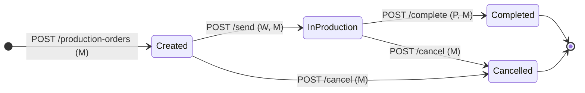
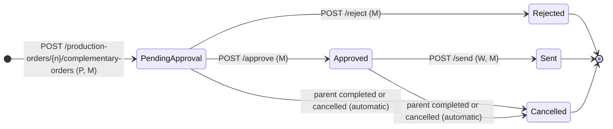
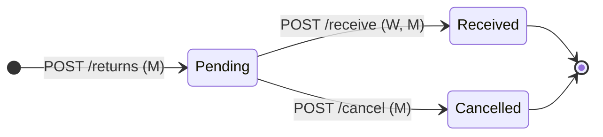
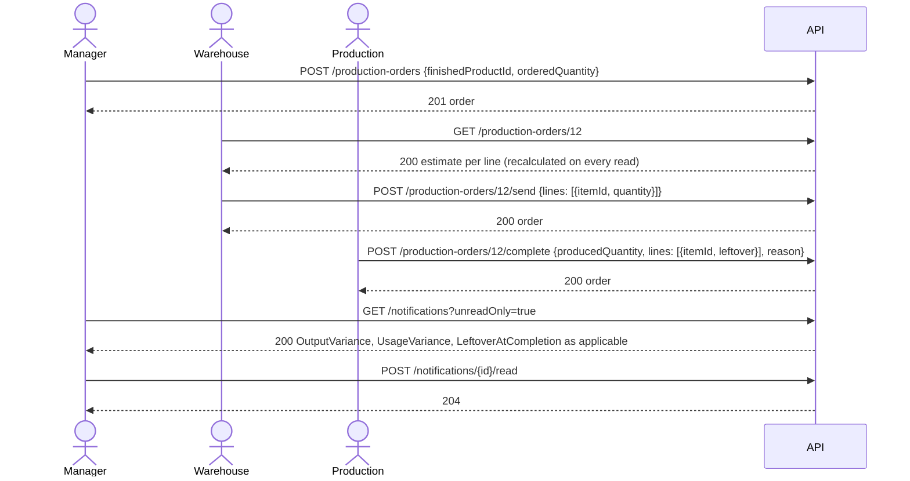

# Design specification: Production & Inventory Tracker API

Based on `docs/01-prd.md` (approved 2026-11-11). Version 1 has no user interface (decision #15), so this document designs the interface the product does have: the HTTP API. Template sections about screens, visual design, accessibility and responsive layout are replaced by API equivalents or marked not applicable. There are no mockups.

## 1. Design direction

The API is used by client programs on behalf of three kinds of people: warehouse staff, production line staff and the production and inventory manager. It should be predictable. Every resource follows the same URL, JSON, paging and error rules, so a client written for one endpoint works for the next. The API returns every computed figure (send ranges, leftover estimates, variances, the "above tolerance" flag) ready to show, so no client has to repeat the calculations in PRD section 4.3. Conventions are the ones ASP.NET Core gives with the least custom code: JSON with camelCase, string enums, ProblemDetails errors.

## 2. Conventions

These rules apply to every endpoint. Section 5 lists each endpoint against them.

### 2.1 URLs

- Base path: `/api/v1`. All paths in this document are relative to it. The version prefix costs nothing now and lets a later web front end or breaking change live beside v1.
- Resources are plural nouns in kebab-case: `/production-orders`, `/complementary-orders`, `/returns`.
- The resource is called `production-orders`, not `orders`, because sales orders are on the PRD's "Later" list.
- Production orders, complementary orders and returns are identified in URLs by their **number**, the same number people say aloud ("order #12"). Each has its own sequence starting at 1. Units, items, movements and notifications use integer ids. Users use the string id ASP.NET Core Identity generates.
- Nesting is used only to create a child that cannot exist without its parent: `POST /production-orders/12/complementary-orders`. Once created, a child is read and acted on at its own top-level URL (`/complementary-orders/3`), because it has its own number. The recipe is a single sub-resource of its finished product: `/items/7/recipe`.
- State changes are `POST` to an action path named with a verb: `/send`, `/complete`, `/cancel`, `/approve`, `/reject`, `/receive`, `/deactivate`, `/reactivate`, `/read`. The response is `200` with the updated resource, so a client never needs a second request to show the result. The one exception is marking notifications read (`/read`, `/read-all`): it answers `204` with no body, because the read mark belongs to the calling Manager and there is nothing new to show.
- Query parameters are camelCase: `?status=Created&orderNumber=12`.

### 2.2 Status codes

| Code | Used for |
|------|----------|
| `200` | Successful read, update or action. Body: the resource. |
| `201` | Created. Body: the new resource. `Location` header: its URL, for example `/api/v1/production-orders/12`. |
| `204` | Success with nothing to return (delete, password change, mark read). |
| `400` | Invalid input, including business rules the PRD marks as `400` (send outside range, receipt for a finished product). |
| `401` | Missing, invalid or expired token; failed sign-in; token of a deactivated user. |
| `403` | Signed in, but none of the user's roles allows the action. |
| `404` | The record named in the URL does not exist. |
| `408` | The request body arrived too slowly and the web server stopped waiting for it (decision #124). |
| `409` | The request conflicts with current state: status, stock, another order in production, a pending return, a duplicate name. |
| `413` | The request body is over 1 MB (decisions #122, #124). |

Every operation that takes a request body, sign-in included, can answer `408` or `413`. Section 4 and section 5 do not repeat this per endpoint.

`422` is not used. The PRD assigns every rejection to `400` or `409`, and ASP.NET Core uses `400` for validation by default.

**Order of checks.** When a request breaks several rules, the first failing check decides the response: (1) `401` token, (2) `403` role, (3) `404` record in the URL, (4) `400` input shape and format (missing fields, decimal places, negative numbers, unknown ids in the body), (5) `409` state (status, another order in production, pending return, item in use), (6) `400` range rules (send ranges, leftover larger than stock), (7) `409` stock. Checking roles before existence means a user without the role cannot learn which numbers exist. QA can rely on this order, with two consequences of how the framework works (decision #23, built): a body that is not valid JSON, or has a value of the wrong JSON type, is `400` before the `404` check, because the body is read before the action runs; and without a token every path, including one that does not exist, answers `401`, because the token check comes first.

A body the web server will not deliver sits in the same place, after `401` and `403` and before the `404` check (decision #124): over 1 MB is `413` `request-too-large`, too slow is `408` `request-timeout`, and any other broken body (for example a malformed chunked body, or a connection that ends early) is `400` `validation` with no `errors` field (decision #41).

Two caps are checked first in the action, before the write transaction, so they also come before the `404` for the record in the URL, where there is one (security review SEC-01):

- More than 500 lines on a recipe (`PUT /items/{id}/recipe`), a send, a completion, a complementary request or a complementary send is `400` `too-many-lines` (decision #123).
- More than 10 roles on `POST /users` or `PUT /users/{id}/roles` is `400` `validation` (decision #125). On the role change it comes before the `404` for the user in the URL.

Each cap is answered on its own: the response holds only that one message, even when other fields are also wrong. The other body checks keep the order above.

### 2.3 JSON fields and values

- Field names are camelCase. Unknown fields in a request body are ignored.
- Every field defined for a response is always present. A value that is not known yet is `null`, never omitted (AC-14.2: "values not yet known are empty").
- **Enums are strings**, exactly as named in the PRD. Requests accept any letter case; responses use the forms below. An unknown value is `400`.
  - `ItemType`: `RawMaterial`, `FinishedProduct`
  - `Role`: `Warehouse`, `Production`, `Manager`
  - `Location`: `Warehouse`, `ProductionStorage`
  - `MovementType`: `Received`, `SentToProduction`, `ConsumedInProduction`, `ProducedOutput`, `ReturnedToWarehouse`, `Adjustment`
  - `OrderStatus`: `Created`, `InProduction`, `Completed`, `Cancelled`
  - `ComplementaryOrderStatus`: `PendingApproval`, `Approved`, `Rejected`, `Sent`, `Cancelled`
  - `ReturnStatus`: `Pending`, `Received`, `Cancelled`
  - `NotificationType`: `UsageVariance`, `OutputVariance`, `LeftoverAtCompletion`, `ComplementaryAwaitingApproval`, `OrderCancelledWithMaterial`
- **Times** are UTC in ISO 8601 with a `Z` suffix: `"2026-11-11T14:05:00Z"`. Whole-second precision is enough. The one date-only input, `receiptDate`, is `"2026-11-11"`.
- **People** are shown as `{ "id": "8b1c…", "email": "ana.ruiz@example.com" }`. The PRD gives users an email and no display name.

### 2.4 Quantities

- **Quantities are JSON numbers, not strings.** System.Text.Json reads a JSON number straight into a C# `decimal` without going through floating point, so input is exact. Numbers are the ASP.NET Core and OpenAPI default, so no custom converters are needed. The usual reason for sending decimals as strings is client-side arithmetic in JavaScript. Here clients do no arithmetic, because every computed value comes back already rounded.
- **Decimal places on input** (PRD 4.1): at most 3 for quantities and 6 for recipe amounts per unit. Trailing zeros do not count: `12.5000` is accepted as 12.5. A quantity sent as a string (`"12.5"`) is `400`.
- **Maximums on input** (decision #80, owner): every entered quantity (receipts, ordered and produced quantities, sends, complementary requested amounts and sends, leftover entered, adjustments, returns) is at most 999,999,999.999; a recipe amount per unit is at most 999,999.999999. For an adjustment the limit applies to the size, so -999,999,999.999 is the lowest. Above the limit is `400` `validation` (7.2). These limits keep every computed amount for an order (planned and required amounts, ranges, variances) inside the stored range. The one accepted exception (architecture risk 12) is stock, which is a sum and is not capped: only about a million maximum-size movements of one item could push a stock total, or a value stored from it, past that range.
- **Computed values** (planned amount, estimates, send ranges, usage, variances) are rounded by the server to 3 decimal places, half away from zero, before they are returned. Every displayed percentage, in API responses and in notification messages and data, is round(round(unrounded, 6), 2), both steps half away from zero, so a notification and the order response always show the same value (decision #58). Clients must not rely on trailing zeros being present: `1000` and `1000.000` mean the same thing.
- **Percentages are percent values**, not fractions: `1.5` means 1.50%. Field names end in `Percent`.
- **Sign:** a variance or difference is signed. Positive means more than planned or required.
- **The unit travels with the quantity.** Every object that carries quantities of one item includes `"unit"`: the unit's name, for example `"kg"` or `"Bag"`. Quantities are never sent without a unit nearby.
- **Threshold flags are computed by the server.** A usage variance of 2.0001% is returned as `2.0` but is above a 2% tolerance (AC-20.4). A client cannot get this right from the rounded value, so each completed line carries `usageVarianceAboveTolerance` (true or false).

### 2.5 Lists

- Every list endpoint is paged. Query: `page` (1-based, default 1) and `pageSize` (default 50, from 1 to 100). Values outside those limits are `400`. A page past the end returns `200` with an empty `items` array.
- Response envelope:

  ```json
  { "items": [ ], "page": 1, "pageSize": 50, "totalCount": 132 }
  ```

- **Order:** newest first (PRD 4.1), meaning by creation time descending, then by id or number descending. There is no `sort` parameter in v1. Stock has no creation time of its own, so stock rows follow the item's creation time. Units have no creation time either, so they are newest first by id (decision #68).
- **Filters** are optional query parameters. They combine with AND. A filter that matches nothing, including an id that does not exist, returns `200` with an empty list (AC-11.2). A filter value in the wrong format (`status=Done`, `from=yesterday`) is `400`.
- **Date ranges** (`from`, `to`) are dates (`2026-11-01`). Both are whole UTC days and both are included (AC-11.2). `from` later than `to` is `400`.

### 2.6 Text inputs

- Names and reasons have leading and trailing spaces removed before they are checked. A value that is empty after trimming counts as missing.
- Uniqueness checks on names and emails ignore letter case. The value is stored as entered.
- Limits: unit name 1–50 (PRD); reasons and notes up to 500 (PRD); item name 1–100 and item description up to 500 (not in the PRD; default chosen here, see section 9); email up to 256 (the Identity default, decision #66). Length limits apply after trimming. Passwords are never trimmed.

## 3. User flows

Each flow is a sequence of calls. "W", "P" and "M" are the Warehouse, Production and Manager roles. Every call after sign-in carries `Authorization: Bearer <token>`.

### 3.1 Lifecycles



Production order. Only one order can be InProduction at a time (AC-15.10).



Complementary order. There is no manual cancel endpoint; the PRD only cancels them automatically (AC-19.6, AC-21.4).



Leftover return.

### 3.2 First sign-in with the seeded admin (US-02, US-01, US-04)

1. The owner sets `ADMIN_EMAIL` and `ADMIN_PASSWORD` (and the token signing key) as environment variables and starts the application with an empty database. One active Manager is created.
2. `POST /auth/sign-in` with those values → `200` with a token, expiry and `"roles": ["Manager"]`.
3. Optional: `POST /auth/change-password` → `204`. The admin's password now differs from the environment value; restarting changes nothing (AC-02.2).
4. Continue with 3.3 (create staff and a second Manager).

If something fails:
- A variable is missing, or the password breaks the policy: the application does not start. The console shows one of the start-up messages in section 7.4 and no user is created.
- Wrong credentials: `401` "Invalid email or password." After 5 failures in a row: `401` "Account temporarily locked. Try again later." for 15 minutes.

### 3.3 User management (US-03, US-04, US-05)

1. M: `POST /users` with email, initial password and roles → `201`. The person signs in with that password (3.2 step 2) and changes it (`POST /auth/change-password`).
2. M: `GET /users` to see everyone with roles and active status.
3. M: `PUT /users/{id}/roles` → `200`. The new roles apply from that user's next sign-in.
4. M: `POST /users/{id}/deactivate` → `200`. The user's existing tokens stop working at once. `POST /users/{id}/reactivate` reverses it.
5. M: `PUT /users/{id}/password` → `204`, to reset a forgotten password.

If something fails: duplicate email `409`; bad email, empty or unknown role, weak password `400`; removing the Manager role from, or deactivating, the last active Manager `409` "At least one active Manager is required." Nothing changes in any of these cases.

### 3.4 Master data (US-06, US-07, US-08)

1. M: `POST /units` `{ "name": "kg" }`, then `{ "name": "Bag" }` → `201` each.
2. M: `POST /items` for the raw material "Cheese" (kg) and the finished product "Shredded cheese 1 kg bag" (Bag) → `201` each.
3. M: `PUT /items/7/recipe` with one line: Cheese, 1 per bag → `200`.
4. Anyone: `GET /items/7/recipe` to check it.

If something fails: duplicates `409`; invalid recipe lines `400` naming the line; changing type or unit of an item in use `409`. The Manager corrects the request and sends it again.

### 3.5 Receiving stock (US-09, US-10, US-11)

1. W: `POST /receipts` `{ itemId: 3, quantity: 1000, receiptDate: "2026-11-11", note: "Delivery note 4471" }` → `201` with the Received movement.
2. Anyone: `GET /stock/3` → Warehouse stock has gone up by 1,000 kg.
3. Anyone: `GET /movements?itemId=3&type=Received` to see the receipt in the history.

If something fails: a finished product `400` "Receipts are for raw materials only."; a date after today, a bad quantity or a long note `400`. No stock changes.

### 3.6 Main production order flow (US-13, US-14, US-15, US-19, US-20, US-23)



1. M creates the order. Response `201`: status Created, one line per recipe line with `plannedAmount` and an `estimate` block (leftover applied, nominal send, send range, tolerance).
2. W reads the order and weighs out the nominal send, staying inside the range.
3. W sends, with one quantity per line (zero is allowed where the range starts at zero). Response `200`: InProduction; `leftoverApplied`, `warehouseSend` and `carriedLeftover` are now fixed on each line; `estimate` becomes `null`.
4. P completes, giving produced quantity, the physical total leftover per line, and a reason if any leftover is above zero. Response `200`: Completed with every variance figure.
5. M reads unread notifications and marks them read, one at a time or all at once (`POST /notifications/read-all`).

If something fails, the order stays as it was:
- Send outside range: `400` naming each failing line with its range. W adjusts the quantities and sends again.
- Not enough Warehouse stock: `409` naming item and available stock. W records the missing receipt (3.5) or M reduces the order by cancelling and recreating it.
- Another order in production: `409` "Order #N is in production. Only one order can be in production at a time." Wait for that order to be completed or cancelled.
- A pending return of one of the order's materials: `409` "Return #R of Cheese is waiting to be received by the warehouse. Record it first." W records it (3.9 step 2), then sends.
- Order already sent: `409` "Materials have already been sent for this order. Raise a complementary order for more material." Go to 3.7.
- Completion with leftover but no reason, or leftover above stock: `400`. P corrects and sends again.

### 3.7 Complementary order flow (US-16, US-17, US-18)

```mermaid
sequenceDiagram
    actor P as Production
    actor M as Manager
    actor W as Warehouse
    participant API
    P->>API: POST /production-orders/12/complementary-orders {reason, lines}
    API-->>P: 201 complementary order #3, PendingApproval
    Note over API: ComplementaryAwaitingApproval notification created
    M->>API: GET /notifications?unreadOnly=true
    API-->>M: 200 includes complementary order #3
    alt approve
        M->>API: POST /complementary-orders/3/approve
        API-->>M: 200 Approved
        W->>API: POST /complementary-orders/3/send {lines: [{itemId, quantity}]}
        API-->>W: 200 Sent; parent line complementarySends increased
    else reject
        M->>API: POST /complementary-orders/3/reject {note}
        API-->>M: 200 Rejected (can never be sent)
    end
```

1. P raises the request while the parent is InProduction → `201`, PendingApproval, with each line's `sendRange` already shown.
2. M reads it (from the notification or `GET /complementary-orders?status=PendingApproval`) and approves or rejects it.
3. W sends an approved one, within requested amount ± t. No leftover is netted.
4. W or anyone can watch for work with `GET /complementary-orders?status=Approved`.

If something fails: parent not InProduction `409`; item not on the parent `400`; approving a non-pending one `409`; sending one that is not Approved `409` stating its status; outside range `400`; not enough stock `409`. When the parent is completed or cancelled, unsent requests become Cancelled automatically with the note "Parent order completed" or "Parent order cancelled".

### 3.8 Cancellation (US-21)

- **Created order:** M `POST /production-orders/9/cancel { reason }` → `200` Cancelled. No stock moves. Its leftover allocation goes to the next oldest Created order; that order's next `GET` shows the larger estimate (AC-15.5).
- **InProduction order:** same call. No stock moves; everything sent stays in production storage as free leftover; unsent complementary orders become Cancelled; if any of the order's materials has stock above zero in production storage, an OrderCancelledWithMaterial notification is created. M then decides: leave it for the next order, return it (3.9), or write it off (3.10).

If something fails: Completed or already Cancelled `409`; blank reason `400`.

### 3.9 Return flow (US-22)

```mermaid
sequenceDiagram
    actor M as Manager
    actor W as Warehouse
    participant API
    M->>API: GET /stock/3
    API-->>M: 200 freeLeftover 20 kg
    M->>API: POST /returns {itemId: 3, quantity: 20, reason, orderNumber: 9}
    API-->>M: 201 return #5, Pending (20 kg no longer free leftover)
    W->>API: GET /returns?status=Pending
    API-->>W: 200 includes return #5
    W->>API: POST /returns/5/receive
    API-->>W: 200 Received; ReturnedToWarehouse movement created
```

1. M checks free leftover on `GET /stock/{itemId}`.
2. M instructs the return → `201` Pending.
3. W physically moves the material and records it → `200` Received. Production storage goes down and Warehouse goes up by the quantity.
4. If the return was a mistake, M `POST /returns/5/cancel` → `200` Cancelled, and the quantity is free leftover again.

If something fails: more than the free leftover `409` stating the free leftover; material on the order in production `409`; receiving or cancelling a return that is not Pending `409`.

### 3.10 Adjustment and write-off (US-12)

1. M: `GET /stock/3` to see the current figures.
2. M: `POST /adjustments { itemId: 3, location: "ProductionStorage", quantity: -20, reason: "Spoiled" }` → `201` with the Adjustment movement.
3. Anyone: the next `GET` of a Created order shows a leftover estimate 20 kg lower.

If something fails: zero quantity or blank reason `400`; a negative quantity larger than the stock `409` "Not enough stock: Cheese in Production storage has 12 kg."; material of the InProduction order in production storage `409`; a finished product in production storage `400`.

### 3.11 Reading notifications (US-23)

1. M: `GET /notifications?unreadOnly=true` → newest first, each with its message and structured `data`. The count of unread notifications is `totalCount`.
2. M: `POST /notifications/{id}/read` → `204` for that Manager only. Other Managers still see it as unread.
3. M: `POST /notifications/read-all` → `204`.

## 4. Resource and endpoint map

Roles: W = Warehouse, P = Production, M = Manager, All = any signed-in user. A user with several roles may call anything any of their roles allows (AC-05.2). Every endpoint except sign-in needs a valid token.

| Method | Path | Roles | Success | Stories |
|--------|------|-------|---------|---------|
| POST | `/auth/sign-in` | no token | 200 | US-01 |
| POST | `/auth/change-password` | All | 204 | US-04 |
| GET | `/users` | M | 200 | US-03 |
| POST | `/users` | M | 201 | US-03 |
| GET | `/users/{id}` | M | 200 | US-03 |
| PUT | `/users/{id}/roles` | M | 200 | US-03 |
| POST | `/users/{id}/deactivate` | M | 200 | US-03 |
| POST | `/users/{id}/reactivate` | M | 200 | US-03 |
| PUT | `/users/{id}/password` | M | 204 | US-03 |
| GET | `/units` | All | 200 | US-06 |
| GET | `/units/{id}` | All | 200 | US-06 |
| POST | `/units` | M | 201 | US-06 |
| PUT | `/units/{id}` | M | 200 | US-06 |
| DELETE | `/units/{id}` | M | 204 | US-06 |
| GET | `/items` | All | 200 | US-07 |
| GET | `/items/{id}` | All | 200 | US-07 |
| POST | `/items` | M | 201 | US-07 |
| PUT | `/items/{id}` | M | 200 | US-07 |
| DELETE | `/items/{id}` | M | 204 | US-07 |
| GET | `/items/{id}/recipe` | All | 200 | US-08 |
| PUT | `/items/{id}/recipe` | M | 200 | US-08 |
| GET | `/stock` | All | 200 | US-10 |
| GET | `/stock/{itemId}` | All | 200 | US-10 |
| GET | `/movements` | All | 200 | US-11 |
| GET | `/movements/{id}` | All | 200 | US-11 |
| POST | `/receipts` | W, M | 201 | US-09 |
| POST | `/adjustments` | M | 201 | US-12 |
| GET | `/production-orders` | All | 200 | US-14 |
| GET | `/production-orders/{number}` | All | 200 | US-13, US-14 |
| POST | `/production-orders` | M | 201 | US-13 |
| POST | `/production-orders/{number}/send` | W, M | 200 | US-15 |
| POST | `/production-orders/{number}/complete` | P, M | 200 | US-19, US-20 |
| POST | `/production-orders/{number}/cancel` | M | 200 | US-21 |
| POST | `/production-orders/{number}/complementary-orders` | P, M | 201 | US-16 |
| GET | `/complementary-orders` | All | 200 | US-16 |
| GET | `/complementary-orders/{number}` | All | 200 | US-16 |
| POST | `/complementary-orders/{number}/approve` | M | 200 | US-17 |
| POST | `/complementary-orders/{number}/reject` | M | 200 | US-17 |
| POST | `/complementary-orders/{number}/send` | W, M | 200 | US-18 |
| GET | `/returns` | All | 200 | US-22 |
| GET | `/returns/{number}` | All | 200 | US-22 |
| POST | `/returns` | M | 201 | US-22 |
| POST | `/returns/{number}/receive` | W, M | 200 | US-22 |
| POST | `/returns/{number}/cancel` | M | 200 | US-22 |
| GET | `/notifications` | M | 200 | US-23 |
| GET | `/notifications/{id}` | M | 200 | US-23 |
| POST | `/notifications/{id}/read` | M | 204 | US-23 |
| POST | `/notifications/read-all` | M | 204 | US-23 |

Receipts and adjustments are commands that create a movement. They have no list of their own: they appear in `/movements` as types `Received` and `Adjustment`, and their `201` response carries `Location: /api/v1/movements/{id}`.

There is no endpoint that edits or deletes a movement (AC-11.3), edits an order (AC-13.6), deletes a user (AC-03.6) or deletes a notification (AC-23.5). Calls to those methods return `405` with the section 6 error body (7.2, Lists and general).

The OpenAPI description (PRD section 5) is the tech lead's choice of path; `/openapi/v1.json` is the ASP.NET Core default.

## 5. Request and response shapes

Examples use the PRD's worked examples. Ids and emails are illustrative.

### 5.1 Auth

**`POST /auth/sign-in`**

```json
{ "email": "maria.lopez@example.com", "password": "Cheddar2026" }
```

`200`:

```json
{
  "accessToken": "eyJhbGciOiJIUzI1NiIsInR5cCI6IkpXVCJ9…",
  "tokenType": "Bearer",
  "expiresAt": "2026-11-11T22:05:00Z",
  "email": "maria.lopez@example.com",
  "roles": ["Manager"]
}
```

Email comparison ignores case. There is no refresh token; after `expiresAt` the client signs in again.

**`POST /auth/change-password`**

```json
{ "currentPassword": "Cheddar2026", "newPassword": "Gouda-Wheel-77" }
```

`204`.

### 5.2 Users

User object (never contains a password or hash, AC-03.4):

```json
{
  "id": "8b1c2f9e-4d3a-4c55-9a0e-2f6b7d1e3a90",
  "email": "jorge.ibarra@example.com",
  "roles": ["Warehouse", "Production"],
  "isActive": true,
  "createdAt": "2026-11-11T09:12:00Z"
}
```

- `POST /users` body: `{ "email": "jorge.ibarra@example.com", "password": "Initial2026", "roles": ["Warehouse"] }` → `201` user.
- `GET /users` → page of users.
- `PUT /users/{id}/roles` body: `{ "roles": ["Warehouse", "Production"] }` → `200` user.
- `POST /users/{id}/deactivate`, `POST /users/{id}/reactivate`, no body → `200` user. Repeating either on a user already in that state succeeds and changes nothing.
- `PUT /users/{id}/password` body: `{ "newPassword": "Reset-2026a" }` → `204`.

### 5.3 Units

```json
{ "id": 1, "name": "kg" }
```

`POST /units` and `PUT /units/{id}` body: `{ "name": "kg" }`.

### 5.4 Items and recipes

Item:

```json
{
  "id": 7,
  "name": "Shredded cheese 1 kg bag",
  "description": "Mozzarella blend, retail pack",
  "type": "FinishedProduct",
  "unitId": 2,
  "unit": "Bag",
  "createdAt": "2026-11-11T09:30:00Z"
}
```

- `POST /items` body: `{ "name", "description" (optional), "type", "unitId" }`.
- `PUT /items/{id}` body: the same four fields, full replacement. If `type` or `unitId` differs from the stored value and the item is in use: `409`.
- `GET /items?type=RawMaterial` filters by type.

Recipe (`GET` and `PUT /items/{id}/recipe` response):

```json
{
  "finishedProductId": 7,
  "finishedProductName": "Shredded cheese 1 kg bag",
  "unit": "Bag",
  "lines": [
    { "itemId": 3, "itemName": "Cheese", "unit": "kg", "amountPerUnit": 1 },
    { "itemId": 4, "itemName": "Potato starch", "unit": "kg", "amountPerUnit": 0.015 }
  ],
  "updatedAt": "2026-11-11T09:41:00Z"
}
```

`PUT` body: `{ "lines": [ { "itemId": 3, "amountPerUnit": 1 }, { "itemId": 4, "amountPerUnit": 0.015 } ] }`. It replaces the whole list.

`GET` for a finished product with no recipe, or for a raw material: `404` "Shredded cheese 1 kg bag has no recipe."

### 5.5 Stock

`GET /stock/3`:

```json
{
  "itemId": 3,
  "itemName": "Cheese",
  "itemType": "RawMaterial",
  "unit": "kg",
  "warehouse": 1200,
  "productionStorage": 1020,
  "committedToOrder": 1020,
  "committedOrderNumber": 12,
  "pendingReturns": 0,
  "freeLeftover": 0
}
```

- `committedToOrder` (D-3) is `0` and `committedOrderNumber` `null` when no InProduction order uses the material.
- For finished products, `committedToOrder`, `committedOrderNumber`, `pendingReturns` and `freeLeftover` are `null`.
- `GET /stock` → page of these rows. Filter: `itemType`.

### 5.6 Movements, receipts, adjustments

Movement:

```json
{
  "id": 5012,
  "type": "SentToProduction",
  "itemId": 3,
  "itemName": "Cheese",
  "unit": "kg",
  "warehouseChange": -995,
  "productionStorageChange": 995,
  "occurredAt": "2026-11-11T10:02:00Z",
  "user": { "id": "8b1c…", "email": "jorge.ibarra@example.com" },
  "orderNumber": 12,
  "complementaryOrderNumber": null,
  "returnNumber": null,
  "receiptDate": null,
  "note": null,
  "reason": null
}
```

- A movement has one signed change per location. A location it does not touch is `null`. Transfers (`SentToProduction`, `ReturnedToWarehouse`) fill both. Summing `warehouseChange` (or `productionStorageChange`) over every movement of an item gives the stock in US-10 (AC-11.4).
- A send for a complementary order has both `complementaryOrderNumber` and `orderNumber` (its parent).
- `note` is the receipt note. `reason` is the adjustment reason. `receiptDate` is set only on `Received`.

`GET /movements` filters: `itemId`, `location` (a movement matches when it changes that location), `type`, `orderNumber` (matches movements of the order and of its complementary orders), `complementaryOrderNumber`, `from`, `to` (by `occurredAt`, not `receiptDate`).

**`POST /receipts`**

```json
{ "itemId": 3, "quantity": 1000, "receiptDate": "2026-11-11", "note": "Delivery note 4471" }
```

`201`: the `Received` movement.

**`POST /adjustments`**

```json
{ "itemId": 3, "location": "ProductionStorage", "quantity": -20, "reason": "Spoiled" }
```

`201`: the `Adjustment` movement.

### 5.7 Production orders

**`POST /production-orders`**

```json
{ "finishedProductId": 7, "orderedQuantity": 1000 }
```

`201` returns the order detail.

**Order detail while Created** (AC-15.3: 5 kg of free Cheese leftover; the second line shows a two-material recipe):

```json
{
  "number": 12,
  "finishedProductId": 7,
  "finishedProductName": "Shredded cheese 1 kg bag",
  "unit": "Bag",
  "orderedQuantity": 1000,
  "status": "Created",
  "createdAt": "2026-11-11T08:00:00Z",
  "createdBy": { "id": "5a7e…", "email": "maria.lopez@example.com" },
  "producedQuantity": null,
  "outputVariance": null,
  "outputVariancePercent": null,
  "toleranceAtCompletionPercent": null,
  "completionReason": null,
  "cancellationReason": null,
  "lines": [
    {
      "itemId": 3,
      "itemName": "Cheese",
      "unit": "kg",
      "amountPerUnit": 1,
      "plannedAmount": 1000,
      "estimate": {
        "leftoverApplied": 5,
        "nominalSend": 995,
        "sendRangeMin": 975,
        "sendRangeMax": 1015,
        "tolerancePercent": 2
      },
      "leftoverApplied": null,
      "warehouseSend": null,
      "complementarySends": null,
      "carriedLeftover": null,
      "leftoverEntered": null,
      "leftoverRemaining": null,
      "actualUsage": null,
      "requiredForActualOutput": null,
      "usageVariance": null,
      "usageVariancePercent": null,
      "usageVarianceAboveTolerance": null
    },
    {
      "itemId": 4,
      "itemName": "Potato starch",
      "unit": "kg",
      "amountPerUnit": 0.015,
      "plannedAmount": 15,
      "estimate": {
        "leftoverApplied": 0,
        "nominalSend": 15,
        "sendRangeMin": 14.7,
        "sendRangeMax": 15.3,
        "tolerancePercent": 2
      },
      "leftoverApplied": null,
      "warehouseSend": null,
      "complementarySends": null,
      "carriedLeftover": null,
      "leftoverEntered": null,
      "leftoverRemaining": null,
      "actualUsage": null,
      "requiredForActualOutput": null,
      "usageVariance": null,
      "usageVariancePercent": null,
      "usageVarianceAboveTolerance": null
    }
  ],
  "complementaryOrders": [],
  "history": [
    { "status": "Created", "at": "2026-11-11T08:00:00Z", "by": { "id": "5a7e…", "email": "maria.lopez@example.com" }, "note": null }
  ]
}
```

Rules for the line fields:

- `estimate` is the only labelled-estimate block (AC-13.2). It is calculated on every read while the order is Created, and is `null` in every other status.
- `leftoverApplied`, `warehouseSend`, `carriedLeftover` and `complementarySends` become non-null at send. `complementarySends` starts at `0` and grows with each complementary send.
- `leftoverEntered`, `leftoverRemaining`, `actualUsage`, `requiredForActualOutput`, `usageVariance`, `usageVariancePercent` and `usageVarianceAboveTolerance` become non-null at completion. The one exception: when `requiredForActualOutput` rounds to `0`, `usageVariancePercent` stays `null` on the completed line, and `usageVarianceAboveTolerance` is `true` whenever `actualUsage` is not `0` (decision #49).
- After cancellation, values fixed so far stay; the rest stay `null`.

**`POST /production-orders/12/send`**

```json
{ "lines": [ { "itemId": 3, "quantity": 995 }, { "itemId": 4, "quantity": 15 } ] }
```

Every order line must appear exactly once; zero is allowed. `200` returns the detail, now InProduction.

**`POST /production-orders/12/complete`**

```json
{
  "producedQuantity": 1001,
  "lines": [ { "itemId": 3, "leftover": 4 } ],
  "reason": "Last bag line jammed"
}
```

`leftover` is the total quantity of that material physically in production storage (PRD row 1). `reason` may be omitted or `null` when every leftover is zero.

**Order detail after completion** (worked example A, AC-20.5, single-material recipe):

```json
{
  "number": 12,
  "finishedProductId": 7,
  "finishedProductName": "Shredded cheese 1 kg bag",
  "unit": "Bag",
  "orderedQuantity": 1000,
  "status": "Completed",
  "createdAt": "2026-11-11T08:00:00Z",
  "createdBy": { "id": "5a7e…", "email": "maria.lopez@example.com" },
  "producedQuantity": 1001,
  "outputVariance": 1,
  "outputVariancePercent": 0.1,
  "toleranceAtCompletionPercent": 2,
  "completionReason": "Last bag line jammed",
  "cancellationReason": null,
  "lines": [
    {
      "itemId": 3,
      "itemName": "Cheese",
      "unit": "kg",
      "amountPerUnit": 1,
      "plannedAmount": 1000,
      "estimate": null,
      "leftoverApplied": 5,
      "warehouseSend": 995,
      "complementarySends": 20,
      "carriedLeftover": 0,
      "leftoverEntered": 4,
      "leftoverRemaining": 4,
      "actualUsage": 1016,
      "requiredForActualOutput": 1001,
      "usageVariance": 15,
      "usageVariancePercent": 1.5,
      "usageVarianceAboveTolerance": false
    }
  ],
  "complementaryOrders": [
    { "number": 3, "status": "Sent", "requestedAt": "2026-11-11T11:20:00Z" }
  ],
  "history": [
    { "status": "Created", "at": "2026-11-11T08:00:00Z", "by": { "id": "5a7e…", "email": "maria.lopez@example.com" }, "note": null },
    { "status": "InProduction", "at": "2026-11-11T10:02:00Z", "by": { "id": "8b1c…", "email": "jorge.ibarra@example.com" }, "note": null },
    { "status": "Completed", "at": "2026-11-11T15:40:00Z", "by": { "id": "c3d9…", "email": "lucia.mendez@example.com" }, "note": "Last bag line jammed" }
  ]
}
```

`outputVariance` is in the finished product's `unit`.

**`POST /production-orders/12/cancel`**

```json
{ "reason": "Customer order withdrawn" }
```

`200`: the detail, Cancelled, with `cancellationReason` filled.

**`GET /production-orders`** filter: `status`. Each item is a summary:

```json
{
  "number": 12,
  "finishedProductId": 7,
  "finishedProductName": "Shredded cheese 1 kg bag",
  "unit": "Bag",
  "orderedQuantity": 1000,
  "status": "Completed",
  "createdAt": "2026-11-11T08:00:00Z",
  "statusChangedAt": "2026-11-11T15:40:00Z",
  "producedQuantity": 1001
}
```

### 5.8 Complementary orders

**`POST /production-orders/12/complementary-orders`**

```json
{
  "reason": "Hopper spill at start of run",
  "lines": [ { "itemId": 3, "requestedAmount": 20 } ]
}
```

`201`, `Location: /api/v1/complementary-orders/3`:

```json
{
  "number": 3,
  "orderNumber": 12,
  "status": "PendingApproval",
  "reason": "Hopper spill at start of run",
  "requestedAt": "2026-11-11T11:20:00Z",
  "requestedBy": { "id": "c3d9…", "email": "lucia.mendez@example.com" },
  "decisionNote": null,
  "cancellationNote": null,
  "lines": [
    {
      "itemId": 3,
      "itemName": "Cheese",
      "unit": "kg",
      "requestedAmount": 20,
      "sendRangeMin": 19.6,
      "sendRangeMax": 20.4,
      "sentQuantity": null
    }
  ],
  "history": [
    { "status": "PendingApproval", "at": "2026-11-11T11:20:00Z", "by": { "id": "c3d9…", "email": "lucia.mendez@example.com" }, "note": null }
  ]
}
```

- `sendRangeMin` and `sendRangeMax` use the current tolerance while PendingApproval or Approved, and are `null` in other statuses.
- `sentQuantity` is filled when Sent.
- `decisionNote` holds the optional rejection note. `cancellationNote` holds "Parent order completed" or "Parent order cancelled".
- `POST /complementary-orders/3/approve`: no body → `200`.
- `POST /complementary-orders/3/reject`: `{ "note": "Use the spare from order #11" }` (optional) → `200`.
- `POST /complementary-orders/3/send`: `{ "lines": [ { "itemId": 3, "quantity": 20 } ] }` → `200`. Every line of the complementary order must appear exactly once.
- `lines` keep the order in which they were requested.
- `GET /complementary-orders` filters: `status`, `orderNumber`. Each row is the full complementary order shape above, with its `lines` and `history`; there is no separate summary row (decision #105f). Newest first by `requestedAt`, then by number.

### 5.9 Returns

**`POST /returns`**

```json
{ "itemId": 3, "quantity": 20, "reason": "Order #9 cancelled, cheese not needed this week", "orderNumber": 9 }
```

`orderNumber` is optional and may name an order in any status. `201`, `Location: /api/v1/returns/5`:

```json
{
  "number": 5,
  "itemId": 3,
  "itemName": "Cheese",
  "unit": "kg",
  "quantity": 20,
  "reason": "Order #9 cancelled, cheese not needed this week",
  "orderNumber": 9,
  "status": "Pending",
  "history": [
    { "status": "Pending", "at": "2026-11-11T16:05:00Z", "by": { "id": "5a7e…", "email": "maria.lopez@example.com" }, "note": null }
  ]
}
```

- `POST /returns/5/receive` and `POST /returns/5/cancel`: no body → `200`.
- `history` is Pending, then Received or Cancelled; each `note` is `null`.
- `GET /returns` filters: `status`, `itemId`. Each row is the full return shape above (decision #108g). Newest first by creation time, then by number.

### 5.10 Notifications

```json
{
  "id": 41,
  "type": "UsageVariance",
  "orderNumber": 12,
  "complementaryOrderNumber": null,
  "createdAt": "2026-11-11T15:40:00Z",
  "message": "Order #12, Cheese: used 1,030 kg, required 1,001 kg for actual output. Difference +29 kg (+2.90%).",
  "isRead": false,
  "data": {
    "itemId": 3,
    "itemName": "Cheese",
    "unit": "kg",
    "requiredForActualOutput": 1001,
    "actualUsage": 1030,
    "difference": 29,
    "percent": 2.9
  }
}
```

`isRead` is for the calling Manager only. `GET /notifications` filter: `unreadOnly` (`true` or `false`, default `false`). The `data` object depends on `type`:

| Type | `data` fields |
|------|---------------|
| `UsageVariance` | `itemId`, `itemName`, `unit`, `requiredForActualOutput`, `actualUsage`, `difference`, `percent` |
| `OutputVariance` | `finishedProductId`, `finishedProductName`, `unit`, `ordered`, `produced`, `difference`, `percent` |
| `LeftoverAtCompletion` | `materials`: [ `itemId`, `itemName`, `unit`, `leftover` ], `reason` |
| `ComplementaryAwaitingApproval` | `materials`: [ `itemId`, `itemName`, `unit`, `requestedAmount` ], `reason`, `requestedBy` { `id`, `email` } (the number is in `complementaryOrderNumber`) |
| `OrderCancelledWithMaterial` | `materials`: [ `itemId`, `itemName`, `unit`, `productionStorageQuantity` ], `reason` |

For `UsageVariance`, `percent` is `null` when `requiredForActualOutput` rounds to `0` (decision #49); the message then uses the null form in 7.3.

## 6. Error format

Every error is an RFC 9457 (formerly 7807) ProblemDetails body with `Content-Type: application/problem+json`. ASP.NET Core produces this with `AddProblemDetails()` and `ValidationProblemDetails`.

```json
{
  "type": "https://tools.ietf.org/html/rfc9110#section-15.5.10",
  "title": "Conflict with current state",
  "status": 409,
  "detail": "Order #11 is in production. Only one order can be in production at a time.",
  "code": "another-order-in-production",
  "traceId": "00-4bf92f3577b34da6a3ce929d0e0e4736-00f067aa0ba902b7-00"
}
```

Validation (`400`) adds `errors`, keyed by the JSON path of the field in camelCase:

```json
{
  "type": "https://tools.ietf.org/html/rfc9110#section-15.5.1",
  "title": "Invalid request",
  "status": 400,
  "detail": "Cheese: send must be between 975 and 1,015 kg (planned 1,000 kg, leftover applied 5 kg). Potato starch: send must be between 14.7 and 15.3 kg (planned 15 kg, leftover applied 0 kg).",
  "code": "send-out-of-range",
  "errors": {
    "lines[0].quantity": ["Cheese: send must be between 975 and 1,015 kg (planned 1,000 kg, leftover applied 5 kg)."],
    "lines[1].quantity": ["Potato starch: send must be between 14.7 and 15.3 kg (planned 15 kg, leftover applied 0 kg)."]
  },
  "traceId": "00-…"
}
```

Rules:

- `detail` always holds the complete readable message. When several messages apply, they are joined with a space. A client can show `detail` alone.
- `errors` is present when a field is at fault. Whole-body errors (the body is missing, is not valid JSON, is the wrong kind of JSON value, or could not be read) have no `errors` field (decision #41), and neither do `408` and `413`. Each field gets at most one message, from the first rule it fails, in the order required, sign, decimal places, maximum (decisions #75, #81).
- A `400` from the field checks lists at most 100 messages (decision #122). When more apply, only the first 100 are kept, in `detail` and in `errors` alike, and `detail` ends with one more sentence saying how many were left out: "{n} more problems are not shown." (for one: "1 more problem is not shown."). `{n}` is formatted as in 6.1, for example `1,900`. The sentence is not in `errors`, because it belongs to no single field.
- `code` is a stable kebab-case identifier for programs and tests. `400` input errors that are plain field checks share the code `validation`. The line cap has a `400` code of its own, `too-many-lines` (decision #123), so a client can tell "split the request" from a field mistake. A body the web server refuses is `413` `request-too-large` or `408` `request-timeout` (decision #124).
- `title` is fixed per status: `400` "Invalid request", `401` "Not signed in", `403` "Not allowed", `404` "Not found", `408` "Request timeout", `409` "Conflict with current state", `413` "Request too large".
- `type` is left at the framework default. Clients should use `status` and `code`.
- Exact messages given in the PRD are reproduced word for word. QA checks those exactly; other messages may be refined but must keep the facts they state (names, numbers, units, status).
- Messages never contain stack traces, SQL or internal ids other than record numbers.

### 6.1 Number formatting inside messages

- Quantities: invariant culture, comma thousands separator, up to 3 decimals with trailing zeros removed: `1,015`, `974.999`, `0.6`, `0`.
- Percentages: always 2 decimals and a sign: `+2.90%`, `-2.50%`. The value is round(round(unrounded, 6), 2), both steps half away from zero, the same value the API returns (2.4, decision #58).
- Signed differences: `+29 kg`, `-25 kg`. The minus is the ASCII hyphen-minus.
- Units follow the number with a space and are not pluralised: `1,001 Bag`.
- Statuses appear as their enum names (`PendingApproval`).

## 7. Messages

### 7.1 Authentication and access

| Status | Code | When | Message |
|--------|------|------|---------|
| 401 | `invalid-credentials` | Wrong password, unknown email, deactivated user (AC-01.3) | Invalid email or password. |
| 401 | `account-locked` | 5 failures in a row, for 15 minutes (AC-01.4) | Account temporarily locked. Try again later. |
| 401 | `not-authenticated` | No token, invalid or expired token, token of a deactivated user (AC-01.2, AC-01.5, AC-03.6) | Your sign-in is missing or has expired. Sign in again. |
| 403 | `forbidden` | None of the user's roles allows the action (AC-05.1) | Your roles do not allow this action. It needs the {Role} role. *(two roles: "the Warehouse or Manager role")* |
| 400 | `current-password-incorrect` | AC-04.2, under `currentPassword` | Current password is incorrect. |
| 400 | `weak-password` | Policy failed (AC-03.3, AC-03.7, AC-04.1), under the password field | Password must be at least 8 characters and include an upper-case letter, a lower-case letter and a digit. |
| 400 | `validation` | Sign-in or `POST /users` with a missing or blank email (decisions #52, #66) | Email is required. |
| 400 | `validation` | Sign-in or `POST /users` with a missing or empty password | Password is required. |
| 400 | `validation` | Change-password without `currentPassword` | Current password is required. |
| 400 | `validation` | Change-password or password reset without `newPassword` | New password is required. |

A wrong current password on change-password counts towards the sign-in lock-out; while the account is locked, change-password gets the same `401` `account-locked` (decision #71).

ASP.NET Core's JWT handler returns an empty `401` by default. It must be configured to return the ProblemDetails body above.

### 7.2 Business-rule rejections

Placeholders are in braces. Messages marked PRD are exact. The rows marked "any quantity" under Receipts and adjustments apply to every quantity in every section below. `{Field}` is the field's label, the name its other messages use: Quantity, Ordered quantity, Produced quantity, Leftover, Requested amount, Reason, Note, Description. A field message goes under the field's JSON path as its `errors` key (section 6): `quantity`, `orderedQuantity`, `producedQuantity`, `finishedProductId`, `itemId`, `reason`, `lines`, `lines[0].itemId`, `lines[0].quantity`, `lines[0].leftover`, `lines[0].requestedAmount`, `lines[0].amountPerUnit`, `roles`, `roles[0]`.

**Order line bodies.** Four bodies list one figure per order material and share one set of rules and messages (decision #100): the send (`quantity`), the completion (`leftover`), the complementary request (`requestedAmount`) and the complementary send (`quantity`). A line sent as `null` gets both "Item is required." and the figure's "required" message. Where every line must appear (send, completion, complementary send), the missing ones are named together in one message under `lines`, in recipe line order. "Order line" in that message means the lines of the record being sent or completed: the production order's lines, or for a complementary send the complementary order's lines. The sentence is the same for all three, kept as built: the figure on every line is a quantity of the material, whether sent or left over, and the message names the missing materials, which is what the client needs to fix the request. A per-body wording ("needs a leftover") would read worse and add nothing.

**Users (US-03)**

| Status | Code | When | Message |
|--------|------|------|---------|
| 409 | `email-taken` | AC-03.2 | A user with this email already exists. (PRD) |
| 400 | `validation` | Missing or blank email (decision #66) | Email is required. |
| 400 | `validation` | Email longer than 256 (decision #66) | Email must be 256 characters or fewer. |
| 400 | `validation` | Bad email (AC-03.3) | Email is not a valid email address. |
| 400 | `validation` | Missing password on `POST /users` | Password is required. |
| 400 | `validation` | Missing or empty role list | At least one role is required. |
| 400 | `validation` | More than 10 roles on `POST /users` or `PUT /users/{id}/roles`, under `roles`. Answered on its own, before every other check; on the role change also before the `404` for the user (decision #125) | At most 10 roles are allowed. |
| 400 | `validation` | Unknown role, under `roles[i]` | Unknown role '{value}'. Roles are Warehouse, Production and Manager. |
| 409 | `last-manager` | AC-03.8 | At least one active Manager is required. (PRD) |
| 404 | `not-found` | Unknown user id | User not found. |

**Units (US-06)**

| Status | Code | When | Message |
|--------|------|------|---------|
| 400 | `validation` | Empty name | Name is required. |
| 400 | `validation` | Longer than 50 | Name must be 50 characters or fewer. |
| 409 | `unit-name-taken` | AC-06.2 | A unit named '{name}' already exists. |
| 409 | `unit-in-use` | AC-06.4 | Unit is used by one or more items. (PRD) |
| 404 | `not-found` | Unknown id | Unit {id} not found. |

**Items and recipes (US-07, US-08)**

| Status | Code | When | Message |
|--------|------|------|---------|
| 400 | `validation` | Missing name | Name is required. |
| 400 | `validation` | Name longer than 100 (decision #69) | Name must be 100 characters or fewer. |
| 400 | `validation` | Description longer than 500 (decision #69) | Description must be 500 characters or fewer. |
| 400 | `validation` | Missing or unknown type | Type must be RawMaterial or FinishedProduct. |
| 400 | `validation` | Missing unit (decision #69) | Unit is required. |
| 400 | `validation` | Unknown unit | Unit {unitId} does not exist. |
| 409 | `item-name-taken` | AC-07.2 | An item named '{name}' already exists. |
| 409 | `item-in-use` | Type or unit change (AC-07.3) | Type and unit cannot change once the item is in use. (PRD) |
| 409 | `item-in-use` | Delete (AC-07.4) | {item} has movements, recipe lines or order lines and cannot be deleted. |
| 404 | `not-found` | Unknown id | Item {id} not found. |
| 404 | `not-found` | `GET` recipe when none | {item} has no recipe. |
| 400 | `recipe-not-finished-product` | Recipe for a raw material | Recipes are for finished products only. {item} is a raw material. |
| 400 | `validation` | Line item missing (decision #74) | Item is required. |
| 400 | `validation` | Line item is a finished product | Recipe lines must be raw materials. {item} is a finished product. |
| 400 | `validation` | Line item unknown | Item {itemId} does not exist. |
| 400 | `validation` | Same item twice: every later line naming it (decision #75) | {item} appears on more than one line. |
| 400 | `validation` | Amount missing (decision #74) | Amount per unit is required. |
| 400 | `validation` | Amount zero or less | Amount per unit must be greater than 0. |
| 400 | `validation` | More than 6 decimals | Amount per unit can have at most 6 decimal places. |
| 400 | `validation` | Amount above 999,999.999999 (decision #80) | Amount per unit must be 999,999.999999 or less. |
| 400 | `validation` | No lines, or `lines` missing or `null` (decision #74) | A recipe needs at least one line. |

**Receipts and adjustments (US-09, US-12)**

| Status | Code | When | Message |
|--------|------|------|---------|
| 400 | `validation` | Quantity missing (any quantity; decisions #78, #90, #98, #103, #105, #108) | {Field} is required. |
| 400 | `validation` | Quantity zero or less (receipt) | Quantity must be greater than 0. |
| 400 | `validation` | More than 3 decimals (any quantity; decision #95) | {Field} can have at most 3 decimal places. |
| 400 | `validation` | Above 999,999,999.999 (any quantity: receipt, ordered, send, requested amount, complementary send, produced, leftover, adjustment, return; decision #80) | {Field} must be 999,999,999.999 or less. |
| 400 | `validation` | Adjustment quantity below -999,999,999.999 | Quantity must be between -999,999,999.999 and 999,999,999.999. |
| 400 | `validation` | Missing item | Item is required. |
| 400 | `validation` | Unknown item | Item {itemId} does not exist. |
| 400 | `validation` | Missing receipt date (decision #78) | Receipt date is required. |
| 400 | `validation` | Receipt date not a date (decision #78) | Receipt date must be a date in the format yyyy-MM-dd. |
| 400 | `validation` | Future receipt date | Receipt date cannot be later than today (UTC). |
| 400 | `validation` | Note or reason over 500 | {Field} must be 500 characters or fewer. |
| 400 | `receipt-not-raw-material` | AC-09.3 | Receipts are for raw materials only. (PRD) |
| 400 | `validation` | Adjustment quantity zero | Quantity cannot be zero. |
| 400 | `validation` | Missing or blank reason (any reason field) | Reason is required. |
| 400 | `validation` | Missing or unknown location | Location must be Warehouse or ProductionStorage. |
| 409 | `insufficient-stock` | AC-12.3 | Not enough stock: {item} in {Warehouse \| Production storage} has {available} {unit}. (PRD) |
| 409 | `material-in-use` | AC-12.5 | {item} in production storage is in use by order #{number}. Adjust it after the order is completed or cancelled. (PRD) |
| 400 | `finished-product-in-production-storage` | AC-12.6 | Finished products are adjusted in the Warehouse only. |

Field errors (`validation`) come before `receipt-not-raw-material` and `finished-product-in-production-storage` (decisions #78, #103).

**Stock and movements (US-10, US-11)**

| Status | Code | When | Message |
|--------|------|------|---------|
| 404 | `not-found` | `GET /stock/{itemId}` for an unknown item | Item {itemId} not found. |
| 404 | `not-found` | Unknown movement id (decision #89) | Movement {id} not found. |

**Production orders (US-13, US-15, US-19, US-21)**

| Status | Code | When | Message |
|--------|------|------|---------|
| 404 | `not-found` | Unknown number (AC-14.3) | Order #{number} not found. |
| 400 | `validation` | Missing finished product (decision #90) | Finished product is required. |
| 400 | `validation` | Finished product id names no item (decision #90), under `finishedProductId` | Item {finishedProductId} does not exist. |
| 400 | `order-not-finished-product` | AC-13.3 | Orders are for finished products only. {item} is a raw material. |
| 400 | `no-recipe` | AC-13.3 | {item} has no recipe. Set its recipe before creating an order. |
| 400 | `validation` | Ordered quantity zero or less | Ordered quantity must be greater than 0. |
| 400 | `send-out-of-range` | AC-15.6, one sentence per failing line, in body order | {item}: send must be between {min} and {max} {unit} (planned {planned} {unit}, leftover applied {leftover} {unit}). (PRD) |
| 409 | `insufficient-stock` | AC-15.7, one sentence per line short, in body order | Not enough stock: {item} in Warehouse has {available} {unit}. |
| 400 | `validation` | Missing line (send, completion and complementary send; decision #96), under `lines`. `{items}` is the missing materials' names joined with ", ", in recipe line order | Every order line needs a quantity. Missing: {items}. *(example: "Every order line needs a quantity. Missing: Cheese, Potato starch.")* |
| 400 | `validation` | Line item missing (send or completion) | Item is required. |
| 400 | `validation` | Item not on the order, or an id that names no item at all (send or completion; decision #96) | Item {itemId} is not on order #{number}. |
| 400 | `validation` | Same item twice: every later line naming it | {item} appears on more than one line. |
| 400 | `validation` | Negative send | Quantity cannot be negative. |
| 409 | `already-sent` | AC-15.9, InProduction or Completed | Materials have already been sent for this order. Raise a complementary order for more material. (PRD) |
| 409 | `order-cancelled` | AC-15.9, AC-19.5, AC-21.5, Cancelled | This order is cancelled. (PRD) |
| 409 | `another-order-in-production` | AC-15.10 | Order #{N} is in production. Only one order can be in production at a time. (PRD) |
| 409 | `pending-return` | AC-15.11; one sentence per blocking return, in recipe line order, then return number (decision #96) | Return #{R} of {item} is waiting to be received by the warehouse. Record it first. (PRD) |
| 409 | `order-not-sent` | Complete a Created order (AC-19.5) | Order #{number} has not been sent yet. Send its materials before completing it. |
| 409 | `already-completed` | Second completion (AC-19.5) | Output for order #{number} has already been registered. |
| 400 | `validation` | Produced quantity zero or less | Produced quantity must be greater than 0. |
| 400 | `validation` | Negative leftover | Leftover cannot be negative. |
| 400 | `reason-required` | AC-19.4, under `reason`; checked after the field errors (decision #98) | A reason is required when leftover is recorded. (PRD) |
| 400 | `leftover-exceeds-stock` | AC-19.4, under `lines[i].leftover` for every line over its stock, in body order | Leftover for {item} cannot exceed the {stock} {unit} in production storage. (PRD) |
| 409 | `order-completed` | Cancel a Completed order (AC-21.5) | Order #{number} is completed and cannot be cancelled. |

Field errors come before `order-not-finished-product` and `no-recipe` (decision #90). A cancellation's reason is checked before the order's status, so a blank reason on a Completed order is `400`, not `409` (decision #104).

**Complementary orders (US-16, US-17, US-18)**

| Status | Code | When | Message |
|--------|------|------|---------|
| 404 | `not-found` | Unknown number | Complementary order #{number} not found. |
| 409 | `parent-not-in-production` | AC-16.2 | Order #{number} is {status}. Complementary orders can be raised only while the order is in production. |
| 400 | `validation` | No lines, or `lines` missing or `null` (decision #105) | At least one line is required. |
| 400 | `validation` | Request line item missing | Item is required. |
| 400 | `validation` | Amount zero or less | Requested amount must be greater than 0. |
| 400 | `validation` | Request: an existing item not on the parent | {item} is not on order #{number}. |
| 400 | `validation` | Request: an id that names no item at all (decision #105a) | Item {itemId} is not on order #{number}. |
| 400 | `validation` | Same item twice (request or send): every later line naming it | {item} appears on more than one line. |
| 409 | `not-pending-approval` | AC-17.3 | Complementary order #{number} is {status}. Only a PendingApproval complementary order can be approved or rejected. |
| 409 | `not-approved` | AC-18.3 | Complementary order #{number} is {status}. Only an Approved complementary order can be sent. |
| 400 | `validation` | Send: a line of the complementary order is missing (decision #106a) | Every order line needs a quantity. Missing: {items}. *(the shared order-line message, Production orders above)* |
| 400 | `validation` | Send line item missing | Item is required. |
| 400 | `validation` | Send: an item that is not one of the complementary order's lines, existing or not (decision #106a) | Item {itemId} is not on complementary order #{number}. |
| 400 | `validation` | Negative send | Quantity cannot be negative. |
| 400 | `send-out-of-range` | AC-18.2, one sentence per failing line, in body order | {item}: send must be between {min} and {max} {unit} (requested {requested} {unit}). |
| 409 | `insufficient-stock` | AC-18.4, one sentence per line short, in body order | Not enough stock: {item} in Warehouse has {available} {unit}. |

The three "not on" wordings are deliberate and stay as built (decisions #96, #105a, #106a). A complementary request is the one place a person picks materials from the parent's recipe, so an existing item is named to say which choice was wrong. Sends and completions answer with the id the client sent, because each of their lines must already match an order line one to one, and a wrong one is a client mistake rather than a choice. The complementary send names its own record, "complementary order #{number}", because its lines are a subset of the parent's.

Field errors (the reason and every line, in one `400`) come before `parent-not-in-production`; a reject note over 500 (`400`) comes before `not-pending-approval` (decision #105b). The reject body is optional: no body, `{}`, a `null` or an all-spaces note all mean no note.

**Returns (US-22)**

| Status | Code | When | Message |
|--------|------|------|---------|
| 404 | `not-found` | Unknown number | Return #{number} not found. |
| 400 | `validation` | Missing item (decision #108) | Item is required. |
| 400 | `validation` | Unknown item, under `itemId` | Item {itemId} does not exist. |
| 400 | `validation` | Quantity zero or less (decision #108) | Quantity must be greater than 0. |
| 400 | `return-not-raw-material` | Item is a finished product; after the field errors | Returns are for raw materials only. |
| 400 | `validation` | Linked order unknown, under `orderNumber` | Order #{number} does not exist. |
| 409 | `insufficient-free-leftover` | AC-22.2 | Not enough free leftover: {item} has {free} {unit} free in production storage. |
| 409 | `material-in-use` | AC-22.3 | {item} is in use by order #{number}, which is in production. Return it after the order is completed or cancelled. |
| 409 | `not-pending` | AC-22.5 | Return #{number} is {status}. Only a Pending return can be received or cancelled. |
| 409 | `insufficient-stock` | Receive when production storage holds less than the return (section 9, Q2) | Not enough stock: {item} in Production storage has {available} {unit}. Cancel this return or adjust the stock first. |

**Notifications (US-23)**

| Status | Code | When | Message |
|--------|------|------|---------|
| 404 | `not-found` | AC-23.5 | Notification {id} not found. |
| 400 | `validation` | `unreadOnly` is not exactly `true` or `false` (any letter case; decision #102) | unreadOnly must be true or false. |

Marking an already-read notification read again succeeds (`204`). A missing or empty `unreadOnly` means `false`.

**Lists and general**

| Status | Code | When | Message |
|--------|------|------|---------|
| 400 | `validation` | `pageSize` outside 1–100 | pageSize must be between 1 and 100. |
| 400 | `validation` | `page` below 1 | page must be 1 or greater. |
| 400 | `validation` | `from` after `to` | 'from' must be on or before 'to'. |
| 400 | `validation` | `from` or `to` not a date (decision #43) | '{from \| to}' must be a date in the format yyyy-MM-dd. |
| 400 | `validation` | Unknown value in an enum filter, under the parameter (decisions #69, #78) | {parameter} must be {values}. *(for example "status must be Created, InProduction, Completed or Cancelled.", "type must be RawMaterial or FinishedProduct.", "itemType must be RawMaterial or FinishedProduct.", "location must be Warehouse or ProductionStorage."; the values are the enum's names in section 2.3 order, the last two joined by "or")* |
| 400 | `validation` | A number query value that is not a number, such as `?page=abc` (decisions #44, #113; framework wording, accepted) | The value '{value}' is not valid for {Property}. *(on some filters: "The value '{value}' is not valid.")* |
| 400 | `validation` | Body is not valid JSON | The request body is not valid JSON. |
| 400 | `validation` | Body missing where the endpoint needs one | A request body is required. |
| 400 | `validation` | Body is valid JSON but the wrong kind of value, for example an array instead of an object | The request body has the wrong type. |
| 400 | `validation` | A field has the wrong JSON type, for example a quantity sent as a string (design 2.4), under the field's path | {path} has the wrong type. |
| 400 | `validation` | The web server could not read the body, for example a malformed chunked body or a connection that ended early; no `errors` field (decision #124) | The request body could not be read. |
| 400 | `too-many-lines` | More than 500 lines on a recipe, send, completion, complementary request or complementary send, under `lines`. Answered on its own, before the `404` for the record in the URL (decision #123) | At most 500 lines are allowed. |
| 400 | the response's own code | More than 100 messages apply to one `400`; the last sentence of `detail`, not in `errors`. `{n}` is formatted as in 6.1 (decision #122) | {n} more problems are not shown. *(one left out: "1 more problem is not shown.")* |
| 404 | `not-found` | No endpoint matches the path | No endpoint matches this path. |
| 405 | `method-not-allowed` | The path exists but not for this method (section 4) | This method is not allowed on this path. |
| 415 | `unsupported-media-type` | A body sent with a `Content-Type` other than JSON (decision #40) | The request body must be JSON, sent with Content-Type: application/json. |
| 408 | `request-timeout` | The body arrived too slowly and the web server stopped waiting (decision #124) | The request body arrived too slowly. Send it again. |
| 413 | `request-too-large` | The body is over 1 MB, on any endpoint that takes a body, sign-in included (decisions #122, #124) | The request body is too large. The limit is 1 MB. |
| 409 | `concurrent-change` | A concurrent request changed the data first and no more specific message applies (PRD section 5) | The data changed while your request was being processed. Read it again and retry. |
| 500 | `internal-error` | Any unexpected failure; details are logged, never returned (architecture 4.1 item 8) | An unexpected error occurred. |

`405`, `415` and `500` keep the framework's default `title`; the fixed titles in section 6 cover `400`, `401`, `403`, `404`, `408`, `409` and `413`.

When two conflicting requests race, the losing one gets the specific message where one applies (for example `insufficient-stock` or `already-sent`), and `concurrent-change` only as a fallback.

### 7.3 Notification messages

`{n}` is the order number, `{c}` the complementary order number. Lists of materials are written `{item} {quantity} {unit}`, separated by commas, in recipe line order. The reason is quoted as entered.

| Type | Template | Example |
|------|----------|---------|
| `UsageVariance` | Order #{n}, {item}: used {actualUsage} {unit}, required {required} {unit} for actual output. Difference {±difference} {unit} ({±percent}%). | Order #12, Cheese: used 1,030 kg, required 1,001 kg for actual output. Difference +29 kg (+2.90%). |
| `UsageVariance`, percentage null (decision #49) | Order #{n}, {item}: used {actualUsage} {unit}, required {required} {unit} for actual output. Difference {±difference} {unit} (percentage not applicable). | Order #14, Potato starch: used 0.004 kg, required 0 kg for actual output. Difference +0.004 kg (percentage not applicable). |
| `OutputVariance` | Order #{n}: produced {produced} {unit}, ordered {ordered} {unit}. Difference {±difference} {unit} ({±percent}%). | Order #12: produced 1,001 Bag, ordered 1,000 Bag. Difference +1 Bag (+0.10%). |
| `LeftoverAtCompletion` | Order #{n} was completed with leftover in production storage: {materials}. Reason: "{reason}" | Order #12 was completed with leftover in production storage: Cheese 4 kg. Reason: "Last bag line jammed" |
| `ComplementaryAwaitingApproval` | Complementary order #{c} for order #{n} is waiting for approval. {email} requested {materials}. Reason: "{reason}" | Complementary order #3 for order #12 is waiting for approval. lucia.mendez@example.com requested Cheese 20 kg. Reason: "Hopper spill at start of run" |
| `OrderCancelledWithMaterial` | Order #{n} was cancelled with material still in production storage: {materials}. Reason: "{reason}" | Order #9 was cancelled with material still in production storage: Cheese 50 kg, Potato starch 0.75 kg. Reason: "Customer order withdrawn" |

### 7.4 Start-up messages (console, not HTTP)

The application stops with one of these and creates no user. The token signing key is `JWT_SIGNING_KEY` (decision #32). A value of only spaces counts as not set (decision #53).

| When | Message |
|------|---------|
| No users and `ADMIN_EMAIL` missing or empty (AC-02.3) | Start-up stopped: ADMIN_EMAIL is not set. Set ADMIN_EMAIL and ADMIN_PASSWORD to create the first Manager. |
| No users and `ADMIN_EMAIL` not a valid email address (decision #53) | Start-up stopped: ADMIN_EMAIL is not a valid email address. Set ADMIN_EMAIL and ADMIN_PASSWORD to create the first Manager. |
| No users and `ADMIN_PASSWORD` missing or empty (AC-02.3) | Start-up stopped: ADMIN_PASSWORD is not set. Set ADMIN_EMAIL and ADMIN_PASSWORD to create the first Manager. |
| `ADMIN_PASSWORD` fails the policy (AC-02.4) | Start-up stopped: ADMIN_PASSWORD does not meet the password policy. It must be at least 8 characters and include an upper-case letter, a lower-case letter and a digit. |
| Token signing key missing | Start-up stopped: JWT_SIGNING_KEY is not set. Set it to a random secret of at least 32 characters. |
| Token signing key shorter than 32 characters (decision #53) | Start-up stopped: JWT_SIGNING_KEY is too short. Set it to a random secret of at least 32 characters. |
| Tolerance outside 0–100, or not a number (PRD section 5; decision #53) | Start-up stopped: Tolerance must be between 0 and 100. Current value: {value}. *({value} is the configured text, trimmed)* |

## 8. Story coverage

| Story | Where it is designed |
|-------|----------------------|
| US-01 Sign in | 3.2, 5.1, 7.1 |
| US-02 First Manager | 3.2, 7.4 |
| US-03 Manage users | 3.3, 5.2, 7.2 Users |
| US-04 Change own password | 3.2, 5.1, 7.1 |
| US-05 Role checks and audit | 2.2 (check order), 4 (roles column), `history` and `user` fields in 5.6–5.9, 7.1 |
| US-06 Units | 3.4, 5.3, 7.2 Units |
| US-07 Items | 3.4, 5.4, 7.2 Items |
| US-08 Recipes | 3.4, 5.4, 7.2 Items and recipes |
| US-09 Receipts | 3.5, 5.6, 7.2 Receipts |
| US-10 Current stock | 5.5, 7.2 Stock and movements |
| US-11 Movement history | 2.5, 5.6, 7.2 Stock and movements |
| US-12 Adjustments | 3.10, 5.6, 7.2 Adjustments |
| US-13 Create order | 3.6, 5.7, 7.2 Production orders |
| US-14 View orders | 5.7 |
| US-15 Send materials | 3.6, 5.7, 7.2 Production orders |
| US-16 Request complementary | 3.7, 5.8, 7.2 Complementary orders |
| US-17 Approve or reject | 3.7, 5.8 |
| US-18 Complementary send | 3.7, 5.8 |
| US-19 Complete order | 3.6, 5.7, 7.2 Production orders |
| US-20 Variances | 2.4, 5.7 (line and order fields), 7.3 |
| US-21 Cancel order | 3.8, 5.7 |
| US-22 Returns | 3.9, 5.9, 7.2 Returns |
| US-23 Notifications | 3.11, 5.10, 7.3 |

Not applicable in v1 (no user interface, PRD section 5): visual design system, mockups, screen accessibility, responsive behaviour.

## 9. Defaults chosen and questions

**Questions with the default used in this spec:**

1. **Notification order.** The design brief suggested listing notifications unread first; PRD 4.1 says every list is newest first. Default: newest first, with the `unreadOnly=true` filter from AC-23.1 for the unread view. Changing it would be a scope change, so it goes to the owner only if wanted.
2. **Receiving a return after the stock was adjusted down.** The PRD allows a production-storage adjustment of a material that has a Pending return (only the InProduction order's materials are blocked, AC-12.5), so stock can fall below the return quantity before the warehouse receives it. Receiving it then would take production storage below zero. Default: the receive is rejected with `409` `insufficient-stock` (section 7.2, Returns) and the Manager cancels the return or instructs a smaller one. Alternative: block adjustments that cut into Pending return quantities, which would change AC-12.3.

**Small defaults (no owner decision needed; logged in `docs/decisions.md` #16):**

- Base path `/api/v1`; resource `production-orders`; orders, complementary orders and returns addressed by number, each with its own sequence.
- Quantities as JSON numbers; trailing zeros do not count towards the decimal-place limit.
- Item name 1–100 characters, item description up to 500.
- `GET /items/{id}/recipe` returns `404` when there is no recipe.
- Movement date filters are whole UTC days on `occurredAt`; `orderNumber` also matches the order's complementary-order movements.
- Deactivate, reactivate and mark-read are idempotent. A Manager may deactivate themselves unless they are the last active Manager.
- A return may link to an order in any status.
- `pageSize` outside 1–100 is rejected rather than clamped.
